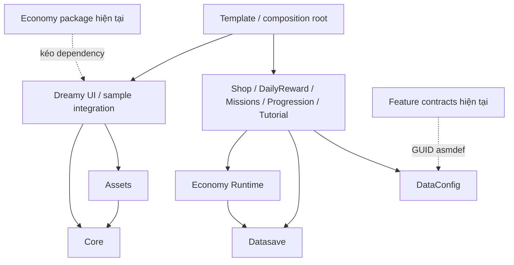
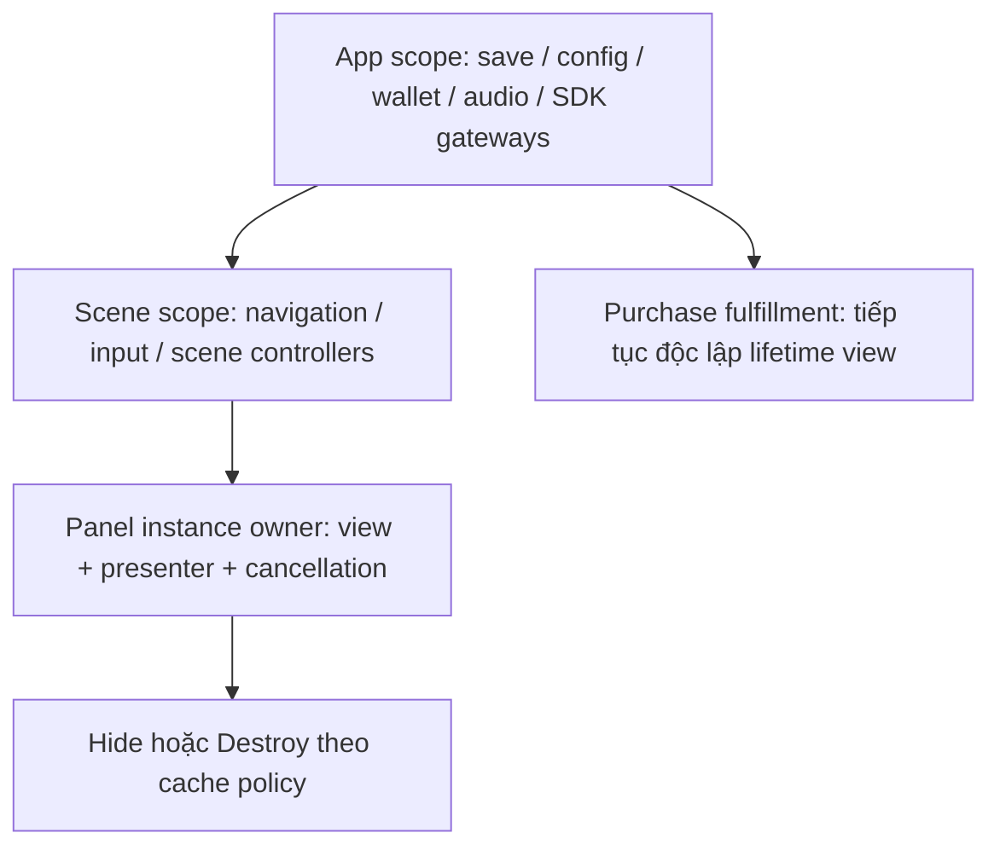

# Dreamy packages: đánh giá kiến trúc và lộ trình cho template team

Ngày đánh giá: **2026-10-04**, theo múi giờ Asia/Saigon. Phạm vi: **15 package có source trong `LocalPackages`**, manifest/lock, bootstrap và integration tiêu biểu của sandbox. Lucky Wheel có khai báo submodule nhưng không có `package.json`/source trong checkout được khảo sát, nên chưa đánh giá implementation.

Đây là **review source và validation tĩnh**, không phải chứng nhận release. Đã đọc README của cả 15 package, toàn bộ manifest/asmdef, các đường xử lý chính của service/model/presenter/installer, một số integration/sample và các test liên quan. Không kiểm từng dòng của mọi shader, cửa sổ Editor lớn hoặc mọi prefab bằng Unity Inspector. Phần runtime cần kiểm chứng được ghi riêng. Trong lượt này chỉ tạo báo cáo, không sửa package hay asset.

## 1. Kết luận và quyết định đề xuất

**Bộ Dreamy đã có nền tảng hợp lý để tiếp tục làm template của team, nhưng chưa đủ chặt để gọi là baseline production dùng chung cho nhiều game.** Điểm yếu lớn nhất nằm ở tính độc lập khi cài package, tính bền vững của giao dịch và ownership khi teardown. Số lượng package và việc đã tách folder chưa giải quyết được các điểm này.

Các phần nên giữ:

- Tách DataConfig, Datasave, runtime state và view; model/presenter dùng dependency qua constructor.
- Có contract thay thế thật cho wallet, clock, save, config source, platform/purchase gateway và view.
- Phần lớn domain feature không phụ thuộc concrete panel hay SDK store; UI/game flow nằm ở integration/sample.
- Runtime và Editor đã được tách bằng asmdef; scan hiện tại không thấy cạnh Runtime → Editor trong source package.
- Missions/Tutorial đã xử lý candidate save, retry và callback cũ tốt hơn nhiều đường xử lý khác. Đây là mẫu nội bộ nên học theo, có chọn lọc.

Các quyết định nên chốt:

| Câu hỏi | Đề xuất |
| --- | --- |
| Cấu trúc đã chuẩn chưa? | Đúng hướng UPM và MVP; chưa đạt tính độc lập của package, độ nhất quán dependency/test/release và lifecycle. |
| Có bỏ toàn bộ Core để chuyển VContainer? | Không. Core còn event/FSM/log/extensions; DI chỉ thay phần composition và ownership phù hợp. |
| Có nên thử VContainer? | Có, bằng một slice Shop + Settings ở template, sau khi sửa blocker package và giao dịch. Chỉ đưa thành mặc định khi đạt gate ở mục 7. |
| Có bắt buộc VContainer trong mọi package? | Không. Giữ domain/presenter độc lập framework; adapter đăng ký ở host hoặc package integration tùy chọn. |
| Việc tiếp theo quan trọng nhất? | Resolve/compile trên consumer sạch → wallet/save/async/lifecycle → sample dùng thật → CI/release baseline. |
| Có mở thêm battle pass/gacha ngay? | Chưa. Cần nền economy, identity giao dịch, clock, SDK adapter và release gate trước. |

**Ưu tiên thực tế:** sửa khả năng cài độc lập và lỗi ảnh hưởng dữ liệu/tương tác trước; thử DI sau; mở rộng feature cuối cùng. Đây là đề xuất kiến trúc từ source đang đọc, không phải khẳng định rằng VContainer tự làm game nhanh hơn hay an toàn hơn.

## 2. Snapshot và nguồn sự thật

### 2.1. Môi trường consumer hiện tại

| Thành phần | Quan sát |
| --- | --- |
| Sandbox HEAD | `dafda831bdc624e08919c70475f936aaa26b6b1d` |
| Unity | `6000.4.12f1`, theo `ProjectVersion.txt`; package thường khai báo minimum `6000.0`, chưa chứng minh đã test minimum này. |
| Pipeline | Có URP `17.4.0`; Graphics/Quality tham chiếu `PC_RPAsset`/`Mobile_RPAsset`. Đây là cấu hình asset, chưa đo behavior/render trên thiết bị. |
| Input | Input System `1.19.0`; `activeInputHandler: 2` trong sandbox. API legacy Input hiện có thể được dùng, nhưng consumer chỉ bật New Input cần kiểm lại. |
| Addressables | Project/lock `2.9.1`; Assets khai báo dependency `2.7.2`. Override không tự chứng minh incompatibility; cần matrix đã test. |
| Newtonsoft | Project/lock `3.2.2`; nhiều package khai báo `3.2.1`. |
| UniTask / DOTween | Được cài bằng Git URL không pin tag trong manifest; lock có hash. Dependency package lần lượt ghi `2.5.10` / `0.0.3`. |
| Scenes | BootstrapScene và MainScene enabled trong Build Settings. |
| Android | `scriptingBackend.Android: 1` trong settings; chưa chạy build/IL2CPP trong review này. |
| Worktree | Có thay đổi sẵn trong nhiều submodule, README, sample và asset. Nhận xét áp dụng cho working tree đọc được; SHA HEAD không bao gồm dirty changes. |

Nguồn: [manifest](../Packages/manifest.json), [lock](../Packages/packages-lock.json), [Unity version](../ProjectSettings/ProjectVersion.txt), [Graphics](../ProjectSettings/GraphicsSettings.asset), [Quality](../ProjectSettings/QualitySettings.asset), [Player settings](../ProjectSettings/ProjectSettings.asset), [Build settings](../ProjectSettings/EditorBuildSettings.asset), [.gitmodules](../.gitmodules).

### 2.2. Catalog toolkit và tài liệu cũ

Root sandbox không có `toolkit.json`. Canonical toolkit tìm thấy ở **`../dreamy-codex-toolkit/toolkit.json`**, HEAD `51e8e3997abb3c3a87e1860e05e0b3f815504b31`: version `0.1.0-alpha.2`, status `alpha`, phase `alpha hardening baseline`. Maturity này thuộc **toolkit Codex**, không phải chứng nhận maturity của từng Unity package.

Đã đối chiếu `compatibility/dreamy-packages.json` và `rules/index.json` ở repo đó. Registry chỉ có verified commits cho một phần bộ package; chưa bao phủ các feature mới trong sandbox. Audio/UI hiện khác commit record. Vì vậy không dùng registry cũ để khẳng định API của toàn bộ working tree đã được chứng nhận tương thích. Báo cáo này mô tả source hiện tại và các khoảng trống cần xác minh.

Một số phát hiện trong [plan ngày 2026-10-01](plans/DREAMY_PACKAGES_TEMPLATE_READINESS.md) đã thay đổi:

- Nay có 15 package có source, thêm Progression/Missions/Tutorial so với inventory cũ.
- Economy đang `0.2.0`, Shop `0.1.1`, Settings/UI `0.2.0`.
- Prefab nguồn Settings hiện khoảng **76,451 byte**, RateUs **54,745 byte**; không còn là stub dưới 1 KB như plan cũ. Kích thước không chứng minh serialized refs hay behavior đã đúng.
- Settings sample hiện không thiếu `.meta` trong scan các file `.cs/.asmdef/.prefab/.asset/.json/.unity`; DailyReward/Progression vẫn có một số file sample thiếu meta, nêu ở mục 5.
- DataConfig manifest hiện vẫn **chưa khai báo UniTask**, dù plan cũ ghi từng bổ sung trong worktree.
- UI có `com.unity.ugui: 2.0.0`; cache thực tế chứa TMP trong package này. Không lặp lại nhận định cũ “UI thiếu com.unity.textmeshpro” một cách máy móc.

Báo cáo này không khảo sát lại consumer template bên ngoài. Các lỗi URL/Editor reference của template được ghi trong plan cũ phải tái kiểm ở đúng repo đó, không coi là lỗi mới đã xác minh trong sandbox này. [Quy tắc thiết kế hiện có](rules/DREAMY_PACKAGE_DESIGN_RULES.md) vẫn phù hợp làm định hướng, nhưng cần gate executable để cưỡng chế.

## 3. Cấu trúc và hướng dependency

### 3.1. Phần đã đúng

Phân bố `package.json`, `Runtime`, `Editor`, `Tests`, `Samples~`, README và changelog gần với [layout Unity khuyến nghị](https://docs.unity3d.com/6000.0/Documentation/Manual/cus-layout.html). Không cần đổi tên toàn bộ folder để “chuẩn hóa” trước khi sửa correctness.

Audio tách Runtime core khỏi Runtime.Components; Economy tách Runtime khỏi Runtime.UI; Tutorial có Integration.Runtime riêng. Các feature Shop/Settings/DailyReward có Domain/Contracts/Presentation/Installation; đây là ranh giới trách nhiệm có ý nghĩa, không chỉ là tổ chức theo tên file.

`noEngineReferences: true` ở một số feature thể hiện ý định hạn chế Unity coupling, nhưng **không đồng nghĩa thuần .NET**: các assembly vẫn phụ thuộc DataConfig/Datasave/Core và có thể UniTask. Pure C# class dễ unit test hơn MonoBehaviour, song cần phân biệt với library có thể chạy độc lập hoàn toàn ngoài Unity.

### 3.2. Ranh giới assembly tốt hơn ranh giới package hiện tại



Mũi tên liền mô tả những dependency chính quan sát được, không phải toàn bộ graph. Mũi tên nét đứt chỉ ra hai dependency nên xem lại. Cài Economy hiện kéo UI → Assets → Addressables/UniTask/DOTween dù consumer chỉ muốn wallet. DailyReward/Settings/Shop khai báo UI và một số dependency phục vụ sample trong cùng package. Tách asmdef đã giúp compile boundary, nhưng chưa làm graph UPM gọn.

**Đề xuất:** giữ domain package nhỏ; đưa integration reusable vào adapter riêng hoặc sample với dependency cài rõ ràng. Nếu team cố ý phát hành bundle UI đầy đủ, ghi rõ bundle đó là preset tiện lợi. Không mặc định mọi game phải kéo toàn bộ UI stack khi dùng economy/mission.

`com.dreamy.feature` chỉ có năm file contract nhỏ mà asmdef reference DataConfig qua GUID, không có sử dụng tương ứng trong năm file đã đọc. Loại reference thừa là lựa chọn nhỏ hơn thêm dependency nặng để hợp thức hóa nó. Prefab nền cần UI nên chuyển sang sample/integration, thay vì để contract package ngầm cần prefab framework.

### 3.3. Cấu trúc mục tiêu khả thi

```text
package/
  package.json
  README.md                 # cài, dependency, ownership, migration
  CHANGELOG.md
  LICENSE.md                # nếu phân phối nội bộ: ghi điều kiện nội bộ rõ
  Runtime/
    Contracts/
    Domain/                 # nếu có nghiệp vụ
    Persistence/            # nếu package sở hữu dữ liệu bền vững
    <Runtime>.asmdef
  Editor/                   # chỉ khi thực sự cần
  Tests/Editor|PlayMode/    # tên và discovery theo một quy ước thống nhất
  Samples~/Minimal/         # được khai báo hoặc ghi rõ internal-only
  Documentation~/          # chỉ khi README không đủ
```

Không bắt mỗi package có đủ mọi folder. Package tiny contracts không cần một tầng service/manager/factory cho từng type. Ownership, dependency graph và đường release quan trọng hơn số tầng kiến trúc.

## 4. Đánh giá từng package

Mức dưới đây là **nhận định từ review**, không ghi đè status canonical trong toolkit. “Có tests” nghĩa là file/assembly đã quan sát, không phải tests vừa pass. Số file test loại trừ sample và TestProject~.

| Package | Version | Test files | Nhận định |
| --- | --- | ---: | --- |
| Core | 1.1.2 | 3 | Nền tảng dùng được có điều kiện; cần ownership/reset/API tick rõ. |
| Assets | 0.1.1 | 0 | API tiện, cần chứng minh lifecycle và nhiều consumer. |
| Audio | 0.1.0 | 4 | Phân lớp tốt; pause/reinit/dispose cần hardening. |
| DataConfig | 0.2.0 | 0 | Concept đúng; packaging, concurrency, immutability chưa kín. |
| Datasave | 0.2.0 | 1 | Có envelope/backup/migration; durability contract và load ownership còn thiếu. |
| Editor Tools | 0.2.1 | 0 | Hữu ích nội bộ; chưa là automation/release contract. |
| UI | 0.2.0 | 1 | Tween có regression suite; navigation/panel lifecycle còn nhiều khoảng trống. |
| Feature | 0.1.0 | 0 | Giữ tối giản; reference thừa và prefab coupling cần xử lý. |
| Economy | 0.2.0 | 0 | Là hạ tầng quan trọng nhất cần sửa trước monetization. |
| Daily Reward | 0.1.0 | 1 | Domain cơ bản tốt; persistence lỗi và ngày/identity cần test sâu. |
| Shop | 0.1.1 | 1 | Có gateway seam; chưa đủ contract cho production IAP. |
| Settings | 0.2.0 | 0 | Domain gọn; async lifetime, sample boot và review flow cần sửa. |
| Progression | 0.1.1 | 1 | Validate khá tốt; mutate-before-save và multi-reward cần hardening. |
| Missions | 0.1.0 | 1 | Candidate commit/retry tốt; catalog evolution và observer/reentry cần chốt. |
| Tutorial | 0.1.0 | 5 | Checkpoint/token/retry tốt; dependency, target/input và player evidence còn thiếu. |

### 4.1. Core

**Ổn:** ServiceLocator type-safe, có TryGet, deferred callback và reset SubsystemRegistration; callback deferred được isolate exception. EventBus trì hoãn mutation khi nested Raise; test có case nested/clear. FSM, lifecycle và logger nằm đúng package primitive.

**Cần sửa/bổ sung:** Register ghi đè service mà không xác minh owner; Unregister chỉ theo type. Deferred Get không trả subscription/cancellation handle. EventBus generic static không có đường reset tự động quan sát được. AppTickService là `internal` dù comment ITickable hướng consumer gọi API của nó. FSM dùng NullState khi type thiếu và ghi đè state cùng type, nên thiếu validation có thể che cấu hình sai.

**Hướng xử lý:** giữ Core nhỏ, locator resolve ở root; lease/registration ownership nếu tiếp tục locator; explicit event subscription; chọn tick API public có owner hoặc entrypoint adapter. Không đưa economy/game feature vào Core.

Nguồn: [ServiceLocator](../LocalPackages/com.dreamy.core/Runtime/ServiceLocator/ServiceLocator.cs), [EventBus](../LocalPackages/com.dreamy.core/Runtime/EventBus/MyEventBus.cs), [AppTickService](../LocalPackages/com.dreamy.core/Runtime/Lifecycle/AppTickService.cs), [FSM](../LocalPackages/com.dreamy.core/Runtime/StateMachine/StateMachine.cs).

### 4.2. Assets

**Ổn:** cache theo type/key, chia sẻ in-flight request; loader backend nội bộ; request có status/progress/error. Khi unload trước completion, có identity check chống cache lại request đã bị loại. Release Addressables handle có IsValid guard.

**Cần bổ sung:** public API chưa có consumer lease/refcount hoặc cancellation theo từng caller; không có OnDestroy release cache trong AssetLoader; Resources Release/ReleaseAll là no-op; key cache không phân biệt Resources/Addressables. LoadSprite nuốt lỗi về null. AddressableLoader có sync `WaitForCompletion` nội bộ, chưa thấy consumer public hiện tại dùng đường này nên là điểm cần kiểm soát, không coi mọi load đang block.

**Hướng xử lý:** chốt app-owned cache với release toàn app, hoặc scoped asset lease cho UI/scene; test unload/reload in-flight, hai consumer, scene unload và error/retry. Đừng thêm eviction/LRU khi chưa có memory measurements.

Nguồn: [AssetLoader](../LocalPackages/com.dreamy.assets/Runtime/AssetLoader.cs), [AddressableLoader](../LocalPackages/com.dreamy.assets/Runtime/AddressableLoader.cs), [ResourceLoader](../LocalPackages/com.dreamy.assets/Runtime/ResourceLoader.cs).

### 4.3. Audio

**Ổn:** service không cần Core, có IAudioService/preference store; profile/library/key/bus/pool/handle tách rõ. Có result cho missing clip/key, cooldown, instance/pool limits; volume đã xét mixer fallback và live sources. Editor authoring/key generator và tests là nền tốt.

**Cần sửa:** paused non-loop voice bị Tick coi là kết thúc; Initialize lần hai tạo pool mới mà không dọn pool/voices cũ; service/facade không có shutdown/dispose/reset session rõ. Fade-out không lưu duration tổng nên đường volume không theo tiến độ tổng thời gian mong đợi. Mute `persist=true` không lưu mute flag; preference store chỉ SetFloat, chưa có flush theo app lifecycle.

**Hướng xử lý:** thêm trạng thái pause riêng, reinit policy, shutdown owner; ghi contract volume/mute/flush; dùng test kiểm source count và handle qua reinit/pause/resume. Giữ static facade như tiện ích tùy chọn nếu có owner rõ.

Nguồn: [AudioService](../LocalPackages/com.dreamy.audio/Runtime/Services/AudioService.cs), [DreamyAudio](../LocalPackages/com.dreamy.audio/Runtime/Services/DreamyAudio.cs), [PreferenceStore](../LocalPackages/com.dreamy.audio/Runtime/Services/PlayerPrefsAudioPreferenceStore.cs).

### 4.4. DataConfig

**Ổn:** nguồn JSON thay thế được; typed register/get; error chứa document/path; duplicate document/row ID bị reject. LoadRegisteredTablesAsync tạo candidate dictionary trước commit, giúp failed reload giữ bộ tables cũ. RemoteConfigSource giữ cancellation và có lựa chọn fallbackOnError.

**Cần sửa:** manifest thiếu UniTask; Initialize/Reload chưa single-flight, registration có thể đổi trong lúc initialize đang await. Read-only interface vẫn trả List thật và row.Id public settable; index có thể lệch dữ liệu. Composite source là first-success theo document, README lại mô tả nguồn sau ghi đè nguồn trước. SchemaVersion chỉ được lưu trong ConfigBase, chưa có enforcement chung quan sát được.

**Hướng xử lý:** gate registration ngay khi bắt đầu init; một operation owner; snapshot/version config cho domain; immutable row hoặc convention được validator enforce. Fallback transport error khác invalid remote JSON: invalid JSON hiện bị deserialize fail sau khi source đã trả, không tự thử nguồn local.

Nguồn: [DataConfigService](../LocalPackages/com.dreamy.dataconfig/Runtime/DataConfigService.cs), [Table](../LocalPackages/com.dreamy.dataconfig/Runtime/DataConfigTable.cs), [Row](../LocalPackages/com.dreamy.dataconfig/Runtime/DataConfigRow.cs), [Composite](../LocalPackages/com.dreamy.dataconfig/Runtime/CompositeConfigSource.cs), [README](../LocalPackages/com.dreamy.dataconfig/README.md).

### 4.5. Datasave

**Ổn:** không phụ thuộc Core; envelope có version/type/time, reject future version, hook migration, backup recovery có error context. AES định dạng mới có HMAC và kiểm tra tag constant-time; XOR được tài liệu phân biệt là obfuscation. Test có corrupted main recovery, invalid envelope, AES tampering.

**Cần làm rõ:** AtomicWrite là chuỗi write/move có khả năng recovery, chưa phải transaction nhiều file hay bảo đảm power-loss durability. Load luôn tạo object mới; nhiều owner load cùng key có thể overwrite nhau. Load key default dùng type name, Save default ưu tiên data.SaveKey, dễ lệch khi override. SaveAll dừng ở exception đầu tiên. Type FullName vẫn là phần contract bền vững, nên namespace/type rename cần migration.

**Hướng xử lý:** single owner cho mỗi save key; stable explicit key/schema ID; failure/recovery contract trước khi tối ưu async. Test migration thực, main/backup/tmp combinations, write failure và pause/restart trên player. Save synchronous nên cần đo latency nếu save nhiều/codec AES; chưa có số đo để gọi đây là performance bug.

Nguồn: [DatasaveService](../LocalPackages/com.dreamy.datasave/Runtime/DatasaveService.cs), [SaveData](../LocalPackages/com.dreamy.datasave/Runtime/SaveData.cs), [AES](../LocalPackages/com.dreamy.datasave/Runtime/AesSaveCodec.cs), [tests](../LocalPackages/com.dreamy.datasave/Tests/Runtime/DatasaveServiceTests.cs).

### 4.6. Editor Tools

**Ổn:** Editor-only assembly; có quản lý scene/build/package/data và xác nhận trước các thao tác xóa được kiểm tra. BuildPlayer đọc BuildReport, không chỉ in “build succeeded” vô điều kiện.

**Cần bổ sung:** asmdef Newtonsoft chưa đúng loại reference; một số helper Inspector/Console dựa reflection private Unity API. Build action còn private/window oriented; chưa thấy public headless/dry-run/evidence API. Không thấy `.github/workflows` trong source package được scan.

**Hướng xử lý:** giữ công cụ UI, tách logic cần reuse/test thành public command nhỏ; validation không mutate; build trả result/code rõ cho CI. Không xây framework automation toàn diện trước khi có command thật cần gọi.

Nguồn: [build tools](../LocalPackages/com.dreamy.editor-tools/Editor/Build/DreamyBuildToolsWindow.cs), [hotkeys](../LocalPackages/com.dreamy.editor-tools/Editor/DreamyEditorHotkeys.cs), [menu](../LocalPackages/com.dreamy.editor-tools/Editor/DreamyEditorMenu.cs).

### 4.7. UI

**Ổn:** panel có state + operationVersion + cancellation; layer/cache/back contract rõ hơn thao tác SetActive đơn giản. Create có dedupe theo panel type; Transition dùng semaphore. Tween player có nested ownership, manual/auto, prune destroyed effect và settle task khi Kill; test đã xét timing và cache rebuild.

**Cần sửa:** Transition lock không có scene cancellation; Create fail trước inner catch có thể khóa panel cũ; Init/PostInit fail sau Instantiate chưa cleanup instance; Show/Hiding lifecycle có đường disable khiến state/stack/active lệch. OnPreShow/OnPreHide ở ngoài try có thể làm operation kẹt khi observer ném lỗi. CanvasGroup chỉ được fill trong Reset; prefab setup sai có thể làm SetInteractable no-op.

**Hướng xử lý:** lifecycle gate cho manager/panel, rollback theo operation owner; explicit init-ready task; test navigation tách khỏi tween tests. Escape legacy input nên đưa qua host back action trước khi dùng consumer New Input-only.

Nguồn: [UIPanel](../LocalPackages/com.dreamy.ui/Runtime/Panel/UIPanel.cs), [PanelManager](../LocalPackages/com.dreamy.ui/Runtime/Panel/PanelManager.cs), [TweenPlayback](../LocalPackages/com.dreamy.ui/Runtime/Tween/TweenPlayback.cs), [tween tests](../LocalPackages/com.dreamy.ui/Tests/Editor/UITweenPlayerTests.cs).

### 4.8. Feature contracts

**Ổn:** ID/value contracts nhỏ, không cần service framework. Các concrete feature có thể dùng view riêng thay vì bị ép kế thừa base implementation.

**Cần sửa:** GUID reference DataConfig không được manifest khai báo và không cần cho năm file hiện tại. README mô tả prefab nền cần UI, làm package contracts không còn độc lập ở mức asset. IFeaturePresenter chưa phải interface chung mà các presenter đều implement; đây không phải bug, nhưng tránh quảng bá là feature lifecycle chuẩn đã được enforce.

**Hướng xử lý:** bỏ reference thừa; tách prefab/integration; giữ shared contracts chỉ khi có consumer thật. Không thêm central FeatureManager để hợp thức hóa tên package.

Nguồn: [asmdef](../LocalPackages/com.dreamy.feature/Runtime/Dreamy.Feature.Runtime.asmdef), [contracts](../LocalPackages/com.dreamy.feature/Runtime/IFeaturePresenter.cs), [README](../LocalPackages/com.dreamy.feature/README.md).

### 4.9. Economy

**Ổn:** ResourceId/Amount, Grant/Exchange tách rõ; persistent wallet shared giữa feature; observable balance; transaction dedup và bounded history được ghi trong docs. Request exchange copy danh sách rewards, tránh caller sửa list sau khi tạo request.

**Cần sửa trước monetization:** cộng số dư unchecked; mutate state/ledger trước Save; không rollback nếu Save ném lỗi; default struct có thể vượt validation constructor. Ledger 4096 là cửa sổ dedup hữu hạn. Initial balances có nguy cơ bị seed lại nếu Exists=false chỉ vì main file mất nhưng backup còn. Chưa có test cho implementation wallet thật.

**Hướng xử lý:** validate và tính candidate toàn giao dịch, checked arithmetic, persist candidate rồi commit memory, notification sau commit có isolation. Thêm receipt history riêng đủ bền vững cho IAP; đừng dùng ledger hữu hạn như exactly-once vĩnh viễn. Tách UI dependency ở cấp package khi consumer không cần HUD.

Nguồn: [wallet](../LocalPackages/com.dreamy.feature.economy/Runtime/DatasaveResourceWallet.cs), [requests](../LocalPackages/com.dreamy.feature.economy/Runtime/ResourceExchangeRequest.cs), [amount](../LocalPackages/com.dreamy.feature.economy/Runtime/ResourceAmount.cs), [holder](../LocalPackages/com.dreamy.feature.economy/Runtime.UI/ResourceUIHolder.cs).

### 4.10. Daily Reward

**Ổn:** clock inject được; ngày UTC, policy missed-day và repeat/stop; reward id và cycle giúp retry có identity. View/feedback riêng; config validate ngày liên tiếp và reward dương. Test cover first claim, failed grant, missed day và cycle identity.

**Cần sửa:** feature state mutate trước save, không có guard chống reentry; CycleMode chưa Enum.IsDefined; schedule ID reset là destructive policy cần chủ động chốt. Ledger wallet hữu hạn ảnh hưởng retry lâu. Device clock chưa là trusted server time. UI không tự refresh khi qua ngày trong lúc panel vẫn mở.

**Hướng xử lý:** candidate save + command guard; stable claim key có namespace/encoding rõ; test midnight, rollback/future time, save-failure, restart và thay catalog. Clock server chỉ cần khi sản phẩm có yêu cầu trusted time, không ép network vào mọi game offline.

Nguồn: [model](../LocalPackages/com.dreamy.feature.daily-reward/Runtime/Domain/DailyRewardModel.cs), [config](../LocalPackages/com.dreamy.feature.daily-reward/Runtime/Config/DailyRewardScheduleConfig.cs), [presenter](../LocalPackages/com.dreamy.feature.daily-reward/Runtime/Presentation/DailyRewardPresenter.cs).

### 4.11. Shop

**Ổn:** virtual currency gọi một exchange thay vì spend/grant rời; gateway được host cung cấp; result phân biệt unavailable/cancel/fail. Store transaction ID đi vào grant key. Model/presenter không gọi concrete SDK.

**Cần sửa:** null offer/reward lọt validator; invalid enum chưa reject; presenter chưa lifetime cancellation/busy guard; virtual purchase mỗi lần tạo GUID mới nên không dedup cùng host intent. IAP grant từng reward riêng; chưa có durable pending receipt/fulfillment/acknowledgement contract.

**Hướng xử lý:** ưu tiên virtual-currency shop an toàn; để store adapter sở hữu receipt verification và acknowledgement sau durable fulfillment. Snapshot catalog/reward theo purchase intent để retry không dựa vào danh sách reward đã đổi. Test model hiện dùng RecordingWallet, chưa kiểm atomicity của wallet thật.

Nguồn: [ShopModel](../LocalPackages/com.dreamy.feature.shop/Runtime/Domain/ShopModel.cs), [config](../LocalPackages/com.dreamy.feature.shop/Runtime/Config/ShopCatalogConfig.cs), [presenter](../LocalPackages/com.dreamy.feature.shop/Runtime/Presentation/ShopPresenter.cs), [tests](../LocalPackages/com.dreamy.feature.shop/Tests/Runtime/ShopModelTests.cs).

### 4.12. Settings

**Ổn:** settings domain dựa audio interface và platform capability flags; SDK consent/restore/store/review nằm sau gateway. Volume input được clamp; view contract không phụ thuộc concrete panel.

**Cần sửa:** không có suite tests hiện tại; async presenters tiếp tục gọi view sau Dispose; NaN lọt Clamp01 thủ công. Sample launcher tự Install/Show trong Awake có thể chạy trước Ready và đăng ký gateway mô phỏng. Launcher và presenter đều subscribe CloseRequested và đều có đường Close. Rating threshold 4 trước review API cần tách khỏi native review flow, xem F18.

**Hướng xử lý:** một owner bind/show/close; service thật được compose trước spawn; operations trả result hiển thị được, có lifecycle cancellation/busy. Settings cache reopen phải bind lại đúng service và view owner.

Nguồn: [model](../LocalPackages/com.dreamy.feature.settings/Runtime/Domain/SettingsModel.cs), [SettingsPresenter](../LocalPackages/com.dreamy.feature.settings/Runtime/Presentation/SettingsPresenter.cs), [RateUsPresenter](../LocalPackages/com.dreamy.feature.settings/Runtime/Presentation/RateUsPresenter.cs), [launcher](<../LocalPackages/com.dreamy.feature.settings/Samples~/Settings Feature/SettingsPanelLauncher.cs>).

### 4.13. Progression

**Ổn:** Sequential/Experience rõ; validate threshold tăng, level liên tiếp, level đầu không reward; XP grant kiểm overflow; reward identity ổn định theo level, có event progress. Tests cover duplicate grant/reload và config.

**Cần sửa:** candidate state chưa tách trước Save; nhiều milestone có thể được grant một phần trước khi grant sau fail. Catalog change tự reset state, cùng catalog reorder/change thresholds có thể làm save index mất ý nghĩa. History 4096 là bounded dedup; không hứa infinite replay protection.

**Hướng xử lý:** stable level ID trong persistence/migration, catalog revision policy; candidate commit và batch/journal nếu cần all-or-nothing milestone rewards. Test write failure và restore sau partial fulfillment với wallet thật.

Nguồn: [model](../LocalPackages/com.dreamy.feature.progression/Runtime/Domain/ProgressionModel.cs), [config](../LocalPackages/com.dreamy.feature.progression/Runtime/Config/ProgressionCatalogConfig.cs), [save](../LocalPackages/com.dreamy.feature.progression/Runtime/Persistence/ProgressionSaveData.cs).

### 4.14. Missions

**Ổn:** clone candidate → save → commit; busy guard khi gọi wallet/save; counter tăng bằng phần còn thiếu tránh overflow; event ID dedup; mission claim key có length prefix chống delimiter collision. Tests có persistence failure, retry sau grant và bounded history.

**Cần chốt:** catalog change reset là policy có test, nhưng cần migration/season rule cho game thật. StateChanged được invoke khi busy đã false và chưa isolate exception; observer có thể reenter hoặc khiến command báo lỗi dù đã persist. UI/presenter cần lifecycle consistent; JSON clone mỗi mutation nên đo khi event tần suất cao trước khi tối ưu.

**Hướng xử lý:** giữ command owner; event sau commit và semantics observer rõ; catalog revision/season cho recurring missions nên là mở rộng có nhu cầu thật, không đổi one-time mission ngầm.

Nguồn: [model](../LocalPackages/com.dreamy.feature.missions/Runtime/Domain/MissionModel.cs), [presenter](../LocalPackages/com.dreamy.feature.missions/Runtime/Presentation/MissionPresenter.cs), [tests](../LocalPackages/com.dreamy.feature.missions/Tests/Runtime/MissionModelTests.cs).

### 4.15. Tutorial

**Ổn:** checkpoint theo step ID, token từng session/step; reject stale callback và reentrant publish; candidate persist, SaveFailed retry không lặp gameplay action. Suspend/Resume có revoke token; target availability tách khỏi action completion. Presenter unbind target; controller LateUpdate/Disable có ownership tương đối rõ. Đây là package có coverage boundary tốt nhất trong nhóm feature đã đọc.

**Cần kiểm:** Integration/tests/sample references `Unity.ugui` cần sửa/xác minh resolve; revision chưa thay thế migration policy cho mọi thay đổi flow. Render mỗi Tick và projection/spotlight cần đo nếu mở rộng target/overlay. Overlay không tự khóa gameplay input; host phải làm. Sample Editor builder cần Input System nên clean consumer phải cài đúng dependency sample.

**Hướng xử lý:** giữ core token/checkpoint; hoàn thiện target/UI/world consumer QA, new-input và camera/collider/migration/player gate. Không xây universal cutscene framework từ package tutorial.

Nguồn: [model](../LocalPackages/com.dreamy.feature.tutorial/Runtime/Domain/TutorialModel.cs), [presenter](../LocalPackages/com.dreamy.feature.tutorial/Runtime/Presentation/TutorialPresenter.cs), [controller](../LocalPackages/com.dreamy.feature.tutorial/Integration/Runtime/TutorialController.cs), [tests](../LocalPackages/com.dreamy.feature.tutorial/Tests/Editor/TutorialModelTests.cs).

## 5. Các điểm có thể gây lỗi, xếp theo ưu tiên

Quy ước trong báo cáo: **P0** = blocker phải gỡ trước baseline phát hành; **P1** = correctness/dữ liệu/lifecycle cần hardening trước dùng production; **P2** = contract/structure/tooling nên làm sau. Mức severity là đề xuất review, không phải status toolkit. Các trigger dưới đây suy ra từ control flow đã đọc, **chưa được reproduce trong Unity ở lượt này**. Với reference assembly, kết quả scan là xác nhận tĩnh; compile failure vẫn cần bằng chứng Editor sạch.

### F01. P0: reference asmdef không resolve được theo source/cache hiện tại

`references` có `Unity.Newtonsoft.Json` trong DataConfig Runtime/Editor, Datasave Runtime, EditorTools Editor, DailyReward và Progression Runtime/test. Không tìm thấy asmdef tên đó trong LocalPackages/Assets/PackageCache. Package Newtonsoft hiện chứa **`Newtonsoft.Json.dll`**, không phải assembly definition tên `Unity.Newtonsoft.Json`.

Audio.Components reference `Unity.ugui`, `UnityEngine.PhysicsModule`, `UnityEngine.ParticleSystemModule`; Tutorial integration/test/sample reference `Unity.ugui`. Cache UGUI hiện có asmdef **`UnityEngine.UI`**, còn physics/particle là engine DLL. Đây là sự nhầm lẫn giữa package ID, asmdef name và precompiled/engine assembly.

**Cần làm:** bỏ/chỉnh reference sai loại; với Newtonsoft chọn auto-reference plugin hoặc `overrideReferences` + `precompiledReferences: ["Newtonsoft.Json.dll"]` theo assembly policy, như Missions/Tutorial đã làm. Không thêm một asmdef giả cho tên sai. Engine references xử lý theo cấu hình Unity, không thêm engine DLL name vào asmdef graph tùy tiện. Tham khảo [Unity assembly referencing](https://docs.unity3d.com/6000.0/Documentation/Manual/assembly-definitions-referencing.html).

**Gate:** consumer mới resolve, Unity import/compile và player build. Generated `.csproj`/DLL cũ không chứng minh source asmdef mới hợp lệ. Nguồn đối chiếu: [DataConfig asmdef](../LocalPackages/com.dreamy.dataconfig/Runtime/Dreamy.DataConfig.Runtime.asmdef), [Audio.Components asmdef](../LocalPackages/com.dreamy.audio/Runtime.Components/Dreamy.Audio.Runtime.Components.asmdef), [Tutorial integration asmdef](../LocalPackages/com.dreamy.feature.tutorial/Integration/Runtime/Dreamy.Tutorial.Integration.Runtime.asmdef); cache `com.unity.nuget.newtonsoft-json@4dfd81071c64/Runtime/Newtonsoft.Json.dll` và `com.unity.ugui@009bae8fcd5f/Runtime/UGUI/UnityEngine.UI.asmdef`.

### F02. P0: package cài độc lập thiếu dependency, version baseline lệch

DataConfig Runtime/source dùng UniTask nhưng manifest chỉ Newtonsoft. Feature contracts reference DataConfig GUID nhưng manifest không có dependency. DailyReward/Missions/Progression yêu cầu Economy `0.1.0`, working tree Economy `0.2.0`. Local override đang che dependency graph mà một consumer mới phải resolve.

**Cần làm:** khai báo UniTask; bỏ reference thừa ở Feature; chọn version Economy mà từng feature thực sự hỗ trợ và pin baseline release. Version thấp hơn không tự động là incompatibility, nhưng chưa có gate xác nhận bộ đó.

**Gate:** tạo consumer tối thiểu chỉ có package được test và dependencies công bố, compile/sample smoke. Không lấy sandbox đã cài tất cả 15 package làm bằng chứng tính độc lập. Nguồn: manifest package và graph ở mục 3/4.

### F03. P1: wallet chưa giữ state nhất quán khi persistence fail

[Wallet](../LocalPackages/com.dreamy.feature.economy/Runtime/DatasaveResourceWallet.cs) `TryGrant` ghi transaction ID rồi cộng balance; `TryExchange` trừ/cộng trước Save. Nếu Save ném lỗi, memory/ledger đã đổi. Retry cùng transaction có thể trả true mà không ghi lại; reload từ disk có thể cho kết quả khác. Datasave còn giữ reference tới SaveData, nên SaveAll về sau có thể vô tình ghi candidate thất bại.

**Sửa:** validate/precompute candidate; persist detached candidate; commit balances/ledger sau thành công; kết quả lỗi có nghĩa. **Test:** save fail rồi retry không restart, fail rồi restart, exchange nhiều reward; memory/disk/ledger phải tương ứng contract đã chọn.

### F04. P1: overflow và default struct vượt validation wallet

`AddBalance` cộng `long` không checked; balance gần MaxValue nhận reward có thể wrap thành âm. Constructor ResourceAmount có validate nhưng `default(ResourceAmount)`/`default(ResourceGrantRequest)` không chạy constructor. Exchange request không validate lại từng amount; wallet không chặn default ID/amount/request.

**Sửa:** validate tại command boundary; checked/preflight toàn exchange trước trừ tiền; reject giao dịch không hợp lệ mà không ghi ledger. **Test:** MaxValue + 1, rewards trùng resource, default structs, overflow ở reward cuối. Nguồn: wallet và [ResourceAmount](../LocalPackages/com.dreamy.feature.economy/Runtime/ResourceAmount.cs).

### F05. P1: khôi phục backup có thể seed lại balance ban đầu

Wallet constructor gọi `datasave.Exists(saveKey)` trước `Load`. [Datasave](../LocalPackages/com.dreamy.datasave/Runtime/DatasaveService.cs) Exists chỉ nhìn main file; Load có thể restore từ `.bak` khi main mất. `hasExistingSave=false` khiến wallet ghi lại initialBalances lên balance đã phục hồi.

**Sửa:** kết quả load cần phân biệt new save/recovered/existing, hoặc seed dựa marker persisted trong EconomySaveData. **Test:** main mất, backup có balance khác initial; tạo wallet phải giữ balance phục hồi, không coi đây là người chơi mới.

### F06. P1: bounded history không đủ cho receipt vĩnh viễn

Wallet/Progression mặc định giữ 4096 IDs; Missions cũng bounded. Sau eviction, ID cũ có thể được áp dụng lại; đây là behavior có chủ đích ở Missions test, không phải bug của mọi bounded queue. Nhưng IAP retry/restore đi qua wallet này nên không được quảng bá là exactly-once vĩnh viễn.

**Sửa:** phân biệt recent gameplay-event dedup với durable purchase/entitlement ledger; policy retention theo domain. **Test:** vượt historyLimit rồi replay receipt và event cũ, với expectation riêng cho từng loại. Nguồn: wallet/Progression/Missions models.

### F07. P1: DailyReward và Progression mutate trước khi save thành công

[DailyReward](../LocalPackages/com.dreamy.feature.daily-reward/Runtime/Domain/DailyRewardModel.cs) `ApplyClaim` rồi Save; [Progression](../LocalPackages/com.dreamy.feature.progression/Runtime/Domain/ProgressionModel.cs) đổi index/XP/processed IDs rồi Save. Write failure làm session trông đã claim/advance dù disk chưa cập nhật. DailyRewardPresenter còn disable claim rồi gọi service mà không finally/handled failure, nên error có thể để nút claim bị khóa.

**Sửa:** candidate commit, command guard khi có callback/reentry; error result/refresh UI; dùng Missions/Tutorial làm tham khảo. **Test:** grant thành công, feature save thất bại, retry trong cùng session và restart; balance không được nhân đôi và UI vẫn có đường recovery.

### F08. P1: observer có thể làm command đã commit trông như thất bại

Wallet `BalanceChanged?.Invoke`, Progression `ProgressChanged?.Invoke`, Missions `StateChanged?.Invoke` sau commit không isolate subscriber. Subscriber ném lỗi khiến caller nhận exception dù giao dịch đã persist. DailyReward còn có thể bị reenter từ wallet notification trước khi claim state được cập nhật; Progression tương tự trước khi index commit.

**Sửa:** command guard và publish boundary rõ; không rollback giao dịch đã persist vì lỗi render/observer. **Test:** subscriber throw/reenter; một mutation, result phản ánh commit, observer lỗi được log có context. Callback tests của Core/Tutorial là precedent tốt.

### F09. P1: Transition load thất bại để panel cũ non-interactable

[PanelManager](../LocalPackages/com.dreamy.ui/Runtime/Panel/PanelManager.cs) `Transition` gọi `lastPanel.SetInteractable(false)` rồi `await Create`. Catch rollback chỉ bắt đầu sau Create và gán previousPanels. Address sai/missing component hoặc Init fail đi thẳng outer finally chỉ release semaphore, không unlock panel cũ.

**Sửa:** rollback phủ toàn operation kể từ khi khóa panel cũ. **Test:** transition với invalid address, missing panel component và PostInit throw; old panel vẫn ở stack và nhận click/back được.

### F10. P1: manager/panel async thiếu teardown và init gate

`Create` không cleanup instance nếu Init/PostInit throw sau Instantiate. `InitializeChildPanels` chạy `.Forget()` trong Start; caller có thể thấy panel registered giữa Init và PostInit rồi Show trước khi PostInit set inactive. Create/Transition không gắn cancellation với lifetime scene manager. Scene unload trong lúc tải có thể tiếp tục code trên manager/object đã destroy.

**Sửa:** init-ready task, cleanup candidate, destroy cancellation theo owner, settle pending requests; release asset theo cache policy. **Test:** scene unload giữa load, child init chậm + Show, PostInit throw, hai caller Create cùng type. Nguồn: PanelManager.

### F11. P1: UIPanel state/active/stack có đường lệch

[UIPanel](../LocalPackages/com.dreamy.ui/Runtime/Panel/UIPanel.cs) OnPreShow/OnPreHide ngoài try; observer throw có thể để state Showing/Hiding kẹt. OnDisable chỉ cancel khi transition đang chạy; disable panel đã Shown không mark hidden. Gọi Show sau external disable có thể no-op vì state vẫn Shown. Hide cancellation hiện mark hidden nhưng không luôn deactivate/destroy; phải chốt owner của physical visibility.

**Sửa:** explicit lifecycle state machine bao trùm disable/destroy/callback errors; exception recovery phải khớp active và stack. **Test:** disable ở Showing/Shown/Hiding, event throw, Show-Hide-Show nhanh, cached reopen. Không chỉ kiểm tween task completed.

### F12. P1: presenter async chạm view sau Dispose, busy chỉ nằm trên UI

[ShopPresenter](../LocalPackages/com.dreamy.feature.shop/Runtime/Presentation/ShopPresenter.cs), [SettingsPresenter](../LocalPackages/com.dreamy.feature.settings/Runtime/Presentation/SettingsPresenter.cs), [RateUsPresenter](../LocalPackages/com.dreamy.feature.settings/Runtime/Presentation/RateUsPresenter.cs) await gateway không truyền lifecycle token; Dispose chỉ tháo events. Completion/finally vẫn gọi view. Tắt nút không ngăn command thứ hai từ caller hoặc input đã queued.

**Sửa:** presenter operation owner/token/version/busy; dispose ngăn render muộn. Purchase fulfillment cần lifetime riêng, không hủy durable grant chỉ vì view đóng. **Test:** gateway pending, destroy/close/reopen view, completion/failure đến muộn; hai purchase requests đồng thời. Không gộp lifetime view với lifetime receipt.

### F13. P1: validation Shop/DailyReward chưa kín

[ShopCatalogConfig](../LocalPackages/com.dreamy.feature.shop/Runtime/Config/ShopCatalogConfig.cs) dùng `offer?.Validate` và `reward?.Validate`, cho null entry qua initialize, rồi Model/GetState truy cập null. PurchaseKind chưa Enum.IsDefined; enum số lạ có thể rơi vào IAP async branch. DailyReward CycleMode cũng chưa reject enum lạ.

**Sửa:** reject null/invalid enum với document + index; không đợi runtime lỗi. **Test:** `offers:[null]`, `rewards:[null]`, enum số 99, JSON thiếu required field và invalid ID.

### F14. P1 trước IAP thật: fulfillment chưa có journal/acknowledgement

[ShopModel](../LocalPackages/com.dreamy.feature.shop/Runtime/Domain/ShopModel.cs) await gateway success rồi grant từng reward riêng. Reward thứ hai fail/crash có thể để reward đầu đã persist, chưa có pending fulfillment lưu để resume. Key dùng catalog/offer/receipt/index nên reward reorder khi retry đổi ý nghĩa. Gateway result là struct; default status bằng Purchased do enum bắt đầu từ 0, nhưng transactionId null nếu adapter trả default.

**Sửa:** verify result boundary, durable receipt/intent, reward snapshot, fulfillment retry rồi mới store acknowledge theo adapter contract. Virtual purchase nên nhận stable host intent ID khi có retry. **Test:** partial grant/restart, replay receipt, changed catalog, default gateway result và cancellation sau store success. Đây là missing production contract; chưa có store SDK thật được xác minh trong review.

### F15. P1: audio PauseBus làm non-loop voice bị release

[AudioService](../LocalPackages/com.dreamy.audio/Runtime/Services/AudioService.cs) PauseBus gọi Source.Pause, Tick release non-loop voice nếu `!isPlaying`; không có paused flag. Sau tick, ResumeBus không còn voice để resume.

**Sửa:** pause state riêng, policy fade/trim khi paused. **Test:** phát clip non-loop đủ dài, pause, qua vài frame, resume; handle/source/position phải được giữ theo contract.

### F16. P1: audio reinitialize/shutdown chưa có owner

Initialize lần nữa replace pool mà giữ root/voices và sources cũ. Pool maxCount không còn biểu diễn số sources thật dưới root; active old source về pool mới. DreamyAudio static service không reset session; SetService không cleanup service cũ. Scene root mất khi KeepAlive=false cũng cần policy rebind rõ.

**Sửa:** reject/idempotent reinit hoặc shutdown toàn bộ rồi init lại; IDisposable/explicit Shutdown do root sở hữu. **Test:** hai AudioBootstrap/GameInstaller, reinit profile, enter Play Mode hai lần không domain reload, unload root rồi play lại. Nguồn: AudioService/DreamyAudio/AudioSourcePool.

### F17. P2: audio fade/mute contract không khớp kỳ vọng

Fade-out tính remaining/(remaining + deltaTime), thiếu duration tổng; volume giữ gần ban đầu phần lớn thời gian rồi giảm gấp ở cuối. Muted flag chỉ ở dictionary, `persist=true` gọi SetVolume chứ không persist flag. PlayerPrefs store chưa flush explicit.

**Sửa:** lưu tổng duration/fade progress và mute preference riêng nếu API hứa persist; flush ở lifecycle phù hợp. **Test:** sample volume tại 0/25/50/100% fade; recreate service và kiểm mute/volume. Không thay đổi default persisted settings ngầm khi nâng version.

### F18. P1 trước tích hợp Play review: pre-rating gate cần loại khỏi native review flow

RateUsPresenter chỉ RequestReview khi rating ≥ 4; rating thấp thì Close. Đây là lọc trước review API. Google Play hướng dẫn không hỏi ý kiến/rating trước khi trình bày review flow; nút người dùng chủ động bấm nên dẫn store khi API quota có thể làm prompt không xuất hiện. [Nguồn chính thức](https://developer.android.com/guide/playcore/in-app-review).

**Sửa:** tách feedback nội bộ khỏi native review; không dùng sao nội bộ làm điều kiện mở review. Không coi gateway success là bằng chứng người chơi đã submit review. **Gate:** adapter và UX đúng contract platform thực; hiện gateway demo chưa chứng minh lỗi phát hành store đã xảy ra. Nguồn: RateUsPresenter và Settings sample.

### F19. P1: GameInstaller duplicate và teardown có thể xóa đăng ký của owner khác

[GameInstaller](../Assets/_Project/Scripts/Bootstrap/GameInstaller.cs) Awake luôn DontDestroyOnLoad + Initialize; không duplicate guard. Register ghi đè global instance. Khi một installer bị destroy, Unregister theo type có thể xóa service của installer khác. Root không unregister IDataConfigService/IDatasaveService trong OnDestroy; chưa có shutdown audio. State/InitializationException static chưa reset SubsystemRegistration trong class này.

**Sửa:** một app root rõ, registration ownership/lease hoặc scope; rollback khi bootstrap partial fail; teardown theo thứ tự ngược; reset session state. **Test:** mở BootstrapScene hai lần/additive, fail config rồi retry, stop/start không domain reload; còn đúng một save/wallet/audio owner.

### F20. P2: Datasave nhiều Load/key/type owner có thể mất cập nhật

Load cùng key deserialize object mới rồi thay loadedData entry. Hai owner giữ object khác nhau có thể save/SaveAll overwrite thay đổi của nhau. Override SaveData.SaveKey không đổi default Load key, nhưng Save default lại dùng override. Backup fallback cả khi lỗi future data version cũng cần policy: restore dữ liệu cũ có thể mất tiến trình sau downgrade.

**Sửa:** documented one owner per key, explicit stable key hoặc load result/cache policy; phân biệt corruption với incompatible schema. **Test:** hai Load, override SaveKey, downgrade có backup. Nguồn: DatasaveService/SaveData.

### F21. P2: config reload/concurrency và read-only chỉ theo interface

DataConfig.IsInitialized chỉ set cuối await, nên Register trong lúc initializing được phép. Hai Initialize/Reload có thể tranh commit; source lâu có thể overwrite bộ tables mới. Row.Id settable/List thật cho phép consumer sửa row nhưng index giữ ID cũ. Existing feature giữ reference catalog cũ sau Reload nên không tự live-update.

**Sửa:** freeze registration, single operation, immutable snapshot/version, policy reload apply tại safe point. **Test:** delayed source + register, hai reload đảo completion, đổi row ID, reload khi feature còn giữ catalog. Nguồn: DataConfigService/Table/Row.

### F22. P2: global subscriptions và tick chưa có consumer lifecycle contract

ServiceLocator deferred callback không cancel nếu owner chết trước service install. MyEventBus generic static không reset tự động trong source đã đọc. AppTickService internal khiến external consumer không gọi Register theo comment. Những điểm này có thể làm session/test hoặc scene lifetime lệch dù static locator đã reset.

**Sửa:** subscription token/explicit owner, event reset registry có kiểm chứng, tick entrypoint public hoặc host-owned runner. **Test:** destroy subscriber trước install, repeat play không domain reload, dispose tick service. Nguồn: Core APIs ở mục 4.1.

### F23. P2: sample/runtime coupling và discovery tests chưa thống nhất

Manifest project chỉ testable Audio/UI/Missions/Tutorial và LuckyWheel không có dependency. Core/Datasave/DailyReward/Progression/Shop có tests nhưng chưa nằm trong testables hiện tại; `testables:["Tests"]` ở một số package manifest không thay host testables list. Shop test asmdef không theo pattern TestAssemblies/UNITY_INCLUDE_TESTS như phần lớn package khác; cần chạy discovery để xác minh, không suy ra test đã được chạy.

DailyReward/Progression source sample mỗi bên thiếu meta ở JSON và asmdef. Các file không được prefab tham chiếu có thể được Unity sinh meta, nên không coi tự động là Missing Script; nhưng GUID ổn định cho package import/release cần được chốt. Assets/Core/DataConfig/Datasave/UI có Samples~ nhưng chưa khai báo samples trong package.json. [Unity sample declaration](https://docs.unity3d.com/6000.0/Documentation/Manual/cus-samples.html).

**Gate:** consumer mới, declared sample import, test discovery có count/report, không duplicate asmdef/resource key; test source artifact thuộc package commit phát hành.

### F24. P2: sample/demo đang làm dependency production của template

[Template asmdef](../Assets/_Project/Scripts/Dreamy.Template.Runtime.asmdef) reference Shop/DailyReward integration sample assemblies. [GameInstaller](../Assets/_Project/Scripts/Bootstrap/GameInstaller.cs) cài SimulatedShopPurchaseGateway. [Settings launcher](<../LocalPackages/com.dreamy.feature.settings/Samples~/Settings Feature/SettingsPanelLauncher.cs>) tự ensure/install trong Awake; presenter cũng subscribe CloseRequested. SceneLoader dùng unowned async và Cleanup xóa toàn bộ subscribers sau mỗi load, nên subscriber app-wide mất subscription cho lần load tiếp.

**Sửa:** chuyển code được chấp nhận thành host-owned integration, demo preset riêng, production build reject simulated gateways; một owner panel lifecycle; scene-loading contract nhận cancellation và giữ subscription theo owner. **Test:** remove imported sample khỏi production consumer, boot Ready trước UI, hai lần load scene, Settings close/reopen. Nguồn thêm: [SceneLoader](../Assets/_Project/Scripts/Bootstrap/SceneLoader.cs).

## 6. Các hợp đồng nên chuẩn hóa trước khi thêm package

| Hợp đồng | Quyết định cần rõ |
| --- | --- |
| Save ownership | Ai sở hữu mỗi key; load có identity chung hay snapshot; Save failure có làm thay đổi memory không? |
| Mutation result | Succeeded/Rejected/AlreadyApplied/Busy/PersistenceFailed có semantics rõ; không dùng bool để che nhiều loại outcome khi cần recovery. |
| Transaction identity | Namespace, encoding, catalog revision, intent vs store receipt, retention và replay policy; không phụ thuộc display name/reward index dễ đổi. |
| Cross-feature reward | Wallet sở hữu durable grant; feature checkpoint riêng có journal/retry. Atomic một wallet operation khác atomic nhiều save files. |
| Config evolution | Stable ID, schema/revision, migrate/reset/quarantine; đổi catalog không được ngầm reset người chơi ngoài policy sản phẩm. |
| Async lifetime | View cancellation khác fulfillment cancellation; completion cũ không render view mới; error được quan sát tại boundary. |
| Notification | Commit trước publish; subscriber error không đổi transaction outcome; policy reentry rõ. |
| UI lifecycle | Create → Initialize/Bind → Show → Hide/Disable → Dispose; cached reopen không nhân đôi subscription. |
| Asset ownership | App cache hoặc lease theo scene/panel; caller cancel không unload asset mà caller khác đang dùng. |
| Release identity | Tag/version/commit/lock/README/compatibility record; dirty worktree không là bản release. |

Tách **config design**, **player save**, **session state**, **presentation state** là điểm Dreamy đã làm khá tốt. Cần biến điều đó thành contract và test lỗi, không chỉ convention trong README. Một giao dịch economy không trở nên an toàn hơn chỉ vì presenter gọi interface thay vì concrete class.

## 7. Có nên chuyển sang VContainer?

### 7.1. Quyết định đề xuất

**Nên pilot VContainer trong template; chưa nên thay toàn bộ bộ package hoặc bắt buộc dependency DI.** Đây là bước hợp lý vì constructors của model/presenter hiện đã phù hợp injection, còn static composition đang có ownership lỗi ở duplicate root, teardown và async scene.

VContainer có Singleton/Scoped/Transient và parent-child LifetimeScope; scope disposal xử lý IDisposable theo lifetime. Container không tự destroy mọi MonoBehaviour chỉ vì scope mất, nên hierarchy/Unity object ownership vẫn phải thiết kế. [Lifetime overview](https://vcontainer.hadashikick.jp/scoping/lifetime-overview).

Đó là lý do dùng scope để diễn đạt lifetime có thể có ích cho Dreamy, không phải một bảo đảm tự sửa correctness. Wallet overflow, save rollback, receipt replay và config validation vẫn phải sửa bằng domain contract.

### 7.2. So sánh đúng vấn đề hiện tại

| Tiêu chí | ServiceLocator hiện tại | Explicit composition thủ công | VContainer ở host |
| --- | --- | --- | --- |
| Setup ban đầu | Ít code, global Get thuận tiện | new + truyền dependency tại root | Có registration/scope/factory convention cần học |
| Dependency nhìn từ class | Ẩn nếu leaf tự resolve | Rõ qua constructor/Bind | Rõ nếu dùng constructor/Bind; Resolve khắp nơi vẫn ẩn |
| Ownership | Register/Unregister không gắn owner | Root tự teardown | Có scope, nhưng Unity object/asset vẫn cần owner |
| Nhiều scene/test | Static state cần reset | Có thể tạo graph độc lập | Child scope hữu ích nếu đúng use case |
| Package portability | Core coupling ở installer/leaf | Không bắt buộc DI framework | Giữ portability nếu adapter tách khỏi domain |
| Runtime correctness | Không tự bảo đảm | Không tự bảo đảm | Không tự bảo đảm |
| Performance | Chưa có baseline | Chưa có baseline | Cần đo project thật; không lấy benchmark thư viện làm số đo Dreamy |

### 7.3. Ownership mục tiêu



Đây là graph **đề xuất**, chưa triển khai. Không nhất thiết tạo LifetimeScope trên từng item/panel: một factory/explicit owner có thể đủ. Đừng register mỗi list item thành global service. Một wallet/service chỉ có một owner; không để ServiceLocator và container cùng quản lý disposal.

### 7.4. Pilot và migration từng bước

1. Sửa blocker F01/F02 và wallet critical path trước, chụp behavior baseline Shop/Settings.
2. Giữ constructors `ShopModel(catalog, wallet, gateway)`, `SettingsModel(audio, gateway)` và presenters; root tạo bằng explicit dependencies.
3. Installer overload nhận dependencies hiện vẫn Register locator. Thêm đường factory/composition không side effect; không gọi overload đó từ VContainer rồi vô tình đăng ký thêm owner global.
4. Thử AppLifetimeScope và scene owner ở `_Project`; inject config đã initialize hoặc dùng startup coordinator await Ready. Container build không đồng nghĩa config/source/SDK async đã sẵn sàng.
5. Create prefab qua factory chủ động inject/bind. `[Inject]` trên MonoBehaviour không tự được gọi chỉ vì gắn attribute; prefab runtime cần đường injection phù hợp. [MonoBehaviour injection](https://vcontainer.hadashikick.jp/resolving/gameobject-injection).
6. Presenter/scene controller chỉ được scheduling bởi một runner. VContainer có plain C# entrypoints theo PlayerLoop; không đồng thời cho AppTickService/MonoBehaviour Update chạy cùng service. [Entry points](https://vcontainer.hadashikick.jp/integrations/entrypoint).
7. Nếu cần tương thích launcher cũ, bridge một chiều trong root với một owner và ngày bỏ bridge; không mở đường tùy ý Resolve ↔ ServiceLocator.
8. Sau pilot, mới cân nhắc adapter `com.dreamy.integration.vcontainer` nếu ít nhất hai consumer cần reuse; không tách package adapter chỉ để demo một scene.

Source generator là tùy chọn thay reflection; chưa cần thêm ở bước đầu nếu không có số đo startup/build phù hợp. Khi chọn phải pin và kiểm player/IL2CPP thật, không coi generator là chứng nhận compatibility. [Source generator docs](https://vcontainer.hadashikick.jp/optimization/source-generator).

### 7.5. Gate để quyết định dùng mặc định

- Shop và Settings migrate không thêm VContainer reference vào Domain/Presentation assemblies.
- Có một save/wallet/audio instance ở app scope; scene/presenter được dispose đúng một lần.
- Scene unload lúc gateway pending không chạm view chết; fulfillment vẫn recover được.
- Hai lần boot/reload scene và Play Mode không domain reload không còn stale owner/subscription.
- Tests cũ vẫn chạy; prefab sample có đường standalone rõ; player IL2CPP với stripping target pass.
- Team làm feature thứ hai/consumer thứ hai với ít wiring lỗi hơn; ghi thời gian/wiring thực, không chỉ cảm giác thích DI.

Nếu các gate này không đạt hoặc game chỉ có graph nhỏ, **explicit composition + locator chỉ tại root vẫn là lựa chọn đủ tốt**. Không cần xóa Core/FSM/EventBus để áp dụng DI.

## 8. Các phase tiếp theo có deliverable và gate

Roadmap dưới đây là công việc **đề xuất cho lần thực thi sau**, chưa được làm trong review này. Không gán thời gian ngày công khi chưa có owner/capacity và scope consumer cụ thể.

| Phase | Phạm vi và thứ tự | Owner phù hợp | Deliverable / gate |
| --- | --- | --- | --- |
| 0. Baseline | Freeze bộ package/source muốn release; ghi SHA + dirty state, versions, dependencies, compatibility drift; xác định Android/iOS targets. | Package maintainer + template owner | Matrix commit/version, clean fixture riêng, mỗi drift có owner. Không lấy sample dirty làm release. |
| 1. Cài/compile độc lập | F01/F02/F23; normalize asmdef references/test discovery, samples metadata, pin third-party; compile tối thiểu từng package dependency set. | Package maintainer | UPM resolve + Editor compile sạch; test discovery đúng count; player compile tối thiểu. |
| 2. Persistence và economy | F03–F08/F14/F20; wallet checked candidate commit, recovery/seed, dedup policy; feature candidate save; IAP contract chưa SDK. | Domain developer + tester | Failure injection tests với wallet/save thật hoặc filesystem fixture; crash/restart invariant; receipt replay gate. |
| 3. Lifecycle/UI/assets/audio | F09–F12/F15–F17/F19/F21/F22; panel state machine, scene/root owner, async cancellation, audio pause/reinit. | Unity developer | PlayMode load-fail/cancel/unload/reopen; no stale callbacks; source/handle count và Console evidence. |
| 4. Consumer/sample chuẩn | F18/F24, fresh import và host integration; sample source synced, demo/production presets, singleton guard và Ready contract. | Template owner + docs manager | Clone sạch → bootstrap → panel → claim/shop/settings → restart/scene load; Inspector không Missing refs; device QA. |
| 5. DI pilot | Shop + Settings bằng VContainer ở host; factory no locator side effect; ownership graph mục 7. | Architect + Unity developer | Gate mục 7.5; ADR quyết định adopt/keep manual; không big-bang toàn bộ packages. |
| 6. Release engineering | Package/consumer CI, compatibility registry cập nhật verified SHA, version/tag/changelog/migration/install docs. | Maintainer + release validator | Build/tests/sample smoke có artifacts; pinned consumer repeatable; rollback version/data plan; chỉ gắn mature sau gate. |
| 7. Mở rộng package | Tích hợp package đã có, rồi reusable infrastructure/SDK, cuối cùng feature mới theo nhu cầu game. | Product/template owner + module owner | Mỗi package có ranh giới, sample thật, test boundary, consumer và mục tiêu reuse; không mở roadmap vô hạn. |

Phases 2 và 3 có thể tách owner làm song song sau phase 1 nếu không tranh shared contract. Phase 4 cần hoàn thành critical fixes của cả hai. DI pilot không được làm thay nhiệm vụ correctness. CI scaffolding có thể chuẩn bị sớm, còn release verdict phải đợi consumer gate.

### 8.1. Backlog ngắn để bắt đầu sprint đầu

1. Chốt assembly-reference policy, sửa toàn bộ tên sai loại, khai báo UniTask; chạy consumer sạch.
2. Viết wallet tests: overflow, save failure, backup reseed, same transaction retry, multi-reward exchange.
3. Sửa Transition failure rollback và presenter disposed-view completion.
4. Chốt candidate-save convention cho DailyReward/Progression; kiểm reentry/publish errors.
5. Sửa audio pause/reinit owner; thêm repeat-session PlayMode gate.
6. Chuẩn hóa testables/discovery, package samples metadata và README sai Composite precedence.
7. Tách simulated gateways khỏi production preset và loại pre-rating gate khỏi native review path.

## 9. Package nên làm hoặc tích hợp tiếp

Chưa thể xếp ưu tiên theo doanh thu/sản phẩm vì chưa có game mục tiêu. Thứ tự sau đây phục vụ **team template casual/mobile có các feature hiện tại**; SDK/backend packages chỉ mở khi có yêu cầu tương ứng.

| Ưu tiên | Package/module đề xuất | Có nên viết mới? | Ranh giới và acceptance |
| --- | --- | --- | --- |
| A: nền hiện có | Localization | Registry toolkit đã có record, sandbox chưa cài; kiểm repo/commit trước khi viết mới. | Keys/locale/store/font fallback; presenter nhận text service/state; sample TMP/locale change + player glyph gate. |
| A: nền hiện có | Feedback | Registry đã có record, sandbox chưa cài. | Haptic/SFX/VFX feedback adapter; lifecycle/bounded spawn, không grant reward; cancel sequence/scene unload gate. |
| A: sau hardening | Scene loading/navigation | Bắt đầu chuẩn hóa SceneLoader ở host; tách package sau consumer thứ hai. | Transition ownership, cancellation/error/retry, progress và Ready handoff; back-to-back load/unload tests. |
| A: sau hardening | Pooling adapter | Host đã có LeanPoolService/IPoolService; reuse trước. | Lease/spawn/despawn/reset hooks; pool limit và double-despawn/scene teardown; không buộc mọi package dùng LeanPool. |
| B: cross-feature need | Time/clock | Trước tiên dùng IRewardClock; tách shared time khi Missions/LiveEvent cũng cần. | UTC + monotonic duration, server offset/staleness/offline policy; midnight/device-clock change tests. |
| B: SDK theo game | IAP integration | Viết adapter khi có store thật; giữ Shop domain riêng. | Verified receipt/fulfillment/acknowledgement/replay/restore/entitlements; simulator rõ và store test artifacts. |
| B: SDK theo game | Ads integration | Chỉ khi monetization cần. | Ad operation owner, consent/init/show/result; grant duy nhất sau verified completed callback; timeout/duplicate/background gate. |
| B: vận hành | Analytics | Contract nhỏ + vendor adapter khi event taxonomy đã chốt. | Typed event/version/schema, session/consent/offline delivery policy; analytics không điều khiển economy transaction. |
| B: vận hành | Remote config adapter | DataConfig đã có seam; chưa cần thêm một domain config framework. | Fetch/cache/activation/revision/rollback; apply tại safe point; invalid remote không làm hỏng local baseline. |
| C: player systems | Inventory/entitlements | Cần phân biệt fungible ResourceAmount với unique/equippable item. | Item instances, stable IDs, capacity/stack/equip, migrations; mutation qua owner và wallet/reward fulfillment. |
| C: player systems | Energy/lives | Khi ít nhất một game cần regenerate/purchase/reward. | Clock + persisted state + cap/refill policy; không tạo timer riêng trong view; offline/time rollback tests. |
| C: metagame | Achievements/recurring missions | Mở rộng Missions có policy trước, tránh package trùng nhiệm vụ. | One-time vs daily/weekly/season identity; reward ledger và migration/reset windows. |
| D: sau trusted economy | Battle pass/live events | Chưa nên làm trước backend/time/receipt needs rõ. | Season entitlement, progression, claims, ended season handling, durable rewards; operation/rollback ownership. |
| D: sau trusted economy | Gacha | Chỉ khi sản phẩm cần và authority model đã chốt. | RNG/seed/pity/table revision/paid currency/transaction journal; deterministic replay và restart grant semantics. |
| Theo game cụ thể | Puzzle/grid/gameplay | Giữ host-specific trước khi có pattern reusable. | Pure rules/move validation/seed/replay/undo; visuals/input/camera riêng; hai consumer thực trước khi chuẩn hóa thành toolkit. |

Lucky Wheel đang là **declared nhưng source unavailable** ở checkout này. Khởi tạo/đọc repo đó rồi mới xác định reuse, completion hay thiết kế mới; không coi tên trong `.gitmodules`/testables là implementation sẵn sàng.

**Không nên làm ngay:** universal game framework, service locator thứ hai, central FeatureManager cho mọi feature, generic save/config abstraction thay API hiện có, hoặc container wrapper bắt mọi game đi qua một facade mới. Chỉ tách abstraction khi có hai đường sử dụng thật và contract thay thế cụ thể.

## 10. Validation đã chạy và gate còn thiếu

### 10.1. Kết quả thực tế trong lượt review

Đã chạy từ `D:/Game/dreamy-package-sandbox` bằng Node/Git Bash:

```bash
node ../dreamy-codex-toolkit/harness/dreamy-harness asmdef .
node ../dreamy-codex-toolkit/harness/dreamy-harness package-check .
```

| Kiểm tra | Kết quả | Giới hạn |
| --- | --- | --- |
| Canonical harness `asmdef` | Exit 0, status pass, `Parsed 58 asmdef files`. | Parse và scan Runtime/Editor boundary; không resolve mọi asmdef/plugin reference hay compile C#. |
| Canonical harness `package-check` | Exit 0, status pass, `Package/project sources are complete`. | Kiểm source profile; không chứng minh package độc lập, store SDK hay behavior. |
| Node inventory manifest/lock/package/asmdef | Parse thành công; 15 local package manifests; dependency maps local/lock khớp ở snapshot. | Version skew với consumer và missing direct dependency vẫn phải review riêng. |
| Runtime → Editor scan local | Không thấy direct Editor reference/import trong runtime source package được scan. | Không phải bằng chứng player build; test assemblies Editor có reference Editor là bình thường. |
| Named asmdef resolution scan | Không có asmdef `Unity.ugui`/`Unity.Newtonsoft.Json`; có `UnityEngine.UI`, Newtonsoft là DLL. | Engine/plugin assemblies khác asmdef; đã phân loại F01, không coi mọi DLL không có asmdef là thiếu package. |
| Test discovery config | Testables thiếu 5 package có tests, và chứa LuckyWheel không có manifest dependency. | Chưa chạy Unity discovery/tests. |
| Source sample metadata | Settings relevant files không thiếu meta; DailyReward/Progression mỗi bên thiếu 2 file meta. | Chưa inspect prefab references hoặc import sample sạch. |

Harness timestamps ghi `2026-10-04T15:25:46Z` (UTC). Manifest SHA256: `1583e3f8ff9525749e9af61f2ee18acf394e5ab44a4340d3d04ae7bd2a9018ca`; lock SHA256: `b8e70c64d2594bede141b0a030c1741232d8f33489b2df0326f9b61b20b7f84a`. Kết quả pass hẹp này **không phủ định F01–F24**: harness hiện không kiểm hết những invariants đó.

File [test-results.xml có sẵn](../LocalPackages/test-results.xml) ghi 11 Audio EditMode tests pass ngày **2026-09-29**, từ TestProject~ trên đường dẫn Linux khác. Đây là evidence lịch sử, không phải test run mới của working tree hôm nay.

Trong lượt này không chạy Unity compile, test runner, PlayMode UI, import prefab, Addressables content build hay Android/iOS build. Không có Unity MCP callable trong toolset phiên này; Unity executable có trên máy nhưng review này giữ trạng thái Editor/asset dirty hiện có và chỉ chạy static checks. Không gọi kết quả runtime là pass, và không dùng build output/csproj cũ làm substitute.

### 10.2. Test matrix cần chạy khi thực thi fixes

| Surface | Scenarios tối thiểu | Invariant cần quan sát |
| --- | --- | --- |
| UPM consumer sạch | Minimal install từng package, sample import, compile | Dependency được khai báo; không phụ thuộc package vô tình đã có trong sandbox. |
| Wallet/save | Overflow, default input, filesystem fail, backup-only seed, restart, same transaction | Memory/disk/ledger nhất quán; không mất/nhân reward; recovery không reset balance. |
| Feature rewards | Grant success/save fail; multi-milestone partial grant; event subscriber throw/reenter | Retry có identity ổn định; command outcome không bị observer lỗi làm sai. |
| Shop/IAP | Pending gateway, view close, store success rồi crash, replay receipt, changed catalog | View không nhận callback cũ; durable fulfillment đúng một policy; acknowledge đúng thời điểm. |
| UI/navigation | Wrong address, Init/PostInit fail, Show-Hide-Show, disable/destroy, cached reopen, load scene lúc tạo panel | Active/state/stack/input agree; old panel được phục hồi; không orphan instance. |
| Audio | Pause non-loop, resume, repeated init, scene root teardown, mute/restart, fade samples | Handle/source lifecycle đúng; pool count không tăng ngoài policy; settings persistence rõ. |
| Config | Invalid/null/enum, init concurrent, register while initializing, reload race, remote invalid/fallback | Reject sớm có context; snapshot ổn định; config không đổi ngầm trong transaction. |
| Tutorial | Stale token, target lost, save retry, migration, camera/occluder/input, controller disable | Không repeat gameplay action; checkpoint đúng; UI/world target chỉ complete action hợp lệ. |
| Template | Duplicate root, partial bootstrap fail, reload BootstrapScene, no domain reload, sample removal | Một owner mỗi service; Ready có nghĩa; production không còn simulated gateway. |
| Player/device | Android IL2CPP, stripping, pause/resume/kill/relaunch; iOS theo target team | Source compile và persistence/UI/audio đúng trên platform thật. |

Chạy targeted tests trước, rồi consumer PlayMode/device smoke theo feature. Khi thay public/serialized API, thêm migration fixture và prefab reference gate. Không cần thêm test chỉ phản chiếu getter/constructor nếu không bảo vệ behavioral boundary.

## 11. Commit provenance của 15 package

HEAD dưới đây phục vụ tái kiểm; **không phải working-tree hash**. Mọi submodule trong inventory ban đầu đang có dirty hoặc gitlink change ở repo cha. Muốn release phải commit và kiểm chứng chính xác source/tag đó.

| Package | HEAD đã đọc |
| --- | --- |
| com.dreamy.assets | `72d8386068d7f6875a17057f4eb0b24b0ff8c81b` |
| com.dreamy.audio | `8eb21c939ce3b4ac1cd2371f9dfe8fa1c145a8ac` |
| com.dreamy.core | `6e2d50d0ee6243c472fccd4cce08a7db9cb154b4` |
| com.dreamy.dataconfig | `6d199250c544ff7a42414c44fb560217b734af8b` |
| com.dreamy.datasave | `9fa6bd21812004b0b2d64a6119ee0514399366b8` |
| com.dreamy.editor-tools | `e00ca5cfdf8886fa1c84dd98d76ee8e983d4e7dd` |
| com.dreamy.feature | `885e27604f9b867d91f57b4e54fc1e375d18835f` |
| com.dreamy.feature.daily-reward | `a890b18104f9783e76cd4ccc4cdeacf3f12ded4c` |
| com.dreamy.feature.economy | `64b27adfd6f61dc819af840a6d76e64c0107ebb6` |
| com.dreamy.feature.missions | `20b8d93e112c7aa1d11dbf2139d35ec84e82ff39` |
| com.dreamy.feature.progression | `d56ef9bd145b413f23c5eed43c8d2e0b6571bf37` |
| com.dreamy.feature.settings | `9e0e3f0e2dd07853faed4b718ab94f399304a08b` |
| com.dreamy.feature.shop | `f55feb6180e6b9d65359b92e04bbaa69a52aea24` |
| com.dreamy.feature.tutorial | `862f8b2453310ab7603e807b967f2df9b7d2580e` |
| com.dreamy.ui | `aed41b9229c1eea60e652738b415fe2a12cb0bf9` |

**Điểm kết thúc của review:** cấu trúc nền đáng giữ, nhưng readiness cần được chứng minh qua compile/consumer/runtime/release gates. Quyết định DI nên dựa pilot ownership; phase kế tiếp ưu tiên cài độc lập và giao dịch bền vững. Các mục trong roadmap là đầu việc tiếp theo, không phải thay đổi đã được triển khai bởi báo cáo này.
