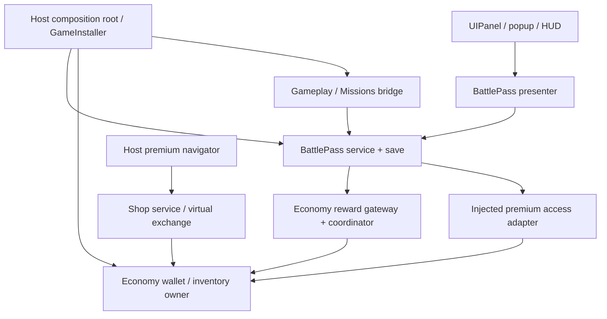

# Dreamy Battle Pass — kế hoạch package cho game offline casual/puzzle

Ngày lập: **2026-10-20**. Trạng thái: **0.1.0 candidate đã triển khai; xem checkpoint mục 13**. Package đề xuất: `com.dreamy.feature.battle-pass`, namespace domain `Dreamy.BattlePass`, phiên bản đầu dự kiến `0.1.0`.

Tài liệu này là backlog triển khai theo phase, có output và gate để review. Các checkbox mục8 giữ nguyên làm backlog thiết kế ban đầu; mục13 ghi trạng thái triển khai và evidence thực tế của candidate. Không suy ra mọi gate release đã hoàn thành.

## 1. Mục tiêu và phạm vi

Tạo Battle Pass dùng lại giữa các game offline casual/puzzle: chơi màn → nhận XP mùa → mở tier → claim Free/Premium → thưởng đi vào cùng Economy mà Shop, Daily Reward, Missions và Progression đang sử dụng.

Hai nghĩa của MVP được tách rõ:

- **Kiến trúc Model–View–Presenter:** domain/service sở hữu luật; presenter nhận intent và phối hợp; panel/item chỉ render, phát event.
- **Bản dùng được tối thiểu:** một mùa, XP từ gameplay, hai track, claim/retry/restart, một panel hoàn chỉnh, sample import được, installer và tài liệu. Chỉ gọi copy-ready sau consumer gate.

### 1.1. Bắt buộc trong bản đầu

- Một season occurrence đang chơi trên mỗi profile; Free + Premium, XP tích lũy và các mốc tier cấu hình bằng JSON.
- Season theo thời lượng từ lúc tham gia, phù hợp offline; hỗ trợ tùy chọn lịch UTC cố định bằng cùng domain policy.
- Nhận XP có idempotency, scope theo occurrence; không cộng lại khi callback thắng màn bị lặp hoặc app restart.
- Claim từng reward slot và Claim All, bundle nhiều entry; recovery theo Economy journal/receipt hiện có.
- Premium mua bằng gem qua Shop virtual exchange hoặc entitlement được host cấp; mở premium muộn vẫn claim được các tier đã đạt.
- Panel chính, reward slot, premium popup, kết quả claim, entry/HUD badge; đủ loading, empty, pending, error, expired và close/back.
- Offline sample chạy độc lập và sample bridge tới game loop hiện có; config, prefab, scene, README và install theo convention Dreamy.
- Save schema/version, retention, config snapshot và mùa cũ còn pending được thiết kế từ đầu.

### 1.2. Để sau bản đầu

- Server authority, live operations, cloud merge/cross-device, multiplayer, leaderboard.
- IAP tiền thật/receipt/restore production. Sample không giả lập Purchased rồi quảng bá là đã tích hợp store.
- Paid tier skip, mua XP, ads boost, extra track, infinite chest, lựa chọn reward, random/mystery reward, gifting.
- Một hệ quest riêng bên trong Battle Pass. Missions hiện có tiếp tục sở hữu mission rules.
- Generic event bus/workflow framework, DI framework mới, BigNumber, inventory instance metadata.

## 2. Nguồn đã kiểm tra và các giới hạn bằng chứng

### 2.1. Rule và môi trường

Nguồn áp dụng trực tiếp:

- AGENTS instructions của phiên làm việc: đọc manifest/lock trước claim API; Runtime không tham chiếu Editor; chạy validation nhỏ nhất phù hợp.
- [Dreamy package design rules](../rules/DREAMY_PACKAGE_DESIGN_RULES.md): package boundary, MVP/lifecycle, save ownership, release, sample và prefab.
- Các skill đã đọc: `unity-project-analysis`, `dreamy-feature`, `dreamy-architecture`, `dreamy-datasave`, `dreamy-ui`.
- [Manifest](../../Packages/manifest.json), [lock](../../Packages/packages-lock.json), [.gitmodules](../../.gitmodules), package manifests, asmdefs và source liệt kê dưới đây.
- [Reward evolution và resume](REWARD_EVOLUTION_ARCHITECTURE_AND_RESUME_2026-10-15.md), [Progression multi-reward plan](DREAMY_PROGRESSION_MULTI_REWARD_PLAN.md) là bối cảnh quyết định trước; source hiện tại quyết định API thực tế.

Unity quan sát từ `ProjectSettings/ProjectVersion.txt`: **6000.4.12f1**. Sandbox HEAD lúc khảo sát: `35004a5f0af87e95618b18480e30a096129f98ff`.

Không tìm thấy `toolkit.json`, `rules/index.json` hoặc `compatibility/dreamy-packages.json` trong checkout này và các vị trí installed skills đã khảo sát. Không suy ra trạng thái maturity hay toolkit-certified compatibility. Chưa tìm thấy skill `omg-*` trong hai thư mục skills global đã kiểm tra; sử dụng Dreamy skills và rules/source hiện hữu cho plan này. Khi có toolkit/OMG thực tế, đối chiếu lại ở P0; không cần cài thêm để viết plan.

Worktree có sẵn thay đổi ở GameInstaller, Bootstrap scene, prefab Missions, Economy/Editor Tools và gitlink UI. Những thay đổi này không thuộc plan. Economy source được quan sát kèm trạng thái dirty; không coi toàn bộ working tree là nội dung tag `v0.6.0`.

### 2.2. Baseline package

| Package | Version trong `package.json` / HEAD quan sát | API/source liên quan | Ý nghĩa với Battle Pass |
| --- | --- | --- | --- |
| Feature | `0.2.0` / `fec5ceeb850964c4a76d5b763cef3c1db406fec1` | `FeaturePresenter`, `IFeatureView<T>`; Runtime chỉ reference nền tảng .NET | Dùng lại subscription lifecycle; không thêm wallet/save/clock vào Feature. |
| Economy | `0.6.0` / `f5b28684292d98b7751debf1011c55846abf0707`, dirty | Shared wallet/inventory, strict reward delivery, resource recovery | Một authority tài nguyên; dùng journal/coordinator thay vì tự dựng reward protocol. |
| Daily Reward | `0.2.2` / `c3dee45406ba2eca98b9e186504a799449f94c08` | Model, embedded pending claim, presenter, feature sample installer | Tham khảo detached commit và mẫu panel/presenter/install. |
| Missions | `0.2.0` / `1e1b4b57b738a83d7325ee229a80852c397c739e` | Period/window, event identity, strict claim | Tích hợp qua host bridge; giữ quyền sở hữu mission ở Missions. |
| Progression | `0.2.1` / `c49961d8a94af999635ff40be74a047a8c39a5ad` | Milestone journals, retry, XP/level save riêng | Tham khảo recovery; không dùng player XP/level làm season XP. |
| Shop | `0.2.0` / `28fb105c839505ebc31a2c195a1f4fbe9b635f85` | `purchaseOnce`, `ownershipResourceId`, virtual exchange, shortage routing | Mua entitlement bằng gem trong cùng Economy owner. |
| UI | `1.0.6` tại package manifest; checkout `064c3ac890cbaf535540e9abf8bf22bc1f0e6727` khác gitlink cha | `UIPanel`, `IPanelPresenter`, factory/host, SafeArea | Dùng panel lifecycle, quản lý transition/asset ở UI/host. Kiểm lại pin trước release. |

Các dependency trong lock là version requirements của package, không phải một chứng nhận API tương thích. Ví dụ Progression/Shop đang khai báo Economy `0.5.0`, Missions `0.3.0`, Daily `0.3.1`, trong khi local Economy manifest là `0.6.0`. Không copy nguyên minimum versions cũ cho package mới.

### 2.3. Source tham chiếu cho implementation

| Chủ đề | Source đã đọc |
| --- | --- |
| Reward identity, fingerprint, journal callbacks, recovery | [reward-api.md](../../LocalPackages/com.dreamy.feature.economy/Documentation~/reward-api.md), [reward-delivery.md](../../LocalPackages/com.dreamy.feature.economy/Documentation~/reward-delivery.md), [RewardDeliveryCoordinator.cs](../../LocalPackages/com.dreamy.feature.economy/Runtime/Rewards/RewardDeliveryCoordinator.cs) |
| Shared inventory và entitlement | [shared-inventory.md](../../LocalPackages/com.dreamy.feature.economy/Documentation~/shared-inventory.md), [DatasaveResourceWallet.cs](../../LocalPackages/com.dreamy.feature.economy/Runtime/DatasaveResourceWallet.cs), [EconomySaveData.cs](../../LocalPackages/com.dreamy.feature.economy/Runtime/EconomySaveData.cs), [ResourceRewardDefinition.cs](../../LocalPackages/com.dreamy.feature.economy/Runtime/Rewards/ResourceRewardDefinition.cs) |
| Domain/presenter | [FeaturePresenter.cs](../../LocalPackages/com.dreamy.feature/Runtime/FeaturePresenter.cs), [DailyRewardPresenter.cs](../../LocalPackages/com.dreamy.feature.daily-reward/Runtime/Presentation/DailyRewardPresenter.cs), [IMissionService.cs](../../LocalPackages/com.dreamy.feature.missions/Runtime/Contracts/IMissionService.cs) |
| Install/sample UI | [MissionFeatureInstaller.cs](<../../LocalPackages/com.dreamy.feature.missions/Samples~/Mission Feature/MissionFeatureInstaller.cs>), [MissionPanel.cs](<../../LocalPackages/com.dreamy.feature.missions/Samples~/Mission Feature/MissionPanel.cs>), [GameInstaller.cs](../../Assets/_Project/Scripts/Bootstrap/GameInstaller.cs) |
| Premium qua Shop | [ShopModel.cs](../../LocalPackages/com.dreamy.feature.shop/Runtime/Domain/ShopModel.cs), [ShopCatalogConfig.cs](../../LocalPackages/com.dreamy.feature.shop/Runtime/Config/ShopCatalogConfig.cs), [ShopGatewayPurchaseRequest.cs](../../LocalPackages/com.dreamy.feature.shop/Runtime/Domain/ShopGatewayPurchaseRequest.cs) |
| Resource suggestion | [IResourceAcquisitionGateway.cs](../../LocalPackages/com.dreamy.feature.economy/Integration/UI/IResourceAcquisitionGateway.cs), [ResourceAcquisitionCoordinator.cs](../../LocalPackages/com.dreamy.feature.economy/Integration/UI/ResourceAcquisitionCoordinator.cs) |
| UI lifecycle | [PresenterViewHost.cs](../../LocalPackages/com.dreamy.ui/Runtime/Panel/PresenterViewHost.cs), [IPanelPresenter.cs](../../LocalPackages/com.dreamy.ui/Runtime/Presentation/IPanelPresenter.cs), [UIPanel.cs](../../LocalPackages/com.dreamy.ui/Runtime/Panel/UIPanel.cs) |

**Drift cần nhớ:** tài liệu Economy cũ còn mô tả inventory do host giữ, save v2 hoặc Progression chưa strict. Source mới có `EconomySaveData.Version = 4`, shared inventory và Progression reward recovery. Shop virtual path đã gọi `IResourceTransactionWallet.Exchange` khi có; IAP path vẫn loop `TryGrant`, chưa có durable fulfillment đầy đủ. Kế hoạch dưới đây bám các quan sát source này; không kế thừa các nhận định cũ một cách máy móc.

## 3. Quyết định kiến trúc

### 3.1. Ownership và dependency một chiều



| Dữ liệu/hành vi | Owner | Không đặt ở |
| --- | --- | --- |
| Season/tier/XP curve/reward definition | DataConfig; snapshot lịch sử trong BattlePass save | Panel, Economy balance |
| Season XP, enrollment, event dedup, claimed slots, pending journal, batch | BattlePass save/service | Player Progression save, PlayerPrefs, panel |
| Coin/gem/booster/chest/cosmetic/entitlement quantity | Shared Economy owner hoặc destination hiện hữu của game | BattlePass save thứ hai cho cùng tài nguyên |
| Cost và premium entitlement mua bằng gem | Shop virtual exchange trong cùng Economy owner | Panel trừ gem rồi bật bool premium |
| Mission objective/progress/period/selection/reroll | Missions | BattlePass domain |
| Mapping thắng màn/mission → XP mùa, producer outbox | Host gameplay integration | Core, UI item |
| Format icon/text, navigation, art, feedback | UI sample/host presenter adapter | Model domain |

ADR chính:

1. Tạo package Battle Pass riêng vì feature dùng lại được qua nhiều game. Không mở rộng Progression thành season framework; hai domain có lifecycle khác nhau.
2. Tái sử dụng `Dreamy.Economy.Rewards`. Không thêm package reward mới, không tự ghi journal save độc lập.
3. Runtime C# thuần; UI concrete nằm trong sample theo Missions/Daily/Shop. Không tham chiếu `_Project`, UnityEngine.Object, store SDK hay Editor từ domain.
4. Một BattlePass model/writer trên mỗi profile/save key, một Economy writer trên mỗi Economy key. Installer/panel reopen không tạo owner mới.
5. Dùng interface ở boundary thật: clock, premium access, view, persistence/gateway có sẵn. Tránh thêm manager/factory/interface chỉ để đủ tầng.
6. Hợp đồng domain synchronous trên Unity owner thread theo Economy hiện tại. Network/IAP async nằm ở host; không chặn main thread để đưa network vào domain sync.

### 3.2. Package layout đề xuất

Các tên dưới đây là **contract/file mới dự kiến**, chưa tồn tại trong repo:

```text
LocalPackages/com.dreamy.feature.battle-pass/
  package.json
  README.md
  CHANGELOG.md
  Documentation~/
    architecture.md
    configuration.md
    integration.md
    offline-time-and-seasons.md
    save-and-recovery.md
    premium-and-shop.md
  Runtime/
    Dreamy.BattlePass.Runtime.asmdef
    Config/           BattlePassCatalogConfig.cs, BattlePassSeasonDefinition.cs,
                      BattlePassTierDefinition.cs, BattlePassRewardBundleConfig.cs
    Contracts/        IBattlePassService.cs, IBattlePassView.cs,
                      IBattlePassClock.cs, IBattlePassPremiumAccess.cs
    Domain/           BattlePassModel.cs, BattlePassModel.Claims.cs,
                      BattlePassModel.Seasons.cs, BattlePassViewState.cs,
                      BattlePassProgressRequest.cs, BattlePassResults.cs
    Persistence/      BattlePassSaveData.cs, BattlePassSeasonSave.cs,
                      BattlePassPendingClaim.cs, BattlePassClaimBatch.cs
    Presentation/     BattlePassPresenter.cs
    Installation/     BattlePassInstaller.cs
  Tests/
    Runtime/          Dreamy.BattlePass.Runtime.Tests.asmdef, domain/fault tests
  Samples~/
    Battle Pass Feature/
      Dreamy.Feature.BattlePass.Integration.Runtime.asmdef
      README.md
      BattlePassFeatureInstaller.cs
      UI/             BattlePassPanel.cs, BattlePassTierItem.cs,
                      BattlePassRewardItem.cs, BattlePassEntryView.cs,
                      BattlePassPremiumPopup.cs, BattlePassClaimSummaryPopup.cs
      Presentation/   BattlePassPanelPresenter.cs, premium/HUD adapters
      Prefabs/        panel, tier, reward item, premium popup, summary, entry
      Resources/DataConfig/battlePassCatalog.json
      Resources/      visual catalog, icon/font references
      Demo/           bootstrap, fake clock, deterministic gameplay buttons
      Scenes/         BattlePassDemo.unity
      Editor/         sample builder/validator + Editor-only asmdef
      Tests/          UI integration tests + test asmdef
    Casual Puzzle Bridge/
      README.md
      Dreamy.BattlePass.CasualSample.asmdef
      Runtime/        durable completion outbox adapter, Shop/Missions wiring
      Config/         optional Shop offer/Missions examples, không Resources trùng key
      Tests/          bridge restart/replay fixtures
```

Không tạo `Runtime.UI` hay `Integration/UI` chỉ vì package khác có. Bản đầu dùng contract/presenter thuần ở Runtime và concrete UI trong sample. Nếu sau này có adapter UI dùng lại thật giữa nhiều sample/consumer, tách assembly riêng với dependency rõ ràng.

### 3.3. Assemblies và package dependencies

- `Dreamy.BattlePass.Runtime`: reference trực tiếp Feature.Runtime, Core.Runtime cho installer, DataConfig.Runtime, Datasave.Runtime, Economy.Runtime; `noEngineReferences: true`. Khai báo Newtonsoft nếu config dùng `[JsonProperty]` theo package hiện có. Không cần UI/UniTask trong domain.
- `BattlePassPresenter : FeaturePresenter` phụ thuộc `IBattlePassView`; adapter `BattlePassPanelPresenter : IPanelPresenter` trong sample forward Show/Dispose. Cách này dùng UI factory mà Runtime không cần reference UI.Presentation.
- Sample UI reference BattlePass.Runtime, Feature.Runtime, Economy.Runtime, Economy.UI.Runtime, UI.Runtime/UI.Presentation, UniTask, TMP/uGUI theo source sử dụng. Feedback là dependency của sample nếu bật adapter đó.
- Sample bridge reference Shop/Missions/Progression chỉ khi dùng trực tiếp; domain Battle Pass không dependency ba feature này.
- Tests có test-only references và constraints, không lọt NUnit/UnityEditor vào player Runtime. `Tests/Runtime` là tên thư mục, không suy ra Test Runner mode; xác minh discovery thực tế.
- Đề xuất minimum Economy `0.6.0`, Feature `0.2.0`; lấy minimum Core/DataConfig/Datasave/Newtonsoft từ API sử dụng và consumer gate, không từ số version cho có. Toàn bộ pin/tag cần chốt ở P0/P11.
- Dependency UPM và dependency assembly là hai việc khác nhau: không khai báo UI ở Runtime asmdef không làm optional UPM UI thực sự khi Economy manifest hiện vẫn kéo UI. Ghi transitive dependencies thật trong README.
- Sample dependency phải ghi rõ và thử import. Không thêm Shop/Missions/Feedback vào Runtime package chỉ để sample compile.

## 4. Luật sản phẩm và domain cần chốt trong code

### 4.1. Season occurrence và clock offline

| Chính sách | Quy định bản đầu |
| --- | --- |
| Mùa mặc định | `EnrollmentDuration`: bắt đầu khi host gọi enrollment sau unlock; duration cấu hình, ví dụ 14 ngày. Enrollment được persist, không reset khi mở panel. |
| Mùa theo lịch | `FixedUtcWindow`: khoảng `[startUtc, endUtc)`; chưa tới giờ thì Upcoming, hết khoảng thì không nhận XP/mua mới. Không dùng local timezone. |
| Unlock | Host quyết định, ví dụ thắng màn 5. Package nhận eligibility; không tự query player level global. |
| Identity | `seasonId` là definition; `occurrenceId` là một lần chạy đã persist, không phải revision. Enrollment có token tạo một lần rồi lưu; retry enrollment không tạo mùa thứ hai. |
| Rollover | Host chọn next definition/enroll theo catalog. Không tự lặp cùng definition vô hạn trong bản đầu. Chỉ một active occurrence, lịch overlap bị reject. |
| Grace | Mặc định đề xuất 48 giờ sau end: không XP/mua premium mới, vẫn claim reward đã đủ điều kiện trước end. Được cấu hình; mua premium trước end mở quyền claim trong grace. |
| Sau grace | Slot chưa bắt đầu claim chuyển Expired, không auto-grant. Intent đã persist trước deadline phải được recovery/finalize dù deadline đã qua. |
| Rollback giờ | Persist `LastObservedUtc`; effective time không lùi so với giá trị durable đã quan sát. Rollback không mở lại mùa/claim. Forward jump lớn có thể làm hết mùa; sample hỗ trợ diagnostic, không tự đặt lại giờ để mở reward. |
| Resume/pause | Host gọi refresh khi resume, trước progress/claim/purchase check; không chỉ dựa countdown trên panel. Time watermark được persist ở boundary có ý nghĩa, không ghi mỗi frame. |
| Guarantee | Clock máy phù hợp offline convenience; watermark giảm lỗi lùi giờ, không chống sửa save/clock hoặc bảo đảm thời gian thật. |

Season state dự kiến: `Locked → Upcoming/Available → Active → ClaimOnly → Archived`. Available dùng cho mùa chờ enrollment; lịch cố định có thể enroll khi đang Active. UI còn có state `Unavailable` cho config/save hỏng và `RequiresReload` khi kết quả persistence chưa rõ. Pending claim là trạng thái giao dịch song song, không đồng nhất với season state.

Khi rollover có old pending, giữ record occurrence cũ và payload gốc. Recovery được thử trước enrollment/rollover; nếu chưa giải quyết được, không xóa record cũ. Bản đầu cho phép tiếp tục XP mùa active sau khi phục hồi state đáng tin cậy, nhưng chặn mở claim mới trong toàn service khi một claim cũ vẫn pending. `RequiresReload` chặn mọi mutation cho tới reload/reconcile.

### 4.2. XP và tier

- `TotalXp` là `long` không âm; threshold theo cumulative XP, strictly increasing. Tier đầu đề xuất 100 XP, không dựa vào index làm identity.
- Đạt threshold mở cả Free/Premium slot; Premium còn yêu cầu entitlement. Một lần nhận XP có thể mở nhiều tier.
- XP cap ở threshold cuối; event receipt vẫn ghi khi event hợp lệ ở cap để retry không thành XP mới sau config change. Không có overflow XP/chest bản đầu.
- XP chỉ là progression của Battle Pass, không là balance spendable trong Economy; player level/XP tiếp tục do Progression sở hữu.
- `BattlePassProgressRequest` dự kiến chứa profile/producer namespace, occurrenceId, eventId hoặc sequence, event fingerprint và amount. Không để view gửi XP tùy ý.
- Producer cấp ID từ completion đã persist, ví dụ run-completion token. Retry dùng lại ID; event của mùa cũ không tự đổi sang mùa hiện tại.
- Duplicate cùng fingerprint → AlreadyProcessed; cùng ID khác amount/occurrence/payload → PayloadMismatch; XP âm/0, overflow, wrong scope, unknown producer hoặc season không Active → result xác định, không mutate.
- Đề xuất receipt XP exact theo occurrence cho producer unordered; giữ tới khi occurrence đóng và có tombstone chống reopen. Không dùng bounded 4096 history để tuyên bố chống replay lifetime.
- Với producer sequence có cursor: chỉ dùng khi có ordered delivery contract và watermark durable; không bỏ event sequence thấp hơn chỉ vì event cao hơn tới trước. Bản đầu ưu tiên exact receipts, đo kích thước trước khi tối ưu.
- Chỉ publish XP/tier event sau durable commit. Lỗi listener không được đổi commit thành failed hoặc gây grant lại.

### 4.3. Premium entitlement

**Nguồn quyền:** Economy balance của resource unique scoped tới đúng occurrence, ví dụ `entitlement.battlepass.garden2026run01.premium`. ID phải hợp cú pháp ResourceId, được host register trước khi dùng, mapping ổn định qua restart. Chuỗi ví dụ không phải format concat bắt buộc cho mọi game.

- `IBattlePassPremiumAccess` là boundary đọc quyền theo occurrence, có notification cho presenter refresh; default adapter dùng cùng Economy owner.
- BattlePass save lưu entitlement resource mapping/snapshot phục vụ lịch sử; không giữ bool premium thứ hai làm authority.
- Mua bằng gem: Shop offer `purchaseOnce`, `ownershipResourceId` đúng resource trên, reward amount 1, definition `unique: true`; cost + entitlement nằm trong một exchange của Economy.
- Shop purchase result/đóng popup không chứng minh đã có quyền: refresh bằng balance durable. Nếu exchange commit nhưng app chết trước callback, startup đọc entitlement vẫn mở Premium.
- Mua muộn không thay XP/claimed Free; mở các Premium slot có threshold đã đạt. Không auto-claim toàn track sau purchase.
- Host navigator kiểm tra đúng profile/occurrence và còn Active ngay trước dispatch purchase. Không mở generic Shop offer cũ từ archive; với async navigation phải revalidate khi trở lại. Contract bản đầu không hỗ trợ purchase bắt đầu trước deadline nhưng thực thi sau deadline.
- Existing Shop không biết Battle Pass season. Adapter/root phải sở hữu gating/lifetime offer; cấu hình sẵn occurrence trong sample, runtime-generated occurrence cần host offer/config mapping tường minh. Không giả định Shop có API thêm offer động.
- `DatasaveResourceWallet` hiện nhận reward definitions ở constructor, chưa có API đăng ký target mới động được xác minh. Bản đầu predeclare occurrence keys và entitlement targets trong catalog rồi truyền toàn bộ definitions khi tạo wallet; thời điểm enrollment vẫn tính theo từng người chơi. Nếu host cần occurrence token sinh động, phải chốt adapter/registry lifecycle ở P0 trước triển khai, không dựng wallet thứ hai hoặc giả định có `RegisterTarget()`.
- Không thêm API `UnlockPremium()` không điều kiện vào public production service. Demo free entitlement đi qua explicit demo action/destination và tách khỏi install production.
- Không dành cùng entitlement ID cho hai occurrence. Khi season tiếp theo bắt đầu, quyền cũ vẫn lưu phục vụ history nhưng không unlock mùa mới.

### 4.4. Claim, identity và Claim All

Slot identity = occurrence + stable tier ID + track ID. Entry identity = stable reward entry ID; không dùng row index, reward display name hoặc thời điểm click.

```text
RewardIdentity.Request(profileScope, "battle-pass", seasonId, occurrenceId, slotId)
  → request fingerprint chứa pinned revision + original eligibility + reward inputs
  → Begin: persist detached intent và original slot context
  → Resolve: persist concrete ResolvedRewardBundle
  → Deliver: mỗi destination persist effect + receipt cùng owner snapshot
  → persist journal acknowledgements
  → Complete: persist Claimed + Completed journal cùng BattlePass save document
  → phát final result, render và feedback
```

- Scope profile là stable save lineage, không phải session GUID hay tên hiển thị. Encoding slot/entry dựa canonical `RewardIdentity`, không tự ghép dấu phân cách dễ collision.
- Revision thuộc fingerprint/snapshot, không tạo request identity mới để regrant cùng slot sau cập nhật config.
- Gateway validate toàn bundle trước entry đầu; đăng ký route đủ kind/target. Sau Resolve dùng journal payload cố định, không đọc config mới để thay reward.
- Mỗi callback persist clone **toàn bộ BattlePass save hiện tại**, thay journal/claimed đúng record, save thành công rồi mới swap state. Không overwrite XP/batch mới bằng stale captured save.
- Một claim live/coordinator mỗi service; busy guard bao trùm eligibility, persistence, notifications/finalization. Reentrant call trả Busy.
- `RewardDeliveryResult.IsSuccess` của Begin/Resolve không có nghĩa claim xong. Chỉ Complete thành công mới trả Claimed. AlreadyClaimed không phát reward animation mới.
- Tách domain claim status và Economy delivery reason: LockedTier, PremiumRequired, Expired, WrongOccurrence, Busy, Pending, RequiresReload, Claimed, AlreadyClaimed; không gộp tất cả thành bool.
- Đóng panel chỉ hủy view work/navigation chưa dispatch. Intent durable tiếp tục thuộc service; không clear journal khi OnDisable/Destroy.

**Claim All bản đầu:** một batch có snapshot danh sách slot đủ điều kiện tại lúc bắt đầu, thứ tự tier tăng rồi Free/Premium ổn định. Persist batch ID, occurrence, slot IDs và cursor trước claim đầu. Mỗi slot dùng identity độc lập như claim tay; resume không chọn thêm slot mới đạt hoặc premium mới mua vào batch đang chạy.

Batch xử lý tuần tự, dừng ở Pending/RequiresReload/lỗi xác định; UI thể hiện số đã final-complete, chưa xử lý và lý do. Chỉ advance cursor bền vững cùng/ sau slot completion; restart đối chiếu claimed state để không cấp lại. Một batch không atomic toàn bộ; không rollback phần đã nhận. Claim tay và Claim All dùng chung lock/claim path. Toàn bộ batch được coi là intent trước deadline chỉ khi batch snapshot đã persist và đủ eligibility; từng slot context phải khôi phục được từ snapshot, không lách expiry bằng một batch ID rỗng.

### 4.5. Snapshot, save và retention

`BattlePassSaveData` bắt đầu schema v1, dùng convention SaveData/OnAfterLoad và migration giống package hiện có:

| Nhóm | Field/record dự kiến |
| --- | --- |
| Scope | Schema version, profile/save scope, active occurrence ID, last observed UTC |
| Season | Season/occurrence ID, pinned revision/fingerprint, enrollment/end/grace UTC, entitlement ID, definition snapshot |
| Progress | Total XP, processed progress event IDs + fingerprint hoặc producer cursor hợp lệ |
| Claim | Stable slot states, original claim context, embedded RewardJournal, deterministic failure diagnostics |
| Batch | Batch snapshot, ordered eligible slot IDs, current index, final state |
| Archive | Old occurrence metadata, claimed/expired slot identity, unresolved journals, closure tombstones |

Lưu immutable season gameplay snapshot khi enrollment: thresholds, reward definitions/entry IDs, time policy, entitlement mapping. Config mới chỉ áp dụng enrollment mới. Art/icon/text có fallback host, không thay payload reward lịch sử.

Không re-resolve mùa đang chơi từ catalog mới khi catalog thiếu season ID. Nếu save snapshot hợp lệ thì tiếp tục theo snapshot; nếu snapshot hỏng/unknown future schema thì read-only/error, không silently reset XP hoặc claimed. First install khác corrupted save; dùng Datasave policy/backup có evidence.

Save failure có thể xảy ra sau write: đánh dấu RequiresReload, dừng mutation/claim batch, reload Economy **và** BattlePass bằng durable state cùng lineage rồi retry ID cũ. Không chỉ clone lại model từ cache cũ. Backup restore phải xét bộ feature saves/Economy cùng generation; plan không hứa chống mọi power loss hoặc độc lập rollback từng file.

Retention v1 ưu tiên correctness: giữ strict Economy receipts/tombstones và occurrence closure records. Không prune pending journals. Chỉ compact completed snapshot/event IDs khi closure policy chứng minh không nhận lại occurrence cũ và có migration/replay fixtures. Đo ledger growth theo mùa trước khi thêm compaction.

## 5. Public contracts đề xuất

Đây là hướng API mới để review ở P1, **không phải API đã có**:

```csharp
public interface IBattlePassService
{
    event Action StateChanged;
    BattlePassViewState GetState();
    BattlePassEnrollmentResult Enroll(BattlePassEnrollmentRequest request);
    BattlePassProgressResult ReportProgress(BattlePassProgressRequest request);
    BattlePassClaimResult Claim(BattlePassClaimRequest request);
    BattlePassBatchResult ClaimAll(BattlePassBatchRequest request);
    BattlePassRecoveryResult RecoverPending();
    BattlePassRefreshResult Refresh();
}
```

- Requests luôn nêu expected occurrence/profile context để stale panel/callback không claim nhầm mùa. Service đối chiếu scope, không tin view tự quyết eligibility.
- View state là snapshot read-only: season state, XP current/next threshold, total/current tier, premium access, end/grace timestamps, slot states, pending batch, reasons, action availability. Không trả mutable SaveData hoặc coordinator.
- Slot state tách `Locked`, `PremiumLocked`, `Claimable`, `Pending`, `Claimed`, `Expired`, `Blocked`; kèm delivery diagnostics khi cần. Không giấu một phần thưởng đã giao nhưng chưa final claim dưới label Claimed.
- `IBattlePassView : IFeatureView<BattlePassViewState>` phát ClaimRequested, ClaimAllRequested, PremiumRequested, RetryRequested, CloseRequested; render và hiển thị kết quả. Không expose wallet/save cho panel.
- Presenter đọc service và premium adapter, xử lý results; navigation/feedback qua adapter sample/host. Không biến presenter thành save owner.
- Reload operation cụ thể được chốt ở P3 theo Datasave cache semantics. Không thêm một `Reload()` giả chỉ đọc cached SaveData rồi gọi là recovery.

## 6. Đồng bộ với các pack hiện có

| Pack/luồng | Điểm tích hợp | Điều phải giữ |
| --- | --- | --- |
| Economy | Shared wallet, strict gateway, unique entitlement, balances/HUD | Một owner; reward mutation + receipt cùng snapshot. Không gọi TryGrant thêm sau claim. |
| Shop | Premium gem offer, purchase-once ownership, shortage UI | Exchange cost + entitlement atomic tại owner; confirm bằng quyền durable. IAP là phase mở rộng riêng. |
| Missions | Host chuyển mission completion/claim đúng policy thành XP event | Mission period/window/ID và producer outbox giữ qua restart; không tự tạo quest system mới. |
| Progression | Gameplay completion cùng nguồn có thể cấp player progression và season XP | Hai entitlement độc lập có IDs riêng; không nghe XP UI rồi cộng Battle Pass mù quáng. |
| Daily Reward | Cùng gateway/wallet, các panel reward consistency | Daily claim không tự cộng season XP mặc định; host bật nếu game design yêu cầu. |
| Lucky Wheel | Dùng chung balances/inventory | Không nâng mọi feature lên strict trong scope Battle Pass; giữ legacy compatibility đã quan sát. |
| Feature/UI | FeaturePresenter, UIPanel/factory/host, SafeArea/back | Bind/dispose đối xứng, service sống theo profile/root, panel sống theo navigation. |
| DataConfig/Datasave | Register trước initialize; snapshot/runtime/persistence tách biệt | Không duplicate Resources key, không tạo save owner ở panel. |
| Assets | Host load/release icon/prefab theo policy hiện có | Domain không load Addressables; item không tự tìm global asset service. |
| Audio/Feedback | Claim/premium confirmed feedback, lỗi/pending theo UI policy | Chỉ celebrate final success; balance notification không đại diện bundle completion. |
| Localization/Connectivity | Host mapping text và trạng thái mạng nếu có | Không giả định hai service đã cài. Offline path không bị khóa bởi network status. |

### 6.1. Bridge gameplay có thể recovery

Không chỉ subscribe event thắng màn trong RAM: nếu gameplay completion đã save mà app chết trước ReportProgress thì XP có thể mất. Host ghi completion + outbox event trong cùng gameplay owner commit; consumer retry ReportProgress với cùng token/fingerprint, mark outbox consumed sau success/AlreadyProcessed.

Nếu game chưa có persistent completion/outbox, sample ghi rõ chỉ minh họa event path, không hứa giao XP không mất qua process death. Sample nâng cao phải có fixture durable outbox thực.

Luật sample: thắng lần đầu một run nhận 20 XP, replay callback cùng run không cộng; run mới của cùng level có token mới. Có XP tối đa/loại màn theo host policy; không hardcode rules vào BattlePassModel.

### 6.2. Bridge Missions không dựa vào UI claim callback

`IMissionService` hiện có StateChanged và claim/recovery methods; chưa có contract durable XP outbox/cross-feature delivery. UI event hoặc đọc `IsComplete` không chứng minh đã emit XP đúng một lần.

P8 chọn một trong hai đường sau dựa vào source consumer:

1. Producer gameplay cấp XP Battle Pass trực tiếp; Missions nhận cùng completion token cho objective. Đây là default bản đầu, không có XP thưởng thêm khi claim mission.
2. Nếu game cần “claim mission nhận pass XP”, bổ sung seam outbox tối thiểu ở owner Missions/host với versioned save và migration review riêng. Record XP intent cùng durable mission transition; bridge gọi BattlePass rồi acknowledge. Không giả định chỉ nghe StateChanged đủ bảo đảm delivery.

Không route pass XP qua Economy destination mutate BattlePassSave trong lúc BattlePass đang claim; tránh cycle/reentrancy và hai writer. Currency/item thưởng mission vẫn đi Economy; XP mùa đi progress request có idempotency.

### 6.3. Battle Pass như nguồn nhận tài nguyên

Adapter tùy chọn ở host implement `IResourceAcquisitionGateway`: chỉ quảng bá Available khi có slot **claim được ngay** chứa resource cần tìm và route/navigator hoạt động. Tier locked, premium chưa mua hoặc mùa expired không được hiển thị như chắc chắn nhận được tài nguyên.

Open chỉ điều hướng/highlight reward phù hợp, không tự claim hoặc mua. `ResourceAcquisitionResult.Returned` là kết quả navigation, không chứng minh reward đã giao. Host kiểm tra lại balance sau khi quay về; cancellation không xóa durable claim. Router ghép Shop/BattlePass thuộc host; không thêm dependency ngược Economy → BattlePass.

## 7. UI/MVP deliverables

### 7.1. Prefab và trách nhiệm

| Artifact | Nội dung và interaction |
| --- | --- |
| `BattlePassPanel.prefab` | Header mùa/countdown, XP bar, tier list hai track, claim-all, premium CTA, retry/status, close/back. SafeArea ở root hoặc parent đã chứng minh. |
| `BattlePassTierItem.prefab` | Stable tier binding, threshold/number, Free/Premium reward slots, milestone decoration; không gọi service global. |
| `BattlePassRewardItem.prefab` | Render bundle icons/amounts, track badge, lock/claimed/pending overlays và claim intent. Bundle nhiều entry không chỉ hiện entry đầu. |
| `BattlePassPremiumPopup.prefab` | Benefits, giá từ Shop presentation, ownership/loading/unavailable/error, confirm/cancel; không tự trừ gem. |
| `BattlePassClaimSummaryPopup.prefab` | Các slot final-complete và delivery pending riêng; close/retry. Không gọi slot partial là toàn bộ reward đã nhận. |
| `BattlePassEntryView.prefab` | Nút mở panel, tier/XP nhỏ, badge claimable. Badge derived từ state, không thêm bool save. |

Claim summary là presentation trong phiên. Domain không lưu “popup đã xem” trừ khi sản phẩm có nhu cầu cụ thể. Không làm một reward popup framework dùng chung tất cả pack trong phase này.

### 7.2. View states và lifecycle

- Initializing: disable actions tới khi root Ready. Available/Upcoming có mô tả enrollment/start; InvalidConfig/SaveUnavailable có reason và retry phù hợp.
- Active: hiển thị XP/tier chính xác; slot khóa nói rõ thiếu XP hay premium. Empty/no claimable khác lỗi tải.
- ClaimOnly/Expired: phân biệt countdown grace và hết nhận thưởng; old pending vẫn có retry khi đã hết mùa.
- Pending: disable thao tác xung đột nhưng vẫn close được; giữ reason/retry sau Render. Mở lại query state, không phụ thuộc event phiên cũ.
- Premium popup không mở lặp, không cho dispatch hai purchase. Claim All/claim tay dùng cùng service busy state.
- `Show/Refresh` không add listener lặp; Dispose/unbind chịu được partial bind. Row reused phải bỏ binding cũ; presenter cũ không refresh row đã bind occurrence mới.
- Countdown refresh từ clock với cadence do UI owner quản lý, không save mỗi frame. Tween/UniTask token theo view; kill/cancel khi hide/destroy; không hủy service claim durable.
- PanelManager/factory hoặc PresenterViewHost có đúng một lifecycle owner. Không gắn hai presenter hosts cho cùng panel.
- Font/TMP, long text, locale fallback và icon missing có fallback; portrait ưu tiên, landscape dùng được. Không giả định package localization chưa cài.

Visual gate: portrait 1080×1920, landscape 1920×1080 và màn hẹp 800×600; ít nhất một device có notch/safe area. Kiểm content scrolling, button reachability, back stack, popup sorting và touch target theo UI convention của game.

## 8. Plan triển khai theo phase

Phụ thuộc chính: `P0 → P1 → P2 → P3 → P4 → P5 → P6 → P7 → P8 → P9 → P10 → P11`.

P6 có thể dựng layout sau khi view contract P1 ổn định; premium interface có fake để domain tests, nhưng chưa gọi feature hoàn chỉnh trước P5/P9. Mỗi phase là một checkpoint reviewable; nếu gate chưa chạy thì ghi chưa xác minh, không tự tick.

### P0 — Baseline, pin và boundary audit

**Output:** bảng API/dependency verified theo commit, dirty-state inventory và quyết định scope cuối.

- [ ] Ghi SHA từng package, package.json, gitlinks, manifest/lock hash; tách source dirty khỏi nội dung release tag.
- [ ] Đọc lại design rules, toolkit/compatibility/OMG nếu tìm thấy; ghi unknown thay vì tự gán maturity.
- [ ] Kiểm API save/cache/reload, config validation, reward coordinator, resource definitions/unique semantics, Shop purchase-once và UI host theo đúng source sẽ dùng.
- [ ] Chốt profile scope/save keys, season default, grace, entitlement mapping, XP producer và sample dependency list.
- [ ] Discover validation hiện có: Unity instance/project đúng, Console baseline, targeted suites và clean consumer fixture. Read-only ở giai đoạn baseline.

**Gate:** không còn giả định “API này có sẵn” khi chưa chỉ ra source; dependency graph mới không vòng; baseline lỗi hiện có được ghi riêng.

### P1 — Package skeleton, contracts và config

**Output:** package compile được với public contracts/config validator; chưa có UI gameplay.

- [ ] Tạo package metadata/asmdef/source folders theo mục 3; một public type chính mỗi file, namespace thống nhất.
- [ ] Chốt result enums, view state, request scope, event identity, clock/premium access contracts và synchronous ownership.
- [ ] Implement catalog ConfigBase: schema, catalog/season/occurrence mapping, time policy, thresholds, tier/entry IDs, concrete reward bundles, entitlement resource và presentation keys.
- [ ] Validator reject duplicate IDs, threshold không tăng, long overflow, duration/grace âm, lịch overlap, invalid resource/kind/entry/amount, thiếu Free/Premium content không đúng policy.
- [ ] Tạo JSON fixture tối thiểu và fixture invalid; sample config dự kiến 10 tier/14 ngày, không coi đây là balancing production.

**Tests:** valid JSON, schema unknown, duplicate/collision, boundary threshold/time, reward bundle validation. **Gate:** Runtime không reference Editor/Unity UI; package import/compile sạch; tests được discover >0.

### P2 — Save, enrollment, time và XP

**Output:** model headless có thể enroll, cộng XP và khôi phục state.

- [ ] Implement SaveData v1, detached clone/candidate, OnAfterLoad, validation và unknown-schema handling; default collections không đồng nghĩa silently reset corrupt state.
- [ ] Implement occurrence enrollment idempotent, pinned gameplay snapshot, UTC windows, effective time watermark, grace/archive/tombstone.
- [ ] Implement ReportProgress với exact receipts/fingerprint, multi-tier unlock/cap và notification isolation sau commit.
- [ ] Tách player Progression khỏi pass XP; public requests reject stale scope/occurrence.
- [ ] Persist meaningful progress/enrollment/season transitions ngay; pause SaveAll chỉ là hỗ trợ, không thay transaction boundary.

**Tests:** first install/restart; duplicate same/different payload; event tới sai thứ tự; event mùa cũ; nhiều tier một grant; cap/overflow; giờ lùi/nhảy; start/end/grace exact boundary; profile isolation; save throw trước/sau write.

**Gate:** recreate model từ serialized durable store vẫn cùng XP/occurrence; fail không phát state success, không mutate cache trước save.

### P3 — Strict claim và startup recovery

**Output:** single-slot claim recoverable qua Economy thật.

- [ ] Dùng RewardIdentity/ResolvedRewardBundle/RewardDeliveryCoordinator hiện có; embed pending context/journal trong BattlePass save.
- [ ] Validate eligibility và route; persist original revision/track/tier/occurrence/time/entitlement evidence trước delivery.
- [ ] Complete persist Claimed + Completed cùng document; giữ fingerprint/payload authority; expose pending/deterministic reasons rõ ràng.
- [ ] Recovery chạy sau load destinations, trước season reset/new claim; old expired intent vẫn finalize.
- [ ] Implement RequiresReload/reconcile khi persistence uncertain; một writer/guard xuyên callbacks và event notifications.
- [ ] Không tạo compatibility constructor bool-wallet cho package mới nếu chưa có consumer legacy cần giữ.

**Tests:** fault injection ở intent, resolved snapshot, mỗi owner commit, acknowledgement, Complete; recreate mọi owner/store/service sau mỗi lỗi. Bao gồm coin+booster, missing destination, unknown target, overflow, payload mismatch, corrupt journal, reentry, listener throw và retry old season.

**Gate:** mỗi effect đúng một lần trên cùng save lineage; Claimed chỉ sau Complete; partial delivery hiển thị Pending; không tuyên bố atomic bundle.

### P4 — Claim All, archive và config evolution

**Output:** batch có thể resume, mùa đổi/config đổi không mất pending hoặc regrant.

- [ ] Persist batch manifest đủ eligibility/context trước execution; dùng single claim path, cursor durable và result per slot.
- [ ] Dừng/resume batch khi pending/fail; block competing claim; handle user close/reopen, premium unlock giữa batch, XP mới đạt giữa batch.
- [ ] Recovery trước rollover; archive lưu original slot context/snapshot và closure identity.
- [ ] Catalog revision mới không thay mùa active; removed season vẫn recovery từ snapshot. Schema future/corrupt vào trạng thái rõ ràng.
- [ ] Document retention v1; tạo fixture bảo vệ chống prune receipts/occurrence tombstones tùy tiện.

**Tests:** crash trước/sau từng slot/cursor; begin trước expiry rồi chạy qua expiry; new premium không chui vào batch cũ; config remove/reorder/revise; two occurrences cùng tier IDs; archive pending ở grace end.

**Gate:** restart batch không claim thiếu/thừa snapshot đã chốt; revision không tạo identity regrant; không xóa dữ liệu cần recovery.

### P5 — Premium và Shop economy integration

**Output:** quyền Premium durable; gem purchase đi cùng shared Economy.

- [ ] Implement premium access adapter đọc đúng entitlement ID từ cùng balance source, refresh khi BalanceChanged và sau resume.
- [ ] Author Shop purchase-once offer/unique resource definition cho occurrence sample; validate mapping và cost resource.
- [ ] Host premium navigator enforce active occurrence/time trước dispatch; stale popup/profile/season bị từ chối.
- [ ] Dùng shortage/recovery route hiện có khi thiếu gem; result navigation không tự unlock pass.
- [ ] Document restore entitlement từ Economy và giới hạn IAP hiện tại. Không sửa Shop IAP sang protocol mới trong scope này.

**Tests:** insufficient gems; purchase duplicate; after-write/restart trước callback; premium late unlock; quyền mùa cũ không dùng cho mùa mới; time expires khi popup mở; profile switch; unique already-owned không charge lại qua purchaseOnce.

**Gate:** gem debit + entitlement trong một owner transaction; không có bool premium authority song song; callback/result không cấp quyền giả.

### P6 — MVP presenter và UI wiring

**Output:** presenter testable và panel tương tác được với model.

- [ ] Implement BattlePassPresenter dùng FeaturePresenter; sample adapter IPanelPresenter/factory theo convention UI hiện có.
- [ ] Bind/unbind service/view/premium events, disable conflicting actions, refresh rồi hiện result reason, handle close/retry.
- [ ] Render immutable states, bundle nhiều entry, premium locks, batch progress, archived pending và countdown.
- [ ] Add premium/HUD/summary presentation adapters; feedback chỉ sau final success.
- [ ] Cancellation/tween/navigation ownership rõ khi close/destroy/reopen/profile switch.

**Tests:** fake view/service kiểm bind/dispose/reopen, failed partial bind, service update khi panel mở, duplicate clicks, stale occurrence, pending feedback, no feedback AlreadyClaimed, close không clear durable intent.

**Gate:** UI không save/grant/parse catalog/mua SDK trực tiếp; một presenter lifecycle owner; Refresh không nhân listener.

### P7 — Prefab, sample scene và visual validation

**Output:** bộ prefab/scene ở `Samples~/Battle Pass Feature` với reference đầy đủ.

- [ ] Dùng Unity Editor/MCP tạo prefab, meta, serialized refs và scene; không ghép prefab/scene YAML bằng text.
- [ ] Tạo panel/tier/reward/premium/summary/entry, safe-area hierarchy, TMP fonts/materials, fallback icons và trạng thái mục 7.
- [ ] Optional sample builder ở Editor assembly: menu rõ, validate/dry-run nếu contract cho phép, output path sample-owned, không overwrite art game.
- [ ] Demo controls: grant deterministic XP, đổi fake clock, fault/retry/restart, reset **demo save namespace**; gắn nhãn Demo, không trong production installer.
- [ ] Chuyển các sửa sample được chấp nhận về source `Samples~`, giữ GUID, rồi import mới. Không dùng `Assets/Samples` đã chỉnh như source release.

**Validation:** Inspector Missing Script/Prefab/null refs; runtime play-through; screenshots ba aspect ratios; SafeArea/back/sorting; 100 chu kỳ open/close trên panel thật, listener/row/tween/handle không tăng bất thường.

**Gate:** sample assets có thật và compile; không gọi copy-ready chỉ vì có builder script; generated source/import consumer cùng contract.

### P8 — Casual/Puzzle và optional feature bridges

**Output:** bridge sample và hướng dẫn host mapping.

- [ ] Durable level-completion outbox → BattlePass progress request; fingerprint/token persist cùng producer transition, ack sau success/AlreadyProcessed.
- [ ] Fan-out cùng gameplay completion tới player Progression/Missions theo authority của từng feature; không cấp trùng XP từ hai listener.
- [ ] Missions default chỉ nhận cùng gameplay event. Nếu cần mission-claim bonus XP, làm ADR/seam/migration riêng như mục 6.2 trước implement.
- [ ] Add optional resource-acquisition navigator: lookup claimable matching resource, open/highlight, recheck balance sau return; giữ routing ở host.
- [ ] Host-facing hook mở pass từ Home/HUD, Ready gating và teardown theo profile/scene.

**Tests:** crash producer-save → consumer-call → outbox-ack; replay cùng run; replay màn với run mới; wrong-window/season callbacks; acquisition Cancelled/Returned/NoMatchingDestination; existing Daily/Missions/Shop vẫn dùng cùng wallet.

**Gate:** default offline gameplay hoàn toàn không yêu cầu network/SDK; mỗi producer có owner/retention contract cụ thể; sample bridge không che gap delivery bằng RAM event.

### P9 — Installer, sample import và tài liệu sử dụng

**Output:** consumer mới cài theo README rồi chạy sample được.

- [ ] `BattlePassInstaller.RegisterConfig` và Install overload nhận explicit config, datasave, gateway, clock, premium access, scope/options. Convenience ServiceLocator chỉ ở installer/root.
- [ ] `BattlePassFeatureInstaller` register presenter factory cho existing service; không tạo wallet/service mỗi lần panel mở.
- [ ] package.json `samples` trỏ đúng folder; sample descriptions nêu dependency thật và thứ tự import. Primary sample tự chạy khi có dependencies đã ghi; bridge cần primary sample.
- [ ] Viết README/Documentation theo mục 9, JSON guide và migration/troubleshooting; sửa README index repo khi cần theo convention hiện có.
- [ ] Rehearse import vào consumer sạch, play → XP → Free → mua Premium bằng gem → Premium claim → restart/pending recovery → expire/grace.

**Gate:** không missing references/duplicate asmdefs/Resources keys; không đòi sandbox `_Project` để sample compile; copy-ready có evidence import/visual/behavior.

### P10 — Regression, file persistence và mobile checks

**Output:** evidence matrix theo đúng source checkpoint.

- [ ] Targeted BattlePass domain/presenter/bridge/UI tests, Economy shared/reward/transaction suites và feature regressions liên quan.
- [ ] File-backed restart/failure tests dùng thư mục temp riêng, dựng lại mọi owner; không đổi global persistent path hay save người chơi.
- [ ] Consumer smoke Daily/Missions/Progression/Shop/HUD; scene unload, pause/resume, domain reload, profile switch, panel lifecycle.
- [ ] Android target build/IL2CPP smoke với sample dependency graph; iOS chỉ khi là consumer target có môi trường phù hợp. Ghi gate chưa chạy riêng.
- [ ] Đo latency save/claim-all và kích thước save/receipt sau nhiều mùa trên baseline; không thêm pooling/index/compaction trước khi thấy nhu cầu.

**Gate:** compile sạch, discovered >0, không fail; build/player smoke có artifact. Không suy kết quả device/store từ Editor NUnit hoặc cộng số tests nhiều run thành final-suite certificate.

### P11 — Release package và consumer pin

**Output:** candidate `0.1.0` có metadata/install/release evidence thống nhất.

- [ ] Audit public API, dependency minimums, asmdef graph, license, README, sample declaration, `.meta`, changelog và migration policy.
- [ ] Tạo repo package/submodule theo URL organization khi repo thực tế đã tồn tại; pin commit/tag cố định ở consumer, không ghi URL phỏng đoán là đang cài được.
- [ ] Commit package trước gitlink consumer; resolve manifest/lock từ pins; rerun clean-consumer gate đúng artifact release.
- [ ] Cập nhật compatibility/toolkit registry nếu hệ thống có owner và checkout; không tự gán maturity khi registry vắng.
- [ ] Release notes ghi offline scope, clock policy, receipt retention, pending recovery, chưa hỗ trợ IAP production/cloud merge và evidence chưa chạy.

**Gate:** package version/tag/SHA/changelog/consumer lock nhất quán; không dựa vào source dirty. Push/tag/publish theo yêu cầu phát hành riêng; bản plan này không tạo repo remote hay publish package.

## 9. Install và composition runbook cần có trong README

### 9.1. Hai cách cài

**Sandbox phát triển:** package local tại `LocalPackages/com.dreamy.feature.battle-pass`; manifest trỏ `file:../LocalPackages/com.dreamy.feature.battle-pass`; thêm package vào `testables` cho test discovery. Chỉ cập nhật lock qua UPM resolve khi triển khai.

**Consumer release:** Git URL pin tag/SHA hoặc submodule theo `.gitmodules` convention hiện có. URL/tag chỉ điền sau P11 xác minh repository tồn tại. Khai báo rõ dependency Dreamy cũng cần nguồn resolve; không giả định registry có mọi `com.dreamy.*`.

Import primary sample từ Package Manager; optional Casual Puzzle Bridge import sau primary và các sample/dependency Shop/Missions đã ghi. Chuyển sample vào `_Project` bằng Unity Move cùng meta nếu muốn làm bản game-owned; tránh compile đồng thời hai asmdef/class copies.

### 9.2. Thứ tự bootstrap

1. Tạo/resolve Datasave, profile identity và clock ở root. Kiểm dữ liệu version/backup trước cho feature ghi state.
2. Tạo DataConfig service; register BattlePass catalog cùng Shop/Daily/Missions/Progression **trước** `InitializeAsync`.
3. Initialize config, validate definitions/occurrence mapping. Không mở UI khi catalog chưa Ready.
4. Tạo hoặc nhận **wallet owner hiện có**; root tập hợp target definitions cho booster/entitlement trước khi gọi constructor wallet, gồm các occurrence được hỗ trợ và archived pending targets. Nếu wallet đã được dựng ở bước nền trước đó, di chuyển việc tập hợp definitions về đúng bước tạo owner; không dựng lại owner chỉ để install Battle Pass. Load/import legacy inventory trước recovery nếu cần.
5. Tạo reward gateway với destinations từ cùng owner qua `CreateRewardDestination(kind)` và các owner game khác nếu thực sự cần. Không tạo wallet mới theo mỗi kind/feature.
6. Tạo premium access adapter và BattlePass service explicit dependencies. Load save; recover pending claims/batch trước season transition/enrollment mới. Nếu pending còn unresolved, expose state đúng, không grant bằng ID mới.
7. Wire Shop premium navigation, gameplay outbox consumer và optional feature bridges sau khi service có state ổn định. RequiresReload thì không cho producer ack success.
8. Register presenter factory/panel hosts, visual catalog/balance holders; root công bố Ready rồi Home/entry được mở panel. Unresolved pending không nhất thiết làm mọi UI game unavailable; mutation restrictions theo service state.
9. Pause/resume refresh clock/season và flush producer/save theo policy. Teardown dispose subscriptions/hosts/adapters/owned registrations; dừng producer trước profile switch, không unregister service do root khác sở hữu.

Không đưa root-specific `_Project` types vào package API. Installer hỗ trợ explicit injection để consumer dùng ServiceLocator hiện có hoặc DI riêng mà không đổi model.

### 9.3. Checklist tài liệu

- Quick start từ project mới, dependencies và thứ tự import, sample scene và controls.
- Cấu hình schema/IDs, cumulative XP, reward bundle, season timing/grace, premium offer/ownership mapping.
- Mapping một run completion sang event có durable identity; example duplicate/retry và save lineage.
- Claim/Claim All pending/recovery, operation success so với final claim success, RequiresReload.
- Save keys/version/snapshot/retention/profile switch/backup; policy thay config trong mùa và nâng schema.
- UI bind/open/close/back, art reskin, SafeArea, fonts/localization fallbacks, asset ownership.
- Install local/Git/submodule, exact release pins; cách nâng package, rollback cả bộ saves và compatibility giới hạn.
- Troubleshooting: không có XP, wrong occurrence, premium không mở, duplicate Resources config, missing destination/target, PayloadMismatch, InvalidJournal, zero tests discovered.

## 10. Ma trận acceptance quan trọng

| ID | Tình huống | Kết quả bắt buộc |
| --- | --- | --- |
| BP-01 | Enroll rồi đóng app, mở lại | Cùng occurrence/start/end/snapshot, không reset duration. |
| BP-02 | Callback thắng cùng run 3 lần và replay sau restart | XP cộng đúng một lần; fingerprint khác bị reject. |
| BP-03 | Completion đã commit, chết trước ReportProgress hoặc ack | Outbox retry giao XP đúng một lần. |
| BP-04 | XP mở nhiều tier, tới cap, long boundary | Đúng unlock/cap, không overflow hoặc nhận lại event. |
| BP-05 | Claim Free coin+booster, lỗi sau owner commit | Retry cùng receipt; không cộng lại phần đã nhận, final Claimed sau Complete. |
| BP-06 | Complete save fail sau giao đủ bundle | Hiện pending; restart finalize, không re-deliver effect. |
| BP-07 | Premium locked → mua bằng gem → process death trước UI callback | Debit/entitlement nhất quán; restart mở Premium theo durable balance. |
| BP-08 | Mua premium muộn hoặc retry purchase khi đã sở hữu | Claim được tier Premium đã đạt, không charge/grant lặp. |
| BP-09 | End/grace exact boundary; claim intent trước deadline | Chặn intent mới đúng hạn; pending gốc vẫn resume. |
| BP-10 | Rollback clock, đổi timezone hoặc config giữa mùa | Không mở lại reward; snapshot/UTC policy được giữ. |
| BP-11 | Claim All restart giữa slot/cursor và mở Premium sau batch begin | Đúng batch snapshot, không thêm slot mới, không duplicate. |
| BP-12 | Old-season pending rồi enrollment mùa mới | Recovery giữ context cũ; quyền mùa cũ không unlock mùa mới. |
| BP-13 | Reentrant notification, listener throw, double click | Busy/isolation, không mutation lặp hoặc false failure sau commit. |
| BP-14 | Import sample vào consumer chưa có sandbox code | Compile/play được theo dependencies tài liệu, không missing script/ref. |
| BP-15 | 100 open/close, scene unload, profile switch | Không listener/presenter/tween/handle leak; stale callback không ghi profile mới. |
| BP-16 | Daily/Missions/Shop/Progression cùng shared wallet | Balances/receipts không overwrite; không wallet/inventory song song. |
| BP-17 | Corrupt/future save, thiếu config season cũ | Không silently reset/regrant; fail/recover theo snapshot và policy rõ. |
| BP-18 | Resource acquisition navigation | Returned không tự nhận thưởng; claimable match và recheck balance đúng. |

Evidence triển khai dự kiến đặt tại `docs/evidence/battle-pass/`: source SHAs/dirty hashes, manifest/lock hashes, Editor/platform, test discovery + pass/fail/skip, fault boundary logs, imported consumer revision, screenshots và build artifact. Không ghi pass cho gate chưa chạy.

## 11. Mốc bàn giao và thứ tự ưu tiên

| Mốc | Phase | Có thể review/đánh giá |
| --- | --- | --- |
| M0 — Contract baseline | P0–P1 | API/config/layout/dependency đúng convention, package skeleton compile. |
| M1 — Domain vertical slice | P2–P3 | Chơi → XP → claim Free → restart/recovery, chưa cần UI art. |
| M2 — Offline feature complete | P4–P6 | Batch, season lifecycle, premium gem flow và MVP hoạt động. |
| M3 — Copy-ready candidate | P7–P9 | Prefab/panel/sample/install dùng được trong consumer sạch. |
| M4 — Release candidate | P10–P11 | Regression, mobile/consumer evidence và exact package pins. |

Ưu tiên correctness/save/recovery trước art polish; premium dựa entitlement durable trước purchase animation; source `Samples~` và clean import trước nhãn copy-ready. Mỗi milestone ghi phần đã chạy và phần chưa xác minh riêng. Không coi M1 là toàn bộ Battle Pass hoàn thành.

## 12. Validation của bước lập kế hoạch

Phạm vi hiện tại chỉ thêm tài liệu này, chưa tạo package, sửa runtime/manifest/scene/prefab hay publish. Kiểm tra tối thiểu cho tài liệu: whitespace và local Markdown links tới source đã tồn tại. Unity tests/player build là các gate triển khai nêu trên, chưa chạy trong bước viết plan.


## 13. Checkpoint triển khai 2026-10-20

Reward Presentation đã được checkpoint ở sandbox `e774311` (Economy `1373c1d`, Daily `140f24e`, Missions `6e68566`). Battle Pass candidate hiện nằm tại [package README](../../LocalPackages/com.dreamy.feature.battle-pass/README.md); [evidence](../evidence/battle-pass/README.md) ghi đúng source/checks đã chạy. Các checkbox design ở mục8 được giữ làm release backlog; bảng này phân biệt phần đã code với gate còn lại, không tự đánh dấu toàn bộ package hoàn thiện.

| Phase | Kết quả hiện có | Gate/phần còn lại |
| --- | --- | --- |
| P0–P1 | Manifest/lock đã đọc; local package0.1.0, Runtime engine-independent, contracts, ConfigBase validator,10-tier JSON, optional Reward Presentation assembly | Toolkit/OMG/compatibility registry vẫn không tìm thấy; chưa có remote/tag để pin |
| P2 | Save schema1, detached commits, frozen enrollment snapshot, two time policies, durable UTC high-water, XP cap/receipts, retained archives | Chưa benchmark retention dài hạn; chưa có schema cũ để migrate |
| P3–P4 | Economy coordinator/journals, Complete là claimed truth, RequiresReload, one pending owner; durable frozen batch/cursor, recovery qua deadline/config removal | Batch API hiện trả kết quả tổng/slot đang dừng; chưa có history UI per-slot cho batch |
| P5 | Economy premium reader, entitlement unique mỗi occurrence, sample Shop purchaseOnce200gem, gate occurrence/time/pending | Production shortage navigator và IAP/restore SDK không triển khai |
| P6–P7 | FeaturePresenter + IPanelPresenter adapter; panel/tier/reward/premium/entry/shared reward panel, SafeArea, prefabs/scene do Editor tạo;100cycles và portrait/landscape/compact | Art/localization/feedback theo game; không chứng nhận thiết bị notch thật |
| P8 | Completion outbox mẫu có persist run/token/ack và replay; HUD/scene teardown | Chưa có sample thứ hai fan-out thực thi cả Missions/Progression; optional resource-acquisition/highlight chưa code |
| P9 | Explicit installer + RegisterConfig trước initialize, independent persistent sample, Samples~ đúng bytes/GUID, README +6docs, isolated consumer compile/import | Host game cần merge vào composition root/wallet hiện hữu; standalone sample không sửa GameInstaller đang có thay đổi của bạn |
| P10 |69/69targeted tests (BattlePass23), file-backed failure/restart, real UI, Linux dev build0errors | Android/iOS/IL2CPP/device và save latency/size benchmark chưa chạy |
| P11 | Changelog candidate, dependency/asmdef/source hash audit và evidence | Chưa tạo repo/submodule remote, commit/tag Battle Pass hoặc publish; chưa có license/release approval của owner |

Các điều chỉnh so với layout dự kiến: concrete UI nằm trong primary sample; Confirm/Notice dùng chung Economy Reward Presentation; không tạo framework/summary domain thứ hai. New package được track local trong sandbox cho tới khi có repository URL thật. Runtime không dependency Shop/Missions/Progression; sample Shop dependency được ghi rõ khi import.


### 13.1. Correction: gate kế thừa prefab base

Review sau checkpoint phát hiện primary sample đang tạo panel bằng GameObject mới, chưa tạo variant từ `BaseFeaturePanel.prefab`. Evidence69tests/100cycles/build xác nhận behavior của asset hiện tại, **không xác nhận tuân thủ prefab inheritance**. Áp dụng [rule4.1](../rules/DREAMY_PACKAGE_DESIGN_RULES.md#41-kế-thừa-basefeaturepanel-khi-tạo-ui-feature):

- [x] Chuyển BattlePassPanel, BattlePassPremiumPopup và RewardPanel trong primary sample sang Prefab Variant từ BaseFeaturePanel qua Unity Editor/MCP; sửa builder để regenerate đúng variant và giữ GUID/bindings.
- [x] Tái sử dụng Backdrop/SafeArea/tween kế thừa; kiểm owner và serialized canvasGroup/tweenPlayer, tránh cấu trúc/tween trùng.
- [x] BattlePassRewardItem, BattlePassTierItem, RewardItem và BattlePassEntry là variant từ BaseFeatureItem; item hiển thị thuần disable root Button/raycast, không kế thừa panel base.
- [x] Export về Samples~;7variant/source-chain/bindings/GUID pass,100cycles với tween kế thừa, manager Back khôi phục panel, Confirm/double Claim đúng một lần, consumer mới import/compile pass. Evidence: prefab-variants.json, variant-migration.json và ảnh variant-panel/variant-confirm.

Cập nhật tiếp theo đã chuyển đủ7prefab qua Unity MCP, giữ nguyên7GUID và xác minh đúng source base/bindings; xem prefab-variants.json trong evidence. Consumer import/compile sau migration đã pass. Lifecycle/Back được ghi ở checkpoint migration sau khi kiểm tra thực tế; build Linux cũ vẫn là evidence trước migration.
