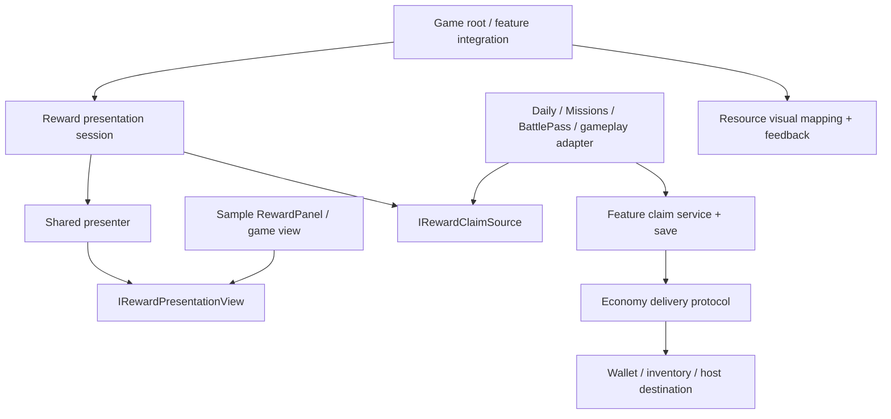

# Dreamy Economy — Reward Presentation dùng chung

Ngày lập: **2026-10-20**. Trạng thái: **Implementation candidate — xem checkpoint thực thi tại mục 16**.

Package owner: **`com.dreamy.feature.economy`**. Phạm vi mới: contract/presenter điều phối hiển thị thưởng, panel/item mẫu, adapter tới service phát thưởng, sample/install/documentation và validation. Không tạo package mới ở giai đoạn đầu.

Các mục 1–15 giữ nội dung kế hoạch thiết kế ban đầu; tên API trong đó có thể khác bản code đã chốt. Checklist giữ vai trò backlog, không tự đóng các gate chưa chạy. API đã triển khai, evidence và phần còn lại được ghi riêng tại mục 16.

## 1. Mục tiêu và các quyết định đã thống nhất

Làm một bộ Reward Presentation có thể dùng lại cho nhiều nguồn thưởng: thắng màn, Daily, Missions, Battle Pass, achievement, chest, event, mailbox và thông báo kết quả mua hàng. Game mới có thể dùng prefab mẫu, reskin hoặc thay view mà không phải viết lại presenter/claim interaction.

Hai trải nghiệm chính:

1. **Confirm Claim:** hiện quyền nhận thưởng, người chơi bấm **Nhận**, service có authority mới giao/lưu thưởng. Trước khi bấm, balance không tăng vì panel này.
2. **Granted Notice:** service đã hoàn tất giao/lưu thưởng, panel chỉ thông báo kết quả; nút **Tiếp tục/Đóng** không grant thêm.

Các quyết định nền:

- Panel có thể tắt theo flow/game. Tắt panel không làm thay đổi transaction semantics.
- Eligibility, thời hạn, pending claim và final claimed thuộc feature/game service phát thưởng.
- Economy tiếp tục sở hữu reward bundle, delivery, journal, receipt và wallet/inventory reference implementation hiện có.
- UI package sở hữu panel/navigation/tween primitives. Feedback sở hữu hiệu ứng/âm thanh/haptic sau commit.
- Concrete prefab/art/flow có thể thay ở host. Không hardcode game resource enum, level rules hoặc store SDK vào shared presenter.
- V1 tập trung game offline casual/puzzle và integer rewards. Kiến trúc có seam cho game khác; không tuyên bố đã hỗ trợ mọi game/backend.

### 1.1. Bản dùng được đầu tiên

- Hai mode Confirm Claim / Granted Notice, dùng một view contract và prefab mẫu có thể reskin.
- Nút Claim/Retry/Close, state busy/pending/error/expired/already claimed và khả năng mở lại.
- Bundle nhiều entry/kind; icon/name/amount mapping và fallback; không giới hạn coin/gem.
- Một presenter/session mỗi lần mở; queue FIFO nhỏ ở root để tránh nhiều popup chồng nhau.
- Một nguồn thưởng demo có persistence thật, restart/fault controls; bridge tới ít nhất Daily và Missions sau khi API identity được kiểm chứng.
- Hướng dẫn Battle Pass integration và Progression/Shop notice adapter phù hợp behavior hiện tại.
- Prefab, scene, sample declaration, installer, docs, clean-consumer import và lifecycle checks.

### 1.2. Chưa làm trong v1

- RewardManager chung sở hữu eligibility/save của tất cả feature, global reward inbox hoặc journal save thứ ba.
- Persist UI queue hoặc serialize delegate/MonoBehaviour để resume sau restart.
- Giao dịch atomic giữa nhiều owner, cloud merge, chống sửa save, server/billing authority production.
- Reward choice/random resolver framework, ads multiplier, chest opening rules, purchase/refund/restore engine.
- Generic popup scheduler toàn game, priority/preemption framework, analytics framework hoặc localization package mới.
- Tự động sửa tất cả feature thành manual claim. Feature đang auto-deliver có thể dùng Granted Notice ngay; thay thời điểm grant là thay domain behavior riêng.

## 2. Nguồn sự thật và baseline

### 2.1. Rules và môi trường

- AGENTS instructions của phiên làm việc: kiểm manifest/lock, Runtime không reference Editor và validation nhỏ nhất trước khi báo hoàn thành.
- [Dreamy package design rules](../rules/DREAMY_PACKAGE_DESIGN_RULES.md): ownership, MVP/lifecycle, samples, prefab/meta và release gates.
- Skills áp dụng: `dreamy-feature`, `dreamy-architecture`, `dreamy-ui`; hướng persistence theo `dreamy-datasave` đã đọc trong phiên.
- [Manifest](../../Packages/manifest.json), [lock](../../Packages/packages-lock.json), [.gitmodules](../../.gitmodules), [Economy package manifest](../../LocalPackages/com.dreamy.feature.economy/package.json).
- [Battle Pass plan](DREAMY_BATTLE_PASS_PACKAGE_PLAN.md), [reward evolution/resume](REWARD_EVOLUTION_ARCHITECTURE_AND_RESUME_2026-10-15.md) là context bổ sung.

Unity quan sát: **6000.4.12f1**. Sandbox HEAD: `35004a5f0af87e95618b18480e30a096129f98ff`. Economy manifest: **0.6.0**, HEAD `f5b28684292d98b7751debf1011c55846abf0707`, có thay đổi dirty sẵn. Feature `0.2.0`, Daily `0.2.2`, Missions `0.2.0`, Progression `0.2.1`, Shop `0.2.0` là baseline manifest đã khảo sát trong phiên; chốt lại exact source/pins ở P0.

UI đang checkout khác gitlink repo cha; không suy package HEAD/dirty state là artifact release. Có thay đổi sẵn ở Bootstrap/GameInstaller, prefab Missions và các submodule khác. Bước viết plan chỉ thêm tài liệu này.

Không tìm thấy toolkit/compatibility registry trong checkout ở lần khảo sát trước; `omg-*` cũng chưa tìm thấy trong installed skill roots đã kiểm tra. Dùng rules/source Dreamy hiện hữu, ghi **chưa xác minh** cho toolkit maturity/compatibility. P0 đối chiếu registry/skills nếu môi trường triển khai có bổ sung.

### 2.2. Source và capability quan sát

| Chủ đề | Evidence/source | Hệ quả thiết kế |
| --- | --- | --- |
| Reward payload/identity | [ResolvedRewardBundle.cs](../../LocalPackages/com.dreamy.feature.economy/Runtime/Rewards/ResolvedRewardBundle.cs), [RewardIdentity.cs](../../LocalPackages/com.dreamy.feature.economy/Runtime/Rewards/RewardIdentity.cs) | Tái sử dụng stable entry ID, immutable bundle và fingerprint; không chuyển display rows thành payload authoritative. |
| Durable delivery | [reward-api.md](../../LocalPackages/com.dreamy.feature.economy/Documentation~/reward-api.md), [RewardDeliveryCoordinator.cs](../../LocalPackages/com.dreamy.feature.economy/Runtime/Rewards/RewardDeliveryCoordinator.cs) | Chỉ feature final Complete mới đủ điều kiện báo claim xong. Begin/Resolve thành công chưa phải đã nhận thưởng. |
| Shared inventory | [shared-inventory.md](../../LocalPackages/com.dreamy.feature.economy/Documentation~/shared-inventory.md) | Coin/gem/booster/unique entitlement có thể cùng owner; không tạo wallet riêng cho panel. |
| Existing UI integration | [Economy UI integration asmdef](../../LocalPackages/com.dreamy.feature.economy/Integration/UI/Dreamy.Economy.UI.Integration.asmdef), [ResourceSuggestionPresenter.cs](../../LocalPackages/com.dreamy.feature.economy/Integration/UI/ResourceSuggestionPresenter.cs) | Có chỗ đặt engine-independent contracts/presenter, reference UI.Presentation/UniTask. |
| Existing Unity presentation | [ResourceSuggestionPanelPresentation.cs](../../LocalPackages/com.dreamy.feature.economy/Integration/Unity/ResourceSuggestionPanelPresentation.cs) | Tham khảo session sở hữu async UI/navigation; không copy cancellation semantics sang durable claim một cách máy móc. |
| Resource visuals | [ResourceDisplayCatalog.cs](../../LocalPackages/com.dreamy.feature.economy/Runtime.UI/ResourceDisplayCatalog.cs), [ResourceAmountFormatter.cs](../../LocalPackages/com.dreamy.feature.economy/Runtime.UI/ResourceAmountFormatter.cs) | Có mapping ResourceId → name/icon/format; v1 không cần một resource database mới. |
| Daily | [IDailyRewardService.cs](../../LocalPackages/com.dreamy.feature.daily-reward/Runtime/Contracts/IDailyRewardService.cs), [DailyRewardClaimResult.cs](../../LocalPackages/com.dreamy.feature.daily-reward/Runtime/Domain/DailyRewardClaimResult.cs), [DailyRewardViewState.cs](../../LocalPackages/com.dreamy.feature.daily-reward/Runtime/Domain/DailyRewardViewState.cs) | Claim hiện không nhận expected claim identity; state chưa cung cấp full durable occurrence token/per-entry delivery query. Không bọc Claim() rồi hứa scoped retry. |
| Missions | [IMissionService.cs](../../LocalPackages/com.dreamy.feature.missions/Runtime/Contracts/IMissionService.cs), [MissionPresenter.cs](../../LocalPackages/com.dreamy.feature.missions/Runtime/Presentation/MissionPresenter.cs) | Claim có missionId, periodic identity còn cần window; enum result chưa có receipt/bundle final snapshot đầy đủ cho mọi UI recovery. |
| Progression | [IProgressionRewardService.cs](../../LocalPackages/com.dreamy.feature.progression/Runtime/Contracts/IProgressionRewardService.cs), [ProgressionRewardState.cs](../../LocalPackages/com.dreamy.feature.progression/Runtime/Domain/ProgressionRewardState.cs) | Có reward states/retry/reload; acknowledge từng entry không bằng final Delivered. Milestone delivery hiện thuộc advancement flow. |
| Shop | [ShopModel.cs](../../LocalPackages/com.dreamy.feature.shop/Runtime/Domain/ShopModel.cs) | Virtual exchange có strict path; IAP vẫn legacy TryGrant loop. Notice không thể nâng mức bảo đảm fulfillment. |
| UI factory/lifecycle | [PanelPresenterFactory.cs](../../LocalPackages/com.dreamy.ui/Runtime/Presentation/PanelPresenterFactory.cs), [PresenterViewHost.cs](../../LocalPackages/com.dreamy.ui/Runtime/Panel/PresenterViewHost.cs) | Register ở root; mỗi panel chỉ có một presenter owner. |

Các nhận định này là source observations, chưa là Unity runtime test hoặc chứng nhận production. Không kế thừa nhận định cũ trong README khi source/API đã khác.

## 3. Ownership và vị trí code

### 3.1. Dependency direction



Mũi tên thể hiện quan hệ sử dụng/triển khai ở mức khái niệm; assembly graph phải giữ Economy không reference Daily/Missions/BattlePass/_Project.

| Trách nhiệm | Owner |
| --- | --- |
| Có được nhận, nhận lúc nào, claim nào, original reward nào | Feature/game domain service |
| Claim pending, eligibility snapshot, final claimed | Feature save, cùng document với embedded journal khi dùng strict flow |
| Giao từng entry, receipt chống lặp | Economy protocol + từng destination owner |
| Render list, buttons, pending/error, gửi intent | Reward view + shared presenter |
| Open/close/queue, lifecycle scope, source injection | Presentation session/root |
| Icon/name/amount/localization, art và feedback | Visual adapter/sample/host |
| Có popup hay inline, thời điểm hiện, ưu tiên navigation | Host game/feature presenter |
| Cần hiện lại thông báo chưa xem sau restart | Feature-owned notice outbox tùy chọn, tách khỏi claimed state |

### 3.2. Quyết định về package/assembly

**Economy Runtime hiện có giữ nguyên vai trò:** bundle/journal/delivery/wallet. Không đưa popup contracts hoặc UI queue vào `Dreamy.Economy.Runtime`.

**`Dreamy.Economy.UI.Integration` hiện có:** thêm contracts, state, shared presenter, in-memory session/queue coordination. Giữ `noEngineReferences: true`; có UniTask và UI.Presentation như assembly đang dùng. Presenter có thể implement `IPanelPresenter` theo ResourceSuggestionPresenter; không bắt buộc thêm FeaturePresenter dependency chỉ để dùng base class.

**`Samples~/Reward Presentation`:** concrete RewardPanel/RewardItem, Unity open/close adapter, installer, visual/feedback wiring, demo feature owner, prefab/scene và Editor builder. V1 không ép prefab hoặc MonoBehaviour mới vào Runtime.UI, và không mở rộng assembly tên `Recovery.Unity` cho một feature không phải resource recovery.

**Các adapter feature:** đặt ở integration/sample của feature đó hoặc host. Daily adapter được phép reference Daily + Economy.UI.Integration; chiều ngược lại bị cấm. Mỗi integration có asmdef/dependencies trực tiếp. Primary Economy sample không reference Daily/Missions/Shop để compile.

**Code theo game:** art/layout, level-completion eligibility, SDK authority, mapping resource instance, Home/end-level navigation ở `_Project`. Domain leaf không tự ServiceLocator.Get; root inject dependencies.

### 3.3. Package layout dự kiến

```text
com.dreamy.feature.economy/
  Runtime/Rewards/                         [protocol hiện có, tránh đổi khi không cần]
  Integration/UI/
    RewardPresentation/
      IRewardPresentation.cs
      IRewardPresentationView.cs
      IRewardClaimSource.cs
      RewardPresentationRequest.cs
      RewardClaimReference.cs
      RewardClaimSnapshot.cs
      RewardClaimCommand.cs
      RewardClaimExecution.cs
      RewardGrantedSnapshot.cs
      RewardPresentationState.cs
      RewardPresentationResult.cs
      RewardPresentationPresenter.cs
      RewardPresentationSession.cs
      RewardPresentationQueue.cs
  Tests/Editor/RewardPresentation/
    contracts, presenter, session, queue, cancellation tests
  Samples~/Reward Presentation/
    Dreamy.Economy.RewardPresentation.Sample.asmdef
    README.md
    Runtime/
      RewardPresentationInstaller.cs
      RewardPanelPresentation.cs
      UI/RewardPanel.cs
      UI/RewardItemView.cs
      UI/RewardPreviewView.cs
      UI/RewardPresentationVisuals.cs
      Feedback/RewardPresentationFeedback.cs
    Demo/
      DemoRewardService.cs
      DemoRewardSaveData.cs
      DemoRewardClaimSource.cs
      RewardPresentationDemo.cs
    Prefabs/RewardPanel.prefab
    Prefabs/RewardItem.prefab
    Prefabs/RewardInlinePreview.prefab
    Scenes/RewardPresentationDemo.unity
    Resources/RewardPresentation/           [display assets, không duplicate game config]
    Editor/                                [builder/validator, Editor-only asmdef]
    Tests/                                 [sample UI integration tests, test asmdef]
  Documentation~/reward-presentation.md
  Documentation~/reward-presentation-adapters.md
  Documentation~/reward-presentation-recovery.md
```

Đây là layout đề xuất, không yêu cầu một interface cho mỗi class. Chốt public types/visibility ở P1; gộp các DTO nội bộ nhỏ khi hợp lý, không tạo framework scaffolding không có use case.

## 4. Hai mode và policy hiển thị

### 4.1. Confirm Claim: bấm Nhận rồi tiền mới cộng

```text
Feature persist earned entitlement / completion
  → host mở panel bằng stable claim reference
  → source query đúng original claim
  → render Available, wallet chưa nhận effect của claim
  → người chơi bấm Nhận
  → source Claim(original reference, expected fingerprint)
  → feature persist intent / resolve / deliver / final Complete
  → presenter hiển thị Claimed sau final commit
  → feedback rồi close hoặc chuyển Continue theo presentation options
```

Phải có quyền nhận durable trước khi UI trở thành bước bắt buộc. Với thắng màn, gameplay lưu completion + reward entitlement trong cùng producer commit. Chưa cần tạo delivery journal khi mới mở preview; journal bắt đầu khi feature thực sự xử lý Claim theo luật của nó.

Daily/Missions có thể derive eligibility từ save + period policy thay vì lưu một earned entitlement mới. Nhưng khi panel giữ một offer qua thời gian, **original identity/expiry phải rõ**; nếu service không thể bind original claim thì adapter chỉ hỗ trợ luồng an toàn hơn hoặc yêu cầu API seam ở P7.

Back/Close trước Claim: không grant, không mark claimed, entitlement vẫn thuộc source và có thể mở lại nếu còn hạn. Hết hạn có thể mất quyền theo policy nguồn; shared UI không tự gia hạn hoặc biến preview thành reservation.

### 4.2. Granted Notice: đã nhận rồi mới thông báo

```text
Feature grant + final claimed commit
  → tạo immutable granted snapshot từ authoritative result
  → host enqueue/open Notice
  → render “Đã nhận”, nút Tiếp tục
  → đóng/skip UI không thay balances/claimed
```

Notice không có Claim command và không nhận wallet/gateway dependency. Lỗi load prefab, cancellation, app exit hoặc không hiện panel không được rollback/grant lại.

Snapshot thông báo lấy từ final result hoặc query claim record. Không tính “đã nhận” bằng chênh lệch balance trước/sau vì có thể có spend/grant khác xen vào. Không coi balance event hoặc một delivery receipt của entry đầu là final completion toàn claim.

### 4.3. Tách claim policy khỏi presentation policy

| Claim policy của source/host | Presentation | Behavior |
| --- | --- | --- |
| Manual | Confirm panel | Chỉ execute khi bấm Nhận. |
| Manual | Inline view | Nút ở end-level/Battle Pass gọi cùng source; không cần popup thứ hai. |
| Manual | Không có UI/claim entry khác | Reject configuration hoặc yêu cầu host cung cấp đường claim; không để quyền treo vô hình. |
| Auto | Granted Notice | Source tự hoàn tất, popup chỉ hiện kết quả. |
| Auto | Toast/inline summary | Source hoàn tất; host chọn presentation nhẹ hơn qua cùng display snapshot. |
| Auto | None | Grant bình thường, không mở view. Không instantiate presenter/panel chỉ để đi qua nhánh hidden. |

V1 implement panel và inline preview mẫu; toast có contract/host hook nhưng không bắt buộc tạo thêm toast system hoàn chỉnh. `None` là quyết định orchestration của host, không phải “panel invisibly bấm Claim”.

### 4.4. Trường hợp nên hiện

| Feature/trigger | Mặc định gợi ý | Ghi chú |
| --- | --- | --- |
| Win level casual/puzzle | Inline result + Nhận hoặc Confirm panel | Completion/entitlement phải survive restart; không buộc hai lần Claim. |
| Daily/Mission/Battle Pass đã có nút Claim | Claim ngay tại view, optional Notice | Không mở thêm popup Confirm nếu người chơi đã gửi claim intent. |
| Claim All / milestone lớn | Một Notice tổng hợp | Slot hoàn tất và còn pending phải phân biệt. |
| Chest | Theo chest service: Confirm hoặc Granted Notice | Chest cost/open/random authority không thuộc shared UI. |
| Achievement/event/mailbox | Manual claim nếu source hỗ trợ | Timer/expiry/claimed của nguồn được revalidate. |
| Shop/IAP | Granted Notice sau fulfillment xác nhận | Không chờ nút Nhận trên popup mới fulfill giao dịch đã trả tiền. |
| Coin nhỏ/thưởng liên tục | HUD/toast/animation | Tránh modal popup cho từng event. |
| Startup recovery | Host query pending/notice outbox | Không tự popup mọi receipt Economy trong lịch sử. |

## 5. Contract mới đề xuất

### 5.1. Identity và immutable data

`RewardClaimReference` gồm stable profile/save scope, source ID và claim ID. Claim ID do feature cung cấp, chứa occurrence/window/tier/track hoặc run-completion identity theo domain. UI session ID là identity khác, không được dùng làm transaction ID.

`RewardClaimSnapshot` là dữ liệu read-only từ source:

- Reference, source revision/snapshot token và payload fingerprint.
- Status: Available, Executing, Pending, Claimed, Expired, Blocked, Unavailable, RequiresReload.
- Immutable resolved bundle khi có; original claim context cần cho UI và expected-match.
- CanClaim/CanRetry/CanDismiss, reason, retryability; domain vẫn revalidate khi execute.
- Optional per-entry delivery state nếu source expose được; unknown phải hiển thị unknown, không dựng trạng thái từ balance.

`RewardGrantedSnapshot` chứa final claim reference, bundle/snapshot gốc và final completion marker của source. Đây là DTO được trusted adapter tạo sau final commit, không phải receipt cryptographic hay chứng nhận remote authority. Demo receipt phải được ghi là demo.

`RewardPresentationRequest` chứa mode, stable presentation key, claim reference hoặc granted snapshot, title/message keys và options UI. Không giữ mutable SaveData, Unity Object, wallet hoặc persisted callback trong DTO engine-independent.

### 5.2. Source boundary

Hướng API để chốt ở P1:

```csharp
public interface IRewardClaimSource
{
    UniTask<RewardClaimSnapshot> QueryAsync(
        RewardClaimReference reference,
        CancellationToken cancellationToken);

    UniTask<RewardClaimExecution> ClaimAsync(
        RewardClaimCommand command);
}

public interface IRewardPresentation
{
    UniTask<RewardPresentationResult> OpenAsync(
        RewardPresentationRequest request,
        CancellationToken uiCancellationToken);
}
```

`RewardClaimCommand` mang original reference + expected snapshot/fingerprint; không mang một arbitrary amount để adapter grant theo lời UI. Nếu snapshot đã đổi, source trả mismatch/expired hoặc yêu cầu refresh; không silently claim reward kế tiếp.

Source execute không nhận view cancellation token trong contract đề xuất này. Service/adapter sở hữu transaction lifetime, timeout và recovery; close UI không đồng nghĩa hủy giao dịch. Nếu implementation thêm cancellation, phải phân biệt “chưa dispatch” và “sau dispatch chưa biết kết quả”, không map cả hai thành chắc chắn không nhận.

Current Dreamy services synchronous: adapter gọi trên owner thread rồi trả UniTask đã hoàn tất. Không Task.Run, không block main thread, không biến synchronous Economy thành parallel mutation. Async host/backend nếu có cần authority/retry contract riêng.

`QueryAsync` phải là read/query, không tự grant chỉ vì mở panel. Source không dùng được nếu nó chỉ có “Claim current reward” mà không thể kiểm original identity; dùng notice-only cho tới khi có seam phù hợp.

### 5.3. Execution result và presentation result

`RewardClaimExecution` dự kiến phân biệt:

- **Claimed:** thao tác vừa hoàn tất final commit, kèm granted snapshot authoritative.
- **AlreadyClaimed:** đúng claim cũ đã hoàn tất; có thể show summary, không lặp “new grant” feedback.
- **Pending:** chưa final-complete, có hoặc chưa có entry effects; retry cùng reference.
- **Busy:** owner đang xử lý, không tạo claim ID khác.
- **Expired/Unavailable:** không còn eligibility của original claim.
- **Blocked:** deterministic error như payload mismatch, target unknown hoặc invalid journal.
- **RequiresReload:** durable outcome chưa rõ; mutation bị chặn tới khi owner reconcile.

Retry action gọi source path phù hợp: resume/recover claim cũ, không mặc định `Claim()` current. `Retryable` và action do adapter mapping từ source; shared UI không chọn retry bằng một exception type chung.

`RewardPresentationResult` tách hai trục:

| Trục | Ví dụ |
| --- | --- |
| UI outcome | Dismissed, ClosedAfterCompletion, PresentationUnavailable, CancelledBeforeOpen, DetachedWhileExecuting |
| Claim observation | NotDispatched, Claimed, AlreadyClaimed, Pending, Unknown, RequiresReload |

Không dùng một bool “ShowAsync succeeded” để suy reward đã cấp. Nếu panel bị destroy sau dispatch trước khi thấy kết quả, kết quả claim phải là Unknown/Pending hoặc final result đã biết; không trả chắc chắn “chưa nhận” chỉ vì UI cancel.

### 5.4. View contract và dependency injection

- `IRewardPresentationView` nhận `Render(state)`, phát ClaimRequested/RetryRequested/CloseRequested; không giữ source/wallet/feature service.
- Shared presenter nhận view, source/session context và optional feedback boundary; chỉ phối hợp read/intent/results, không ghi save.
- Source được root truyền trực tiếp cho session/adapter tương ứng. V1 không cần global reflection discovery hoặc persisted source registry.
- View factory/PanelManager bridge ở Unity sample; engine-independent contracts không nhận Sprite, GameObject hoặc Addressables handle.
- Feature adapter có quyền biết Daily/Missions/BattlePass type; Economy assembly không biết concrete feature types.

## 6. State machine, lifecycle và cancellation

### 6.1. State transitions

```text
Confirm:
  Opening → Loading → Available → Executing → Claimed → Closing
                         │            ├→ Pending → Retry → Executing
                         │            ├→ Blocked / RequiresReload
                         └→ Expired / Unavailable

Notice:
  Opening → DisplayingGranted → Closing
```

- Query/execute failures render reason có nghĩa, không nuốt exception rồi đóng panel như đã nhận.
- Busy disable Claim/Retry; event reentrant/double tap không dispatch hai execution.
- Pending vẫn close được; entitlement/journal thuộc service, UI không xóa khi Dispose.
- RequiresReload không spam Retry Claim; hiển thị recovery action nếu root có adapter hoặc hướng dẫn quay lại. UI không tự gọi arbitrary Datasave.Load rồi coi owner đã reload.
- Empty notice không silently grant hoặc render amount 0. Reject invalid payload hoặc dùng host message-only UI ngoài scope reward bundle.
- Unknown source/claim/expired: không fallback sang reward mới nhất hoặc source mặc định.

### 6.2. Owner lifetime

| Owner | Tài nguyên phải cleanup |
| --- | --- |
| Root presentation service | Queue, source session registrations, profile/scene scope và pending waiters |
| Session | Request identity, current operation observation, view lease, UI cancellation và completion signal |
| Presenter | UI/source subscriptions nếu có, bindings và generation guard |
| Concrete panel/item | Button listeners, tweens, asset bindings, temporary layout rows |
| Feature/source service | Durable operation, writer lock, pending journal, recovery/timeout |
| Visual loader | Icon/font/prefab handles và release policy |

Mỗi async callback kiểm session/generation/reference trước render. Panel instance được tái sử dụng cho claim B không được nhận callback claim A. Unbind chịu được partial bind; Show/Refresh không add listener lặp.

PanelManager/factory hoặc PresenterViewHost là một owner duy nhất của presenter. Không vừa Initialize host vừa tự gọi presenter.Show từ MonoBehaviour khác. Profile switch dừng old producers/queue, detach old views và giữ source operation gắn old profile; không reroute completion sang profile mới.

### 6.3. Cancellation boundaries

| Thời điểm UI cancel | Behavior |
| --- | --- |
| Trước enqueue/open/query hoàn tất | Kết thúc UI, chưa dispatch claim; entitlement không đổi. |
| Sau preview, trước Claim | Đóng panel; source giữ quyền nhận tới deadline. |
| Sau Claim dispatch | Detach presentation nếu cần; transaction tiếp tục/recovery theo source. Không clear pending hoặc tạo ID mới. |
| Sau final commit, trước animation/close | Reward vẫn đã nhận; cancel chỉ bỏ hiệu ứng. |
| Notice bị cancel trước khi mở | Không ảnh hưởng claimed; source quyết định có requeue notice sau hay không. |

Mọi source task phải được owner quan sát lỗi kể cả view đã detach. Không để fire-and-forget exception mất vào async continuation. Không giữ reference GameObject đã chết trong durable owner.

## 7. Queue và optional presentation

V1 dùng FIFO đơn giản, một modal Reward Presentation trên mỗi root/layer scope. Host chỉ enqueue khi navigation cho phép; không chiếm mọi modal game hoặc tự đóng Shop/Settings.

- Stable presentation key gồm scope/source/claim/mode, không dùng display title. Cùng key + cùng fingerprint đang queued/open → coalesce theo policy rõ; cùng key khác payload → reject mismatch.
- Nếu nhiều caller join cùng session, dùng multi-waiter completion an toàn; không await lại một single-consumption UniTask. Cancellation từng waiter không tự hủy nguồn hoặc waiter khác. Có thể chọn trả AlreadyQueued cho v1 thay vì coalesce để giảm complexity; chốt một policy và test ở P1.
- Đề xuất v1 **AlreadyQueued** cho request trùng; một caller/session chính, không thêm multi-waiter framework khi chưa cần.
- Queue có giới hạn cấu hình; vượt giới hạn trả QueueFull/PresentationUnavailable, không tự grant hoặc mark viewed. Source giữ entitlement/notice record nếu cần.
- Không persist queue. Sau restart, source/host query earned/pending/unseen notices và enqueue lại bằng stable reference.
- Đóng UI trong lúc source đang executing không giải phóng transaction lock ở feature. Có thể hiện Notice khác, nhưng claim mới cùng source owner vẫn theo Busy/RequiresReload của source.
- Không gộp nhiều claims thành một transaction chỉ vì cùng popup. Claim All vẫn là domain batch có per-slot identities; UI chỉ render aggregate.
- Không “tự động xem như đã nhận” vì popup không mở được. Với Auto+None, host gọi claim/fulfillment ngoài presentation path.

Optional durable notice: nếu game muốn bảo đảm “thưởng đã cấp nhưng phải thông báo một lần sau restart”, feature lưu notice outbox với original payload cùng final claimed commit; viewed acknowledgement là việc khác, không điều khiển việc grant. V1 primary sample có thể chỉ dùng session notice; README phải nêu rõ guarantee đã chọn. Không quét Economy receipts để suy ra mọi notice chưa xem.

## 8. Save, journal và recovery

### 8.1. Không có presentation save authority mới

| Record | Nơi lưu | Khi lưu |
| --- | --- | --- |
| Earned entitlement/completion | Feature/game save | Trước khi UI trở thành bước claim bắt buộc |
| Original claim context + pending journal | Feature save | Khi source bắt đầu xử lý claim |
| Effect + strict delivery receipt | Destination owner save | Mỗi entry được giao |
| Claimed + Completed journal | Cùng feature document | Final claim commit |
| Optional unseen notice | Feature-owned outbox | Cùng final claimed commit nếu cần bảo đảm notice |
| Open panel/queue/tween/selection | Runtime UI | Không persist v1 |

Bản đầu không cần đổi `EconomySaveData.Version` chỉ để thêm popup. Nếu feature phải thêm token/query/outbox, thay schema ở **feature đó** khi serialized data thực sự đổi, kèm migration fixtures.

### 8.2. Crash matrix bắt buộc

| Boundary lỗi/kill | Expected recovery |
| --- | --- |
| Completion commit xong, chưa mở panel | Earned claim còn; host có thể mở lại bằng original identity. |
| Preview hiện rồi đóng app, chưa Claim | Không có delivery effect; eligibility/expiry theo feature. |
| Intent persist xong, Resolve chưa xong | Source recovery theo ID/context gốc; không UI random fallback. |
| Entry owner save xong, journal ack fail | Retry cùng transaction ID; destination AlreadyDelivered, không cộng lại. |
| Một entry giao, entry khác pending | Hiện Pending/partial, không báo toàn bundle đã nhận. |
| Giao đủ, final feature commit fail | Chưa báo Claimed; restart finalize theo journal. |
| Final commit xong, callback/animation bị mất | Query trả claim cũ đã hoàn tất; notice/reopen không grant lại. |
| Save throws sau khi có thể write | RequiresReload/unknown outcome; reconcile owner + feature từ durable state. |
| Reset/restore một file riêng lẻ | Không có guarantee tự động; host phải restore consistent save lineage hoặc reconcile. |

Tests phải recreate store/services/destinations/coordinator, không chỉ presenter. File-backed fixtures dùng temp directory riêng; không sửa Application persistent path hay save thật.

Strict receipt retention theo owner hiện có; UI dedup là session-level, không thay receipt. Không dùng queue history/bounded list để chứng minh chống duplicate grant lifetime.

### 8.3. Notification và actual effect

- Final result, balance change và feedback là các signal khác nhau. Balance có thể đổi trước khi whole claim Complete; shared panel không dựa BalanceChanged để tự chuyển Claimed.
- Unique resource đã sở hữu có thể nhận receipt mới nhưng quantity không tăng. Không mặc định hiện “+1 vật phẩm mới” nếu source không cung cấp actual-effect semantics.
- `ResolvedRewardBundle` là entitlement payload; delivery API hiện không trả một full generic actual-delta receipt cho mọi destination. V1 hiển thị phần thưởng/quyền nhận theo contract, có thể dùng nhãn “Đã sở hữu” khi host expose rõ; không bịa delta bằng balance subtraction.
- Feedback only-newly-completed theo execution outcome/session, không chạy lại vì Notice query/reopen hoặc AlreadyClaimed. Host có thể cho replay animation preview nhưng không gắn với grant.

## 9. Adapter theo từng nguồn thưởng

### 9.1. Gameplay / thắng màn — reference implementation

Demo feature owner riêng của sample: `DemoRewardSaveData` giữ run-completion ID, immutable earned bundle, pending context/journal và claimed state. Completion được persist trước panel; Claim dùng Economy gateway injected cùng owner wallet.

- Button demo “Win level” tạo completion một lần, không trực tiếp cộng coin.
- Button “Open reward” query đúng completion; Claim mới giao thưởng.
- Reopen/restart cùng completion không grant thêm; run mới của level cũ là claim mới theo host policy.
- Fault controls trước/sau write, owner ack, final commit; data namespace riêng, Reset Demo không đụng player save.
- Không biến DemoRewardService thành Runtime generic reward owner cho mọi game. README dùng nó làm mẫu chuyển sang gameplay save thật.

### 9.2. Daily Reward

API hiện tại `GetState()` + `Claim()` không nhận expected claim ID. Panel giữ qua midnight/config change có thể gọi sang một claim khác nếu adapter chỉ gọi current Claim().

P7 phải chốt tối thiểu một opt-in seam ở Daily: query stable claim offer/original pending reference; execute với expected token; query final result/payload cho token cũ. Implementation validate ở **cùng domain boundary** với eligibility/claim, không chỉ check trước ở UI.

- Existing APIs/presenter giữ behavior mặc định; thêm overload/query nhỏ nếu source chứng minh cần, không rewrite Daily thành presentation framework.
- Không publish “manual claim reusable adapter” trước khi token/retry/restart tests pass.
- Trong khi seam chưa có, có thể tích hợp Notice ngay sau `DailyRewardClaimResult.Claimed` từ current call; không hứa persisted replay notice nếu Daily chưa expose record.
- Mystery/resolver payload: preview chỉ là preview nếu chưa resolved. Không roll trong panel. Hỗ trợ reveal/random full flow để phase sau; current result đã resolved có thể show Notice.
- Không bind cả DailyRewardPresenter cũ và shared Confirm presenter vào cùng claim button; chọn một intent path. Có thể dùng shared Notice sau presenter cũ.

### 9.3. Missions

Mission identity cần catalog + mission ID + period/window, selection/reroll occurrence nếu domain phân biệt. `Claim(missionId)` hiện tại chưa đủ làm UI-held token qua reset/reroll.

- Adapter/manual confirmation cần source validate expected original window/selection/mission claim; không claim mission mới cùng ID sau rollover.
- Query old pending phải tìm đúng original claim và bundle snapshot; `RecoverClaims()` có thể recover nhiều claim, không coi nó là execute một claim arbitrary đang render.
- `MissionClaimStatus.Claimed` xác nhận final feature path hiện tại nhưng enum không mang bundle/receipt query đầy đủ. Bổ sung query/result seam nhỏ khi cần per-entry/notice recovery, không đọc private SaveData qua reflection.
- Current MissionPresenter claim-direct flow có thể giữ, dùng Notice qua host adapter; chuyển sang Confirm là opt-in, tránh double confirmation.
- Đóng panel không reroll/refresh/xóa pending; expiry/window thuộc Missions.

### 9.4. Progression

Source hiện có milestone reward state, per-entry acknowledgements, RetryReward/RetryPendingRewards và RequiresReload. Advancement hiện sở hữu việc phát thưởng.

- V1 adapter ưu tiên Granted Notice sau milestone Delivered hoặc Pending/retry view từ reward state, không intercept grant bằng UI.
- `ProgressionRewardStatus.Delivered`/feature final state là completion boundary; entry Delivered/acknowledged một phần không đủ.
- Nếu sản phẩm muốn “level up nhưng chờ bấm Nhận mới cấp reward”, phải thêm opt-in manual delivery policy trong Progression, có migration/backward-compatibility plan riêng. Không thể đạt bằng chỉ thay panel.
- Không tạo level/XP save song song để hỗ trợ Notice.

### 9.5. Battle Pass

Áp dụng [Battle Pass plan](DREAMY_BATTLE_PASS_PACKAGE_PLAN.md): stable occurrence/tier/track slot, Claim/ClaimAll/RecoverPending thuộc BattlePass service.

- Slot đã có nút Claim → gọi service ngay, optional shared Notice sau final success.
- Confirm panel chỉ bật cho flow/game thực sự cần xác nhận, adapter validate original slot/occurrence/fingerprint.
- Claim All render aggregate: danh sách completed và pending riêng, không gọi claim lại từng row trong popup summary.
- `BattlePassClaimSummaryPopup` có thể trở thành host-specific view dùng shared contract/presenter; không duplicate reward protocol hoặc queue.
- BattlePass Runtime không reference Economy.UI.Integration chỉ để UI popup; bridge ở sample/host nhận contracts này.

**Quan hệ với plan trước:** plan Battle Pass ban đầu hoãn shared reward-popup framework. Tài liệu mới này bổ sung workstream dùng chung độc lập; khi triển khai cả hai, ưu tiên reuse Reward Presentation ở Battle Pass P6/P7/P9. Không chặn Battle Pass domain P0–P5 chờ UI module, và không cần sửa domain ownership đã chốt.

### 9.6. Shop / IAP

- Virtual purchase fulfillment hoàn tất → host tạo Notice từ authoritative purchase result/snapshot; nút Continue không chạy Exchange/TryGrant lần nữa.
- IAP phải fulfill theo store transaction/recovery của Shop/host, không đợi người chơi bấm Claim trên reward panel.
- Current Shop IAP path legacy chưa chứng minh durable multi-entry fulfillment; shared UI không sửa gap đó. Không show whole-bundle success khi source chưa xác nhận final fulfillment.
- Nếu cần persisted post-purchase Notice, owner fulfillment lưu original snapshot/notice record; không dựng payload từ offer config mới sau restart.

### 9.7. Achievement / mailbox / chest / remote source

Game adapter cung cấp stable claim query/execute/final snapshot và rights/expiry của riêng mình. Economy panel không nhận SDK credentials hoặc tự mở chest/random/card inventory.

Remote source optional về sau: unavailable/timeout là Pending/Unknown theo authority, retry original ID. Local animation không chứng minh server grant; không client-fallback random khi authority lỗi.

## 10. Visuals, MVP và prefab

### 10.1. Model–View–Presenter

| Lớp | Nội dung |
| --- | --- |
| Model/source adapter | Query/execute original claim, map result, đọc authority; không giữ panel references. |
| Shared presenter/session | Loading/state, intent routing, busy/retry, validate expected snapshot, UI result và lifecycle. |
| View | Render immutable state, buttons/events, layout/tween hooks; không save/grant/parse game config. |

Presenter không tự gọi Economy gateway khi đã có feature claim source. Trường hợp gameplay chưa có feature service phải tạo owner đúng ở host/demo trước, không biến presenter thành model.

### 10.2. Bộ asset mẫu

| Asset | Trách nhiệm |
| --- | --- |
| `RewardPanel.prefab` | Title/message, scroll/grid bundle, state text, Claim/Retry/Continue/Close, SafeArea. |
| `RewardItem.prefab` | Icon/name/amount/kind, optional entry pending/delivered indicator; bind bằng stable ID. |
| `RewardInlinePreview.prefab` | Item list dùng trong end-level hoặc feature panel; không sở hữu transaction. |
| `RewardPresentationVisuals` | Mapping ResourceDisplayCatalog/fallback và style/text options. |
| Demo scene | Root services, shared wallet, deterministic feature owner, Confirm/Notice/None controls, fault/restart controls. |

Tận dụng `ResourceDisplayCatalog`/`ResourceAmountFormatter` hiện có. Với destination target không parse được ResourceId hoặc custom instance metadata, host visual adapter cung cấp display data; không ép mọi game reward vào currency enum.

UI state cần có: Loading, Available, Executing, Pending, Claimed, AlreadyClaimed, Expired, Blocked, RequiresReload, Unavailable. Nút Retry chỉ bật nếu source cho phép; pending reason không bị Render kế tiếp ghi đè mất.

- Nhiều reward cùng target: có thể gộp **display rows** bằng checked arithmetic và giữ mapping entry IDs; delivery bundle/IDs/order không bị sửa vì UI gộp. V1 có thể giữ từng entry để đơn giản.
- Số lớn dùng long theo contract; không convert float để quyết quantity. Compact chỉ là display, tooltip/detail raw khi game cần.
- Long text/localization/font fallback, missing icon, unique item already-owned, nhiều entry và màn hẹp phải có layout rõ.
- Full-screen/modal có SafeArea root hoặc parent đã chứng minh; không double-inset nested safe area.
- View/host sở hữu tweens; view close không cancel source durable operation. Balance HUD update theo owner commit; animation chỉ biểu diễn kết quả.
- Feedback adapter optional; không kéo Feedback dependency vào engine-independent assembly chỉ vì sample muốn coin animation.

Visual checks: 1080×1920, 1920×1080, 800×600 và một thiết bị/simulator có notch. Test scroll, touch target, back/modal stack, canvas sorting, long localized strings và disable interaction khi Executing.

## 11. Plan triển khai theo phase

Phụ thuộc chính: `P0 → P1 → P2 → P3 → P4 → P5 → P6 → P7 → P8 → P9 → P10 → P11 → P12`.

Prefab mockup có thể bắt đầu sau view contract P1. Adapter feature có thể thực hiện sau vertical slice P3/P4; không coi module hoàn thiện trước clean-consumer và runtime gates.

### P0 — Baseline và capability audit

**Output:** evidence baseline, API gap matrix và phạm vi integration v1.

- [ ] Capture source SHAs/dirty diffs, manifest/lock hashes, package versions, asmdefs, sample declarations và Unity version.
- [ ] Đọc lại rules/compatibility/toolkit nếu có; giữ unknown khi thiếu evidence.
- [ ] Audit query/claim/final result/recovery/expiry API của Daily, Missions, Progression, Shop; ghi API có sẵn và seam cần thêm.
- [ ] Chốt Confirm/Notice/None policy, close behavior, queue duplicate policy và profile lifetime.
- [ ] Discover targeted tests/Unity instance/Console baseline, clean consumer fixture; không sửa scene/prefab đang dirty chỉ để chuẩn bị plan.

**Gate:** không còn giả định panel dùng được “cho mọi feature ngay” khi source chưa có scoped claim identity; ownership/dependency graph được review.

### P1 — Public contracts và architecture checkpoint

**Output:** DTO/interfaces/result mapping được chốt, contract fixtures và asmdef compile.

- [ ] Implement minimal identity/request/snapshot/command/execution/result contracts mục 5, immutable defensive copies và validation.
- [ ] Tách claim reference, payload fingerprint, presentation/session ID; reject empty/wrong-profile/mode-invalid inputs.
- [ ] Chốt source Query nonmutating, execute cancellation ownership và final-completion semantics.
- [ ] Chốt v1 duplicate queue behavior AlreadyQueued, queue bound, no UI persistence và session generation guards.
- [ ] Giữ Economy.Runtime không UI references; Integration/UI engine-independent, khai báo mọi assembly dùng trực tiếp.

**Tests:** invalid mode/snapshot combinations, immutable payload, identity collision, wrong scope, duplicate key khác fingerprint. **Gate:** compile + discovered tests >0; API mới được ghi là proposed/implemented đúng trạng thái.

### P2 — Persisted demo source / reference claim owner

**Output:** sample-domain service có quyền nhận trước popup và strict claim/recovery.

- [ ] Implement DemoRewardSaveData/Service với completion/earned bundle, original claim ID, pending journal và final claimed.
- [ ] Dùng shared DatasaveResourceWallet và RewardDeliveryGateway; coin + booster/unique resource definitions, một owner/writer mỗi save key.
- [ ] Query không mutate balance; Claim validate reference/fingerprint và dùng Economy Begin/Resolve/Deliver/Complete đúng callbacks detached candidate.
- [ ] Add reload/reconcile path cho ambiguous save, notification isolation và busy guard.
- [ ] Fault controls + reset demo namespace riêng; document demo ownership, không đưa service thành production runtime authority chung.

**Tests:** earned-before-open, duplicate claim, mismatch, partial delivery, crash boundaries, final commit failure, after-write failure và restart toàn owner.

**Gate:** balance không tăng ở preview; Claim chỉ success sau final commit; retry cùng ID không tăng thêm; không dùng legacy bool wallet để gọi là strict.

### P3 — Shared presenter và single-session vertical slice

**Output:** fake view có thể chạy Confirm và Notice từ đầu tới cuối.

- [ ] Implement IRewardPresentationView + presenter/session, state machine, Claim/Retry/Close và expected-snapshot check.
- [ ] Notice path không có claim mutation dependency; Confirm chỉ dispatch do explicit user intent hoặc host inline action.
- [ ] Map source outcomes thành UI state/result, giữ Pending/RequiresReload và final success riêng.
- [ ] Guard reentry/double click, source task errors, generation, stale callbacks; bind/unbind idempotent.
- [ ] Feedback chỉ final newly-claimed; AlreadyClaimed/query/reopen không giả grant mới.

**Tests:** lifecycle fake view, partial bind fail, duplicate tap, pending/retry, expiry trước click, mismatch after preview, final commit rồi view cancel.

**Gate:** presenter không biết cụ thể Daily/Missions/Shop, không save/grant trực tiếp; Show/Refresh không tạo extra subscriptions.

### P4 — Queue, optional presentation và lifecycle boundaries

**Output:** root service điều phối nhiều request an toàn, hỗ trợ không mở panel.

- [ ] FIFO queue bounded, one active modal/session, AlreadyQueued/reject mismatch và QueueFull outcomes.
- [ ] Implement cancellation trước open, close-before-claim, detach-after-dispatch, finish-after-commit; UI và claim outcomes tách biệt.
- [ ] Scope queue theo root/profile/layer; profile switch/scene unload dừng old UI, không reroute source operations.
- [ ] Host None path bypass UI; validate Manual+None phải có external claim route, không auto-consume entitlement.
- [ ] Quan sát in-flight source task sau detach; không fire-and-forget lỗi hoặc retain destroyed view.

**Tests:** FIFO/dedup/capacity; cancel queued request không chặn queue; active destroy; pending task completion sau panel reuse; profile switch; no prefab path; no implicit grant.

**Gate:** queue/lifecycle không thay transaction identity, lock hoặc durability của source; UI cancellation không bị báo thành chắc chắn transaction cancelled.

### P5 — Concrete UI, prefab và visuals

**Output:** RewardPanel/Item/InlinePreview chạy trên session thật.

- [ ] Implement concrete sample views, Unity panel presentation adapter và factory registration theo UI contracts hiện có.
- [ ] Author prefab/scene/meta bằng Unity Editor/MCP, giữ GUID/serialized refs; không text-edit YAML để ráp prefab.
- [ ] Bind ResourceDisplayCatalog/formatter, fallbacks, multiple kinds/entries, unique semantics và title/status/button text.
- [ ] SafeArea/layout/scroll/back/sorting và optional feedback/tweens theo owner token.
- [ ] Sample Editor builder/validator nếu cần: Editor-only assembly, output sample-owned, không overwrite art/game assets.

**Validation:** missing script/ref inspection; Confirm không cộng trước click; Notice không mutation; ba aspect ratios + safe area; error/pending/empty/long list.

**Gate:** assets thực sự có trong Samples~; source/imported references đúng; prefab đầy đủ không chỉ builder skeleton.

### P6 — Primary sample, installer và first clean import

**Output:** Economy sample độc lập, không cần feature packages khác.

- [ ] Declare `Reward Presentation` sample trong Economy package.json, folder/README/scene có thật.
- [ ] Installer explicit dependencies: source, view factory/navigation, visual catalog, optional feedback, profile/root lifetime.
- [ ] Demo Confirm/Notice/Auto+None/inline, fault/retry/restart, close-before-click và panel unavailable controls.
- [ ] Keep no duplicate Resources/DataConfig keys; sample config nếu dùng DataConfig phải có dependency/registration thực, không thêm mặc định khi ScriptableObject đủ.
- [ ] Import vào consumer sạch với Economy/UI/dependencies đã ghi; inspect prefab/scene/asmdef và Play Mode flow.

**Gate:** primary sample không reference `_Project` hoặc Daily/Missions/Shop để compile; chưa gắn nhãn copy-ready nếu import/play/visual chưa chạy.

### P7 — Daily và Missions integration seams

**Output:** feature-owned adapters an toàn với stale period/claim.

- [ ] Bổ sung minimal opt-in query/expected-claim/recovery seam cần thiết vào đúng feature owner, giữ existing public behavior mặc định.
- [ ] Daily token gắn schedule/cycle/day/original pending; domain revalidate expected token, không current-Claim fallback sau midnight.
- [ ] Missions token gắn window/mission/selection/reroll context cần thiết; query old pending, không Claim mission mới cùng ID.
- [ ] Adapter placement ở feature Integration/sample hoặc host; asmdefs/dependency minimum Economy mới đúng; không thêm Economy → feature references.
- [ ] Wire one intent path: direct claim + optional Notice hoặc Confirm; không để presenter cũ và mới cùng dispatch.
- [ ] Schema migration chỉ khi thêm persisted fields; fixtures giữ old progress/claimed/pending và existing API regressions.

**Tests:** midnight/window reset khi panel mở; pending cũ qua kỳ mới; reroll; config revision; retry old claimed token; payload query sau restart; old presenter unchanged.

**Gate:** không gọi sai next/current claim, không reflection private save, không tuyên bố durable notice khi feature chưa lưu/expose original result.

### P8 — Progression, Shop và Battle Pass adapters

**Output:** integration theo đúng semantics của từng feature.

- [ ] Progression adapter Granted Notice + pending/retry state, dựa final milestone state; không thay auto-delivery bằng UI hook.
- [ ] Shop notice sau virtual fulfillment, snapshot từ original transaction; IAP gap được ghi rõ và không show fake full success.
- [ ] Battle Pass bridge cho slot Claim/ClaimAll và aggregate Notice; dùng stable occurrence/tier/track IDs theo plan trước.
- [ ] Nếu Battle Pass chưa triển khai, cung cấp adapter contract/fixture giả có nhãn rõ; giữ actual Battle Pass runtime gate mở tới khi có package thật.
- [ ] Document future manual Progression policy/remote source như separate scope, không silently đổi existing advancement/purchase.

**Tests:** milestone multi-entry pending, AlreadyDelivered nhưng chưa Complete, purchase notice reopen không Exchange, ClaimAll partial summary, wrong occurrence/profile.

**Gate:** mỗi feature có capability matrix Confirm/Notice/recovery/unknown; không biến source chưa có thành integration đã hoàn thành.

### P9 — UX policy, reskin và host examples

**Output:** end-level, feature claim và notice flows không thừa bước.

- [ ] End-level inline/Confirm example, one-tap claim behavior; source giữ completion entitlement.
- [ ] Direct Daily/Mission/BattlePass claim + optional Notice, ClaimAll gộp display nhưng không merge transactions.
- [ ] Host overrides prefab/layout/title/icon/locale/feedback/navigation mà không sửa shared presenter.
- [ ] Policy popup timing, no modal spam, queue full/unavailable fallback, unknown resource icon và custom host visual adapter.
- [ ] Optional unseen-notice outbox example chỉ nếu sản phẩm cần; owned by source, mark-viewed không grant.

**Validation:** human-readable labels, back behavior, no double claim confirmation, no success before final commit, displayed nominal reward/unique ownership semantics đúng.

**Gate:** cùng shared presenter chạy ít nhất hai view contexts, không kéo game-specific rules vào Economy.

### P10 — Restart/fault/consumer/mobile regression

**Output:** evidence trên checkpoint thực, không chỉ fake view unit tests.

- [ ] Contract/presenter/session/queue suites; fault tests recreate mọi persistence owner và file-backed Datasave temp directory.
- [ ] Targeted Economy reward/wallet/transaction/recovery regressions; Daily/Missions/Progression/Shop tests liên quan adapter/seam mới.
- [ ] Real panel 100 open/close/rebind cycles; duplicate event/tween/row/asset handle counts; scene unload/pause/resume/profile switch.
- [ ] Clean consumer import from release candidate source, existing shortage/Shop panels không bị modal/assembly regression.
- [ ] Android player/IL2CPP smoke khi là target; iOS/device gates chỉ khi có consumer môi trường tương ứng. Đo UI layout/save latency/queue growth theo baseline, không tối ưu bằng đoán.

**Gate:** discovered >0 và no failures; compile/Console sạch; artifacts ghi exact source/environment. Chưa chạy device/build thì giữ chưa xác minh, không suy từ Editor tests.

### P11 — Docs, migration và coordination với Battle Pass

**Output:** README/runbook đủ để game khác dùng lại.

- [ ] Viết docs architecture, Confirm/Notice/None, source adapter contract và async cancellation/unknown outcomes.
- [ ] Quickstart install/import/scene; code examples primary source/feature adapter, scope/identity/fingerprint và direct-claim Notice path.
- [ ] Save/recovery/retention/notice outbox, source capability matrix và limitations cho remote/IAP/manual Progression.
- [ ] Reskin/prefab move cùng meta, sample dependencies, localization/visual fallback và troubleshooting.
- [ ] Khi triển khai Battle Pass, update phần summary UI P6/P7/P9 để reuse module; không đổi XP/eligibility/journal ownership.

**Gate:** docs không dùng tên API proposed như đã release; không sample link/Resources key duplicate; mỗi guarantee có source/test evidence.

### P12 — Release và exact consumer pins

**Output:** Economy release candidate + feature integration pins có thể tái lập.

- [ ] Version theo public API/dependency/serialized impact, changelog/README/sample manifest đồng bộ; không mặc định chọn patch cho public UI additions.
- [ ] Feature packages có API seam đổi phải có version/migration notes/test evidence riêng; không sửa tag cũ.
- [ ] Commit/tag package trước consumer gitlinks/manifest/lock; test clean consumer đúng tagged artifact, không dùng dirty sandbox source làm release proof.
- [ ] Compatibility/toolkit registry cập nhật nếu checkout/owner tồn tại; ghi unknown nếu thiếu, không tự gán maturity.
- [ ] Release checklist nêu support scope, actual adapters đã kiểm chứng, unrun gates; push/tag/publish theo yêu cầu release riêng.

**Gate:** package versions/tags/SHAs/dependency minimums/consumer lock nhất quán; runtime/sample/build evidence đủ cho mức maturity công bố.

## 12. Install và composition runbook

### 12.1. Cài module

Reward Presentation là phần bổ sung Economy, không có package ID mới trong v1. Consumer dùng Economy release chứa module, UI/UniTask/uGUI/TMP và transitive Dreamy dependencies theo manifest thực tế.

- Sandbox dev: tiếp tục `file:../LocalPackages/com.dreamy.feature.economy`; UPM resolve lock khi implementation thay metadata.
- Release consumer: pin Git tag/SHA/submodule hiện hữu theo `.gitmodules`; không dùng main cho reproducible release.
- Import `Reward Presentation` từ Package Manager sau khi có release/sample declaration thực.
- Optional feature adapters import từ feature package/host integration tương ứng; primary sample không tự kéo mọi feature.
- Move sample sang `_Project` bằng Unity Move cùng meta nếu game muốn own/reskin; không compile hai copies cùng tên assembly/types.

### 12.2. Bootstrap order

1. Resolve profile/save scope, Datasave, config/clock và source services ở root hiện có.
2. Tạo/load Economy owner một lần. Reward target definitions tập hợp ở constructor theo API hiện tại; không tạo owner mới mỗi panel/kind.
3. Tạo gateway/destinations, load feature saves và recover pending theo feature policy trước khi UI dispatch claim mới.
4. Tạo feature-owned source adapters, visual catalog/loader, optional feedback adapter; explicit injection.
5. Tạo root Reward Presentation service/session queue, PanelManager/factory bridge và sample/game view factory.
6. Register từng panel presenter đúng một lần; root công bố Ready. Root decide popup timing, direct claim/Notice hoặc Confirm.
7. Producer completion persist entitlement; host enqueue reference khi navigation cho phép. Auto+None gọi domain path ngoài UI.
8. Teardown: stop enqueue/producers thuộc scope cũ, cancel/detach UI, dispose hosts/subscriptions, giữ/await source authority theo lifetime policy; unregister chỉ service root sở hữu.

Không có dependency bắt buộc vào VContainer. Consumer có DI riêng inject qua cùng constructors; tránh hai containers/ServiceLocator cùng sở hữu một queue/source writer.

### 12.3. Quyền tùy biến của game

| Game muốn đổi | Cách mở rộng |
| --- | --- |
| Art/layout/icon/font | Project-owned prefab/view và visual catalog/adapter |
| Text/locale/format amount | Host presentation mapping, fallback formatter đã có |
| Luật thắng/eligibility/expiry | Feature source service của game |
| Local wallet hoặc existing inventory | Inject Economy destination/adapter tới authority hiện hữu |
| Popup sau claim hay inline | Host orchestration, không sửa delivery protocol |
| Network/backend | Async source có request identity/recovery theo authority riêng |
| Notice không được mất qua restart | Source-owned notice outbox + query/ack policy |

Tái sử dụng xuyên game được đánh giá bằng ít nhất hai consumer/view contexts dùng chung contracts/presenter; không phải chỉ đổi title của cùng demo rồi gọi là mọi game.

## 13. Acceptance matrix

| ID | Kịch bản | Kết quả bắt buộc |
| --- | --- | --- |
| RP-01 | Mở Confirm sau earned completion | Hiển thị đúng bundle; balance chưa tăng do claim này. |
| RP-02 | Bấm Claim thành công | Effect + receipts durable, feature final claimed rồi UI mới báo đã nhận. |
| RP-03 | Back trước Claim rồi restart | Không grant, original entitlement còn theo source expiry. |
| RP-04 | Double tap/reentry/duplicate open | Tối đa một dispatch effect; UI dedup không thay transaction ID. |
| RP-05 | Cùng claim reference khác fingerprint | Reject mismatch, không claim payload mới. |
| RP-06 | Daily panel qua midnight | Claim original token hoặc Expired; không tự nhận ngày mới. |
| RP-07 | Missions panel qua reset/reroll | Không claim mission occurrence mới cùng missionId. |
| RP-08 | Owner commit xong, journal ack fail | Pending; retry/restart không cộng lại entry. |
| RP-09 | Partial bundle coin+item | Không show whole claim completed, per-entry unknown/pending trung thực. |
| RP-10 | Giao đủ, final claimed save fail | Chưa Claimed; recovery finalize không grant lại. |
| RP-11 | UI destroy sau dispatch trước result | Không báo chắc chắn cancelled transaction; source vẫn observed/recoverable. |
| RP-12 | Callback claim A tới khi panel render B | Không render/close/grant nhầm B, generation guard hiệu lực. |
| RP-13 | Notice reopen/Continue nhiều lần | Không gọi Claim/Exchange/Deliver, balance không đổi. |
| RP-14 | Auto+None hoặc prefab load fail | Auto reward vẫn do source xử lý; missing UI không rollback/grant lại. |
| RP-15 | Manual+None không có claim route | Config bị reject/host phải cung cấp route; không quyền treo vô hình. |
| RP-16 | Queue duplicate/full/cancel queued | Deterministic results; không đánh dấu viewed/claimed vì drop UI. |
| RP-17 | Profile switch khi source đang executing | Old operation giữ old scope; new profile không nhận callback/mutation nhầm. |
| RP-18 | Unique resource đã owned | Không hiển thị sai là quantity chắc chắn +1; receipt/ownership semantics giữ. |
| RP-19 | Progression milestone auto-deliver | Notice/retry theo final state, không pretend chờ nút Nhận trước grant. |
| RP-20 | Shop purchase Notice | Không chờ Continue mới fulfill; không chạy exchange lần hai. |
| RP-21 | Missing icon/name, long text, nhiều entry | Fallback/scroll/layout đúng, delivery payload không đổi vì UI. |
| RP-22 | 100 open/close, scene unload, repeated bind | Không listener/tween/row/handle leak; một presenter owner. |
| RP-23 | Clean consumer chỉ có primary dependencies | Sample compile/import/play được, không `_Project` hoặc optional feature refs. |
| RP-24 | Reopen sau final commit mất callback | Query đúng original completed claim; không new-grant feedback/credit lặp. |
| RP-25 | Unknown save outcome/after-write error | RequiresReload/reconcile từ durable state, không tiếp tục mutation từ cache cũ. |
| RP-26 | Source listener/feedback callback throw | Commit đã thành công không bị đảo thành grant failed/replay. |
| RP-27 | Battle Pass Claim All partial | Summary phân biệt completed/pending; không merge slot identities hoặc auto-reclaim. |
| RP-28 | Optional persisted notice chưa viewed | Notice được requeue theo outbox; viewed acknowledgement không cấp thưởng. |

Evidence implementation dự kiến: `docs/evidence/reward-presentation/`, gồm source SHAs/dirty hashes, manifest/lock hashes, Unity/platform, test discovery/pass/fail/skip, restart/fault logs, consumer pins, visual screenshots và build artifacts. Không cộng số tests nhiều run thành final-suite certificate.

## 14. Milestones và điều kiện gọi hoàn thành

| Mốc | Phase | Artifact review được |
| --- | --- | --- |
| M0 — Contracts | P0–P1 | Ownership/API/capability gaps, assembly boundaries và contract tests |
| M1 — Strict vertical slice | P2–P4 | Earned → Confirm → Claim → restart/recovery; Notice/None và queue |
| M2 — Importable UI | P5–P6 | Prefab/scene/installer/primary sample chạy ở consumer sạch |
| M3 — Feature integration | P7–P9 | Daily/Missions adapters, Progression/Shop semantics, BattlePass bridge theo trạng thái package thật |
| M4 — Release candidate | P10–P12 | Regression/file/mobile evidence, docs/migration và exact release pins |

Không gọi hoàn thiện chỉ vì có một panel hiển thị danh sách reward. Mức copy-ready yêu cầu imported prefab/reference/flow/lifecycle thật; mức production của từng adapter còn phụ thuộc authority/save/recovery của nguồn. Gate chưa chạy hoặc source feature chưa tồn tại phải được giữ mở và ghi rõ.

## 15. Validation của bước lập kế hoạch

Bước hiện tại chỉ thêm file Markdown này. Đã kiểm tra whitespace, 28 local source links, Markdown fences, 13 phase và 28 acceptance cases; không có link thiếu target hoặc checkbox triển khai bị đánh dấu hoàn thành. Chưa thay đổi package source, manifest/lock, prefab/scene hoặc plan Battle Pass; chưa chạy Unity tests/player build. Các phase trên là backlog triển khai tiếp theo.

## 16. Checkpoint triển khai — 2026-10-20

Mục 15 mô tả thời điểm **lập plan**, không phải trạng thái execution hiện tại. Đã triển khai working candidates Economy **0.7.0**, Daily Reward **0.3.0**, Missions **0.3.0**; metadata và lock đã resolve ở sandbox. Chưa commit/tag/push/publish, nên không xem version candidate là release đã phát hành.

### 16.1. Code đã có

- `Dreamy.Economy.UI.Integration`: claim reference/snapshot/command, Confirm/Notice requests, view/host/source contracts, session điều phối UI, FIFO queue và `RewardClaimFlow` để nhận trực tiếp không mở panel hoặc tùy chọn Notice.
- Confirm chỉ gọi source khi bấm Nhận; Notice không query/grant lại. Stable reference/fingerprint, busy guard, profile scope, UI outcome/claim observation và detach sau dispatch được tách rõ.
- `RewardPresentationSession` giữ cả presenter coordination và một session mở panel; không tạo thêm presenter facade không có trách nhiệm riêng. `RewardClaimSnapshot` dùng cho query/execution/final observation; Notice chỉ chấp nhận snapshot đã completed, không cần thêm một DTO granted/execution trùng dữ liệu.
- Sample `Reward Presentation` importable: cached `RewardPanel`, `RewardItem`, ResourceDisplayCatalog, SafeArea, scene, installer, persisted demo owner, final-save-failure/reload controls và Editor builder/lifecycle check. Inline callers dùng `RewardClaimFlow`; màn end-level/toast cụ thể thuộc host.
- Daily/Missions có optional scoped-offer interfaces, validation tại domain claim boundary và assembly adapter riêng. Token cũ không tự chuyển sang ngày/window kế tiếp. API Claim cũ và save schema hiện có giữ nguyên.
- Tài liệu usage, adapters, recovery, sample dependencies và changelog đã cập nhật; source `Samples~` khớp file/GUID với sample imported.

### 16.2. Gate đã chạy

| Gate | Evidence |
| --- | --- |
| EditMode | **177 pass**, 0 fail/skip; Economy, sample recovery, Missions, Shop và adapter suites. |
| PlayMode | **105 pass**, 0 fail/skip; Daily + Progression, gồm Daily offer regressions mới. |
| Panel thật | **100** vòng mở/đóng; 2 rows, 0 session claim listeners sau close. |
| Flow thật | Preview không cộng; double Claim cộng một lần; Notice không grant; no-panel nhận đúng; final-save-failure rồi reload/retry không cộng lặp. |
| Consumer độc lập | Compile, adapter assemblies, prefab bindings và scene scripts pass từ source sample, không cần `_Project` sandbox. |
| Player build | Linux development build thành công, **0 error / 30 warning**. Không thay thế device runtime smoke. |
| Visual | 1080×1920, 1920×1080, 800×600; prefab/scene được author qua Unity Editor/MCP. |

Chi tiết và source hashes: [execution evidence](../evidence/reward-presentation/README.md). Các run riêng không cộng thành một final-suite certificate. MainScene, Bootstrap play-start preference, Game View sizes và build-generated settings/cache đã được khôi phục; thay đổi có sẵn của người dùng được giữ.

### 16.3. Backlog còn lại

- Battle Pass bridge thật chờ package Battle Pass; không dựng một adapter giả rồi đánh dấu integration hoàn tất.
- Progression/Shop có thể dùng common Notice contract từ final result; chưa bổ sung manual-delivery policy hoặc thay IAP fulfillment.
- Durable unseen-notice inbox, random/chest authority, cloud/server/backend/SDK integration vẫn thuộc scope riêng.
- Android/iOS/device gates, release tags, package commits và consumer gitlink pins chưa thực hiện. Không tự gán toolkit maturity khi thiếu registry/evidence.
